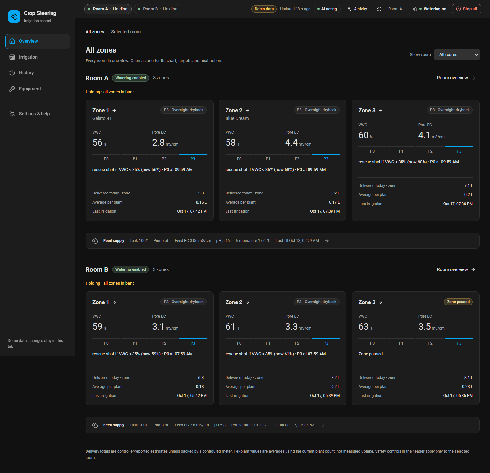
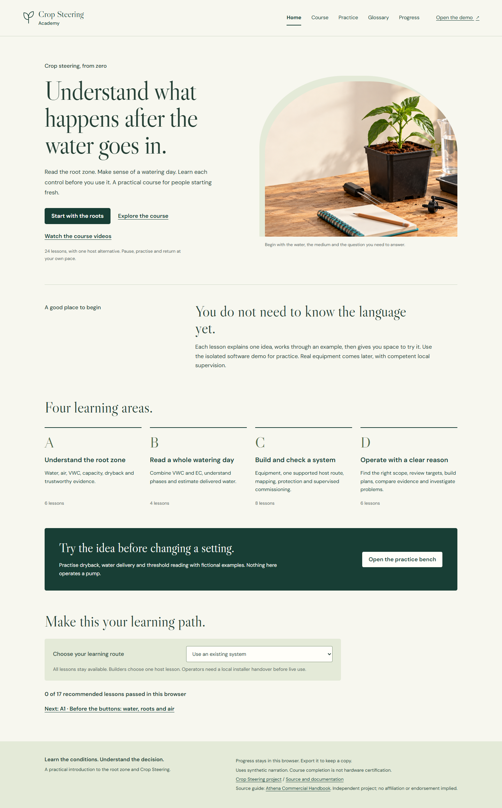
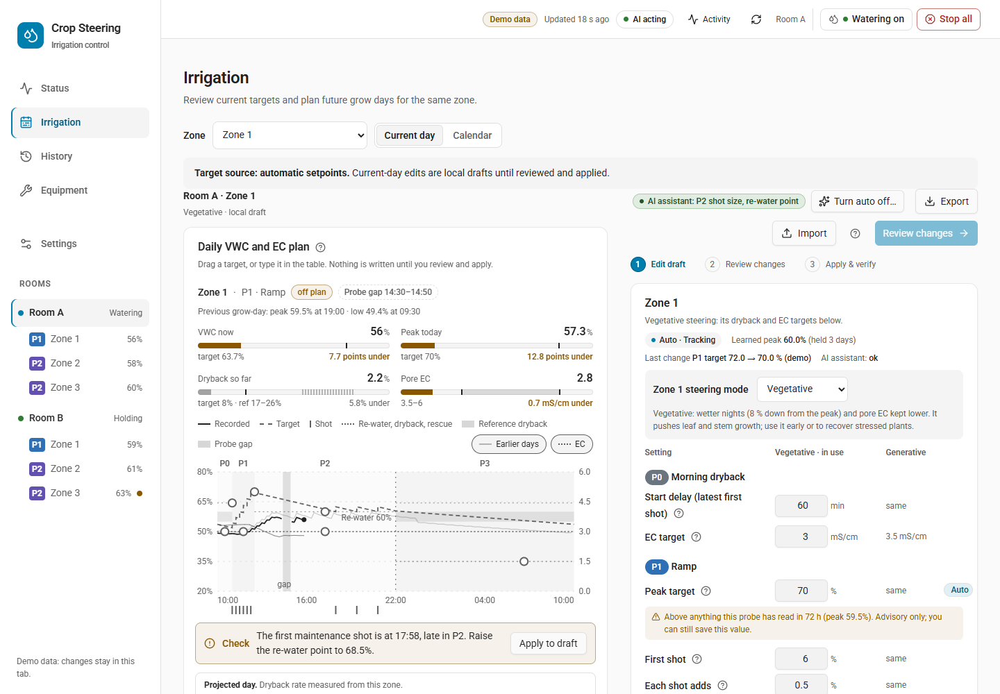

# Crop Steering

**Crop Steering waters each zone of a grow room from what its probes read, inside Home Assistant. It refuses to water when something is wrong, and it shows you every shot.**

> **3.18 (the parity release) is a big upgrade.** Watering keeps its targets and limits, but almost every
> dashboard page is new and many new features wait for you to set them up. Do not update a room that is
> in a grow unless you have a few clear hours afterwards, and never in the hour before lights-on. Update
> the integration first, then the controller. Read [Upgrading to 3.18](docs/UPGRADING-TO-PARITY.md)
> first. To let an AI assistant help with the configuration session, follow
> [Set up an install with an AI assistant](docs/AI-SETUP.md).

[The whole system, part by part](https://cropsteering.growlabs.nz/features) · [Try the released demo](https://jaketherabbit.github.io/HA-Irrigation-Strategy/dashboard.html?demo=1) · [Take the free beginner course](https://jaketherabbit.github.io/HA-Irrigation-Strategy/learn/) · [Safety first](#safety-first) · [New to crop steering?](#new-to-crop-steering) · [Install](#install) · [First-run setup](#first-run-setup) · [Daily use](#daily-use) · [The AI assistant](#the-ai-assistant) · [Upgrade](#upgrade) · [Troubleshooting](#troubleshooting) · [Documents](#documents)

## What it does

1. **Why.** A timer waters at fixed times, whatever the plants did overnight. Crop steering lets the substrate dry back by a set amount, then brings it back up, so you choose whether the plants lean vegetative or generative.
2. **It watches.** Moisture (VWC) and pore EC probes in each zone, the feed tank and the lights. Several probes in one zone become one reading, and a probe that goes quiet is left out.
3. **It decides.** Each day runs in [four phases, P0 to P3](#new-to-crop-steering). You set targets per zone, or a plan for the whole grow, and the engine sizes each shot from how fast that zone is drying.
4. **It stays safe.** A fixed list of checks runs before every shot. Every pump and valve switch is read back, and one that does not answer stops watering and raises an alert. An unreadable kill switch or room switch counts as off.
5. **It acts.** A shot switches the pump, the main line and one zone valve in order, then closes them and counts the water. It can also mix a batch tank and keep track of stock.
6. **You see it.** All rooms, then a room, then a zone with every shot on its day chart. History compares runs. It works on a phone.
7. **You change it.** Edits stay a draft until you review and apply them, and each value is read back so you see what the controller now holds.
8. **The AI layer.** Optional AI judges work inside hard limits, and an AI client can prepare setup or plan changes through the [MCP connector](docs/MCP.md) for you to review.
9. **You can trust it.** Alerts with a code go to the phones you choose, as Home Assistant notifications and Repairs cards.
10. **Start.** [Install](#install) below, or try the demo first.

**New in 3.18:** a shot timeline, [timer programs](docs/features/timers-and-modes.md), [pump sharing and flow checks](docs/features/water-supply.md), [feed probe and dosing pump calibration](docs/features/calibration.md), [a change journal with put back and undo](docs/features/history-and-changes.md), [presets and copy](docs/features/presets-and-copy.md), [alert rules tested against yesterday, an alerts inbox and quiet hours per phone](docs/features/alerts.md), [display units and dashboards](docs/features/dashboards-and-display.md) and [a system status page](docs/features/system-status.md). Each room's Upgrade report says what the update carried across and what needs you ([Upgrading to 3.18](docs/UPGRADING-TO-PARITY.md)).

The [feature matrix](docs/FEATURE_MATRIX.md) lists each released feature with how it was tested and what is still unproven.

## Learn crop steering from zero

**[Open Crop Steering Academy →](https://jaketherabbit.github.io/HA-Irrigation-Strategy/learn/)** A free course for people who have never used a substrate probe: 24 captioned video lessons with practice and a glossary, from water and roots to planning a grow. Practice never operates Home Assistant. [Course guide](docs/ACADEMY.md) · [Learner workbook](docs/training/crop-steering-from-zero/WORKBOOK.md).

## Safety first

This software operates real pumps and valves on live plants. It operates them when nobody is in the room.

> **WARNING:** Do not use the software as an emergency stop. Use the physical shutdown procedure of your installation. The "Watering" switch and the "Room in use" control do not isolate the electrical power.

> **WARNING:** Isolate the electrical power before you do work on a pump, a valve or the wiring. Water and mains power near each other can cause an electric shock.

> **CAUTION:** Install valves that close when the power is lost. Install a float switch or a timer that can stop a pump without the software. The software does not replace these physical safety devices.

> **CAUTION:** Keep the "Watering" switch off until each probe and each switch of the room is correct. A wrong valve or a wrong probe can flood a zone or let it dry out.

Before the first shot, do these steps:

1. Configure the room with the "Watering" switch off.
2. Examine each probe that the room uses.
3. Examine each switch that the room uses.
4. Do a catch test: measure the water that comes out of the drippers in a known time.

## New to crop steering?

Container growers can apply small irrigation events called **shots**. Water content, EC, drainage and environmental conditions contribute to steering:

- **Vegetative steering** aims to support vegetative growth through a coordinated set of conditions.
- **Generative steering** aims to support reproductive development through a different coordinated set of conditions.

These describe an intended direction, not a guaranteed plant response. The slider blends your configured endpoints; pot size and dripper flow alone cannot establish safe targets. Start with the [academy](https://jaketherabbit.github.io/HA-Irrigation-Strategy/learn/) if the terms below are new.

A group of plants on one valve is a **zone**. The probes in the substrate give the numbers that the controller uses:

| Term | Meaning |
| --- | --- |
| **VWC** (moisture) | Water volume divided by total measured sample volume, usually expressed as a percentage. It is not percent plant-available water. |
| **Pore EC** | Conductivity of water in substrate pore spaces, in mS/cm. Identify the measurement type: feed, bulk substrate, pore-water and runoff/extract EC are not interchangeable. |
| **Dryback** | The decrease of VWC between shots, overnight or in the morning. |
| **Field capacity** | A configured reference in this program. Establish the appropriate drained container condition with a documented method; an entered value does not prove physical capacity. |
| **Shot** | One short delivery of water. Its size is a percentage of the substrate volume. |

Each grow-day has four phases:

| Phase | What occurs | Why |
| --- | --- | --- |
| **P0: morning dryback** | After lights-on, the controller uses configured timing and dryback conditions before ramp-up. | Sets the conditions for the first shot; it does not guarantee a root-growth response. |
| **P1: ramp** | The controller gives small shots, some minutes apart, until VWC reaches your peak target. | The ramp fills the substrate slowly. It does not flood the roots. |
| **P2: maintenance** | The controller gives a maintenance shot when VWC falls to your re-water point. | The maintenance shots keep the roots stable through the day. |
| **P3: overnight dryback** | The usual shots stop before lights-off. The controller gives only a rescue shot when a zone becomes too dry. | Much of the steering occurs during the overnight dryback. |

Targets can change with the growth stage and local evidence. Build a plan from reviewed endpoint profiles and calendar blocks, then verify the active targets. Library recipes and illustrated reference curves are starting points for review, not universally safe prescriptions or validated crop-response forecasts. See [grow plans](docs/GROW_PLANS.md) and the academy’s planning lessons.

## How it works

1. Each minute, the controller reads the probes of each zone.
2. It compares the readings with your targets. It finds the phase of each zone and decides if a shot is necessary. These are the rules of the controller.
3. When a decision needs judgement, the controller can ask the AI assistant a question in the background. Examples: "Is the substrate full?" and "Is this probe stuck?".
4. The controller sends the facts with the question, for example "VWC increased 3.1 points after the 10:40 shot". It does not wait for the answer.
5. Code compares each answer with hard limits. These limits are the **envelope**. When the envelope accepts the answer, the controller does the action. When the envelope refuses it, nothing changes, and the log records the reason.
6. Later, code measures the result of the action. The dashboard shows a tick or a cross. The AI assistant sees its own record the next time.

## Install

Crop Steering has two parts. Automatic shots need both parts. The two parts have the same version number. Install and update them together.

| Part | Install with | What it does |
| --- | --- | --- |
| **The integration** | HACS | It keeps your rooms, zones, settings, plans and history. It adds the **Crop Steering** page to the Home Assistant sidebar. It does not operate equipment. |
| **The controller** | The Home Assistant app store, or Docker | It reads your probes each minute and decides each shot. It operates the pump and the valves with all the safety checks. It asks the AI assistant when that is set. |

### What you need

| Item | Requirement |
| --- | --- |
| **Home Assistant** | **2024.10.0 or newer.** Each change is tested on 2024.10.0 and on 2026.9.3. |
| **The controller as an app** | Home Assistant OS or Supervised, with the app store (amd64, aarch64 or armv7). The app brings its own Python 3.12. |
| **The controller as a container** | Home Assistant Container or Core has no app store. Use Docker with Compose v2 on amd64 or arm64. |
| **HACS** | Version 1.6.0 or newer for the guided download. You can also copy `custom_components/crop_steering` into Home Assistant manually. |
| **Hardware** | A switch that Home Assistant can control for the valve of each zone. Also a switch for the pump and the main-line valve, if the room has them. One moisture probe for each zone. EC probes and tank sensors are optional, but we recommend them. |
| **An Anthropic API key** (optional) | Only for the AI assistant. Without a key, the controller uses its rules only. |
| **An MCP connector** (optional) | Node.js 22 or newer, on the computer of your AI client. |
| **Account** | A Home Assistant administrator, to configure rooms and change plans. |

### Install the integration with HACS

1. Download the integration with HACS.
2. Restart Home Assistant.
3. Add Crop Steering, and give your first room a name.

To add the repository manually, go to HACS → ⋮ → Custom repositories. Add `https://github.com/JakeTheRabbit/HA-Irrigation-Strategy` with the type Integration.

To install the integration without HACS, copy the full `custom_components/crop_steering` folder into `/config/custom_components/crop_steering`. Include the file `www/dashboard.html`. Then restart Home Assistant.

### Install the controller as a Home Assistant app

1. Add the app repository.
2. Install **Crop Steering Controller**. Do not start it yet.
3. Keep the kill switch of each room off.
4. Examine the app options in **Configuration**.
5. Start the app. The app then starts with the host, because **Start on boot** is on.
6. Set **Watchdog** to on. The Supervisor then restarts the app if it stops.

The Supervisor gives the app its Home Assistant token. Do not put a token in a repository file.

The buttons open the correct screen. Home Assistant still asks you to confirm each step.

### Install the controller as a Docker container

Use this procedure for Home Assistant Container or Core. The container runs the same controller as the app. It uses the published image `ghcr.io/jaketherabbit/crop-steering-controller`.

1. Install the integration and add a room. Keep the "Watering" switch of each room off.
2. In Home Assistant, sign in as an administrator.
3. Open your profile → **Security** → **Long-lived access tokens** → **Create token**. Copy the token.
4. Put the file `docker-compose.yml` of this repository in a folder.
5. In the same folder, make the file `ha_token.txt`. Put only the token in it.
6. In the same folder, make the file `.env` with `CONTROLLER_VERSION=` and `HA_URL=`.
7. Set `CONTROLLER_VERSION` to the version of your integration, exactly as HACS shows it.
8. Set `HA_URL` to the IP address and the port of Home Assistant, for example `http://<home-assistant-ip>:8123`.
9. Run `docker compose up -d`.
10. Run `docker compose logs -f crop-steering-controller`, and examine the log.

The log must show `runtime: container`, the `base:` address, `token: HA_TOKEN_FILE` and the correct time zone. It must not show `HTTP 401`.

> **CAUTION:** Do not use a reverse proxy, a tunnel or a public address in `HA_URL`. A proxy can refuse a request. The controller then thinks the token is bad and stops.

> **CAUTION:** Never run the container and the app for the same room. Both then operate the same pump and the same valves.

More rules for the container:

- The controller reads the token from a Docker secret. Anyone who can run `docker inspect` can read an environment variable.
- When Home Assistant refuses the token, the controller writes the cause in the log. Then it waits and sends no more requests. Thus Home Assistant does not ban the IP address.
- Put the correct token in `ha_token.txt`. The controller starts again in 30 seconds. If it does not start, run `docker compose restart`.
- Each app option has an environment form `F2_OPT_<OPTION>`, for example `F2_OPT_NOTIFY_SERVICE`.
- Keep `restart: unless-stopped`. Without it, the controller does not start after a host restart, and the plants get no water.
- The controller follows the time zone of Home Assistant. If you set `TZ`, it must be the same zone as Home Assistant.

### Examine the installation

Do these checks with the kill switches still off:

1. Make sure that each room opens in the sidebar.
2. Make sure that the controller heartbeat of the room is current.
3. Make sure that the mapping shows **Mapping acknowledged**.
4. Make sure that **Equipment › Probes** shows the correct entities and units.

## First-run setup

A Home Assistant administrator does the setup in **Equipment › Setup**. Pair the devices in Home Assistant first. The setup maps entities that exist. It does not pair devices.

1. Select a room, or select **Add room**. Give the room a clear name.
2. Tell the setup how the room is plumbed: zone valves only, or a pump and valves. The setup does not guess from empty fields.
3. Map the room pump and the main-line valve, if the room has them.
4. Map the valve of each zone. A valve must read closed before you save.
5. Select one or more VWC probes and EC probes for each zone.
6. Enter the plant count of each zone.
7. Enter the substrate volume for each plant, in litres. You can also select a pot or a rockwool preset.
8. Enter the number of drippers for each plant.
9. Enter the flow of each dripper, in litres per hour. Use the catch test to measure it.
10. Map the optional room equipment, the tank displays and the feed probes.
11. Make sure that the kill switch and the equipment of the room are off.
12. Select **Review configuration**, then **Save configuration**.
13. Wait for **Mapping acknowledged**. A saved setup and an accepted setup are different states.
14. Examine **Status › Room** and **Equipment › Probes**.
15. Set the lights-on and lights-off hours of the room.
16. Examine the water limits, the shot sizes and the rescue floor of each zone.
17. Set the "Watering" switch in the top bar to on.

The setup checks the entity types, the units, duplicate valves and revision conflicts. It also checks that the equipment of the room reads off.

> **CAUTION:** Do a catch test before the first automatic shot. The controller calculates the water totals on the dashboard from the settings and the valve time. Only a catch test or a flow meter shows the water that the plants got.

## Daily use

The dashboard is the **Crop Steering** page in the Home Assistant sidebar. The menu has five sections: **Status**, **Irrigation**, **History**, **Equipment** and **Settings**. Under them, the menu lists every room with its state, and every zone with its phase and VWC: one click opens any room or zone. On a phone the five sections sit in a bar along the bottom, and the menu button at the top opens the rooms and zones. The selected room is part of the page address (`?room=`), so a bookmark or a shared link opens that room. Each zone also has its own page. The screenshots come from the demo of the dashboard, with sample data.

Do these steps each day:

1. Open **Status › All rooms** to see every configured room and zone together. Paused rooms remain visible. Select a zone to open its room and detail page.
2. Open each flagged zone from its card. Read its numbers, its day chart and **Why / next action**.
3. Use **History › Timeline** for controller and AI changes.
4. Change targets only in **Irrigation › Current day**, through the review.
5. Examine the readback after each change.
6. Once each day, or after a change, examine **Equipment › Probes** and **Stock tanks**.

### Landing page and room overview

**All rooms** is the default landing page. It is organised room → zones → sensors. Each room shows its run day and stage, water drunk today (per plant and in total), air temperature, humidity and VPD,, with its feed tank (level, usable litres, pH, EC, pump, and a held-shots warning) and its stock tanks side by side at the top right. Each zone is a card with its slab drawing (water = moisture, dashed line = today's peak, specks = pore EC), its phase and its automation state (Automated, Watering now, Paused, Watering off, Offline, Room off), water per plant, VWC, dryback, pore EC and root-zone temperature (▲▼ outside their band), and every sensor in it with its readings. A problem shows on the room, zone, sensor or tank it belongs to. A zone being watered glows; a zone out of the automation is greyed. Tap a zone to open it.

Choose **Settings › Settings › Display › Default view** to open another workspace by default. The preference is saved in this browser. Bookmarks and notification links take precedence; choosing a default never redirects an explicit page link. **Status › Room** opens Today for the selected room.

### Room

**Status › Room** answers one question: is the room correct, and does a zone need you?

- **The room line** shows the "Watering" switch, the stage and the day of flower, and the steering mode. It also shows the pore EC range of the stage, the lights-off time, the phases of the zones and the alerts.
- **The card of each zone** shows the VWC now and a line of the day. A bar shows the VWC against the rescue floor, the re-water point and the peak target. The card also shows the pore EC, the water for each plant against the room, the last shot and the next event.
- A card has a coloured edge and a warning line only when the zone needs you.
- **History › Timeline** holds controller and AI changes; **Why / next action** explains the selected zone.

### The page of a zone

Select the card of a zone to open its page. The chart shows the grow-day of the zone:

| Part of the chart | Meaning |
| --- | --- |
| The bar at the top | Lights on (yellow) and lights off (dark). |
| The diamonds | The decisions of the AI assistant. A filled diamond is an action. An outline is advice, no action or a refusal. |
| The blue line | VWC. A dot is a shot. A ring is a shot that the controller held back. |
| The green line | Pore EC, on the scale at the right. The green bar is the EC range of the stage. |
| The blue band | The maintenance band, from the re-water point to the peak target. |
| The red dashed line | Field capacity. The runoff zone is above it. |
| The dashed blue line | The expected rest of the day, from the rate at which the zone dries. |
| The grey line | Yesterday. **Compare with** changes it to a typical day. |
| P0 to P3 | The start time of each phase. |

The **Why / next action** panel combines the controller’s reason, shot conditions and the AI explanation. Expand its details for proposals, permitted ranges, applied changes and later outcomes. Full historical traces and previous-run comparisons are in **History › Timeline**, reached with the selected zone intact.

### Irrigation

Current-day targets and future schedules share one workspace, one zone selector and one continuous VWC/EC planning canvas. Switch between **Current day** and **Calendar** without discarding drafts. Current-day editing is locked when an armed schedule owns the targets. Planned curves, recorded evidence and previous-run comparisons stay labelled separately.

**Irrigation › Current day** shows all the targets of a zone, phase by phase. All edits stay in a local draft. A review shows the old and the new values before the dashboard writes them. When Auto setpoints is on, a chip shows the range that the AI assistant can use.

**Irrigation › Calendar** includes an expandable **Stage guide** showing **This flower by stage**: the stage arc for each zone. The highlighted row is the stage of today. A grow plan can change the targets of each zone week by week or day by day. You save a plan as a draft, then you arm it. An armed plan starts at the next lights-on. The arm action does not set the kill switch to on.

### History

**History › Timeline** owns the full sensor-history explorer, previous-run comparisons and controller/AI event records. A shared zone selector keeps the selected zone consistent across these views.

- **Acted**: the controller did what the AI assistant asked.
- **Refused**: the envelope refused the action. An orange line gives the reason.
- **Advice**: an alert or a suggestion only.
- **You**: a change that you made. The AI assistant only records it. Your new value becomes the centre of its range.

**History › Water use** shows the litres of each zone today, this grow week and since the start of the grow. It also shows an estimate for the full grow. **History › Compare runs** compares this run with an earlier run, grow week by grow week.

### Equipment

- **Probes** shows the probes, the controller and the AI assistant. Each probe shows its reading, its last report and its health.
- **Tank and feed** shows the tank level, the feed EC, the feed pH and their history.
- **Stock tanks** shows the level of each concentrate and the batches that remain. When a stock tank is low, a Repairs card tells you. Select **Refilled** when you fill it.
- **Dosing** shows the batch tank and the dosing pumps. A dose or a batch is a request that the controller does.
- **Setup** maps the rooms and the zones (see [First-run setup](#first-run-setup)).

> **WARNING:** Wear the correct protective equipment when you fill a stock tank or touch a dosing pump. Nutrient concentrates and pH adjusters can injure skin and eyes.

### Settings

- **Default view, units and display**: choose browser landing and display preferences here.
- **Capabilities**: search the current values and follow a link to the one workspace that edits each setting. It is a directory, not another set of switches.
- **Room in use** now lives in **Equipment › Setup**. Set it off when the room is empty; this also suppresses room alerts. It differs from pausing watering.
- **Watering** stays in the header: the kill switch of the selected room ("Engine Enabled" in Home Assistant). With it off, the controller opens no valve in the room. A shot in progress stops in some seconds. The controller continues to read the probes and follow the phases.
- **Notifications**: select which phone gets which kind of alert. Send a test to each phone.
- **Help**: each alert code (for example, CS-101). Help tells what the code means, its effect on the shots, the causes and the fixes.

> **CAUTION:** When the room is off or the "Watering" switch is off, the controller gives no shots. This includes the rescue shots. Make sure that no plants need water before you set either switch to off.

## The AI assistant

The AI assistant is optional. Without it, the controller uses its rules, and the rules are always safe. The AI assistant uses Claude Haiku from Anthropic, with your own API key. Anthropic bills you for its use.

### Start the AI assistant

For the app:

1. Get an API key at console.anthropic.com, under **API keys**.
2. Open **Settings → Apps → Crop Steering Controller → Configuration**.
3. Set `brain_provider` to `claude_haiku`.
4. Put the key in `anthropic_api_key`.
5. Set `anthropic_daily_budget_usd` to the most that you want to spend in one grow-day.
6. Restart the app.

The log shows `brain: claude_haiku`, the model, the budget and `key set`. It never shows the key.

For the container:

1. Put the key in a file next to `docker-compose.yml`, for example `anthropic_key.txt`.
2. Add the file as a Docker secret.
3. Set `F2_OPT_BRAIN_PROVIDER=claude_haiku`.
4. Set `F2_OPT_ANTHROPIC_API_KEY_FILE=/run/secrets/anthropic_key`.
5. Run `docker compose up -d`. The log shows `anthropic_api_key=<set>`.

The AI assistant is not available on 32-bit ARM (armv7). On armv7, the controller uses its rules and says so.

### The options of the AI assistant

| Option | Default | What it does |
| --- | --- | --- |
| `brain_provider` | `auto` | `rules`: no AI assistant. `claude_haiku`: the AI assistant with your Anthropic key. `auto`: rules, except on an install that used the removed first AI route, which moves to Claude when it has a key. |
| `anthropic_api_key` | empty | Your Anthropic API key. It is a password field. The controller never shows, logs or publishes it. |
| `anthropic_model` | `claude-haiku-5-5` | Also `claude-sonnet-5-5` or `claude-opus-5-5`. With another model, the controller uses its rules. With a router, also a model after a router prefix, for example `cc/claude-haiku-5-5`. |
| `anthropic_base_url` | empty | The address of an Anthropic-compatible router, for example `http://router.example.local:20128`. Empty: the Anthropic API. The controller sends your key to this address, so use only a router that you control. If the router does not answer, the controller uses its rules. |
| `anthropic_daily_budget_usd` | US$1.00 | The most that the AI assistant can spend from one lights-on to the next. When the budget is spent, the controller uses its rules until the next lights-on, and alert CS-708 tells you. With 0, the AI assistant never asks. |
| `brain_dry_run` | off | On: the AI assistant judges, and the log shows its decisions. It changes nothing. |
| `ai_judges` | `all` | The judges that the AI assistant asks. `all` asks every judge. An old `jev_judges` list is read as `all`. |
| `ai_flower_start` | empty | The first day of 12/12 for each room: a date or an `input_datetime` helper. Without it, the judges do not use a stage. |
| `ai_flower_days` | 56 | The flower length of the cultivar. The finish is the last 14 days. |

Anthropic bills each question. The AI budget limits the cost of one grow-day. A question that timed out can still cost money, so the controller counts a high estimate for it.

**What the controller sends.** Each question has the readings and the settings of the zone, and the stage of the day. It also has the room and zone names that you typed. It never sends an entity ID, a key or personal data. When a probe of a zone that is on is stale or missing, the controller asks nothing for that room. It asks again when the probes report.

### The judges

A judge is one question that the controller asks the AI assistant. The name in bold is the name on the dashboard. The name in brackets is the name in the option `ai_judges`.

| Judge | When the controller asks | The question | What the controller can do with the answer |
| --- | --- | --- | --- |
| **Morning start** (`dawn`) | P0, each 10 min | Is the morning dryback large enough to start the ramp? | Start the ramp earlier. Never later than the rules. |
| **Ramp hand-over** (`ramp`) | P1, each 15 min | Is the substrate full, or does the EC increase only because new feed flows past the probe? | Start maintenance earlier. |
| **Pore EC** (`salt`) | P2, each 30 min, only when EC stacking is on | Why did the pore EC change? | Let EC stacking move the re-water point, hold it, or move it back, inside its limits. |
| **Day end** (`dusk`) | The last 3 h before lights-off | Must the shots of today stop now? | Start P3 earlier. Never for a zone with vegetative steering. |
| **Probe trust** (`probe`) | Each 30 min, after two shots | Is this probe correct, or is it stuck, drifting, out of the block or in the wrong zone? | Set the probe aside. The zone then copies a healthy zone, or uses a careful timer. |
| **Shot landing** (`shot`) | 20 min after each shot | Did the water get to the zone? | Send alert CS-701 after two misses in sequence. It never adds water. |
| **Night low** (`night`) | Overnight, near the rescue floor | Is the substrate dry, or is the probe defective? | Send alert CS-703. The rescue shot still occurs. |
| **Zone comparison** (`zones`) | When the water of a zone is far from the other zones | Why does this zone get much more or much less water? | Send alert CS-702 with the probable cause. |
| Water channel (`channel`, no dashboard name) | With the lights on, a maximum of one time each hour | Does the water flow past the substrate or the probe? | Send alert CS-710, which asks for a catch test. It never adds water. |
| **Stage arc** (`stage`) | One time each grow-day | Are the dryback and the pore EC of the zone correct for the stage of today? | Send advice CS-705. It never changes a setting. |
| **Setpoints** (`setpoints`) | One time each night, only with Auto setpoints on | Must the maintenance shots of tomorrow be smaller or bigger, or start later or sooner? | Move one setting by one small step, inside a range around your value. |
| Balance (`balance`, no dashboard name) | One time each grow-day, in the last 2 h before lights-off. | Must the water of tomorrow move toward the water of the room? | Advice only. The Setpoints judge sees the answer. |

Two more judges, **Targets** (`targets`) and **Shot sizes** (`shotsize`), set a zone's targets and shot sizes once a night, only with their powers on ([the AI assistant in full](docs/AI_ASSISTANT.md#powers)).

The controller also gives these tasks to the AI assistant. Their names in `ai_judges` are `feed`, `plan`, `report` and `why`.

- **Feed**: one time each grow-day, one hour after lights-on, in a room with a feed EC sensor. It can propose a change to the feed on a CS-711 card. It never changes the feed or the dosing. A person decides.
- **Grow plan**: when the room does not follow its grow plan, code sends a CS-713 card. The AI assistant selects the suggestion that the plan line shows.
- **Daily report**: three hours after lights-off, it writes a report of the grow-day on `sensor.crop_steering_<prefix>brain_report`. The report is advice only.
- **Ask why**: an administrator can ask why the controller or the AI assistant did something. A room can ask a maximum of 20 questions each day.

Three rules make the answers safe:

- **The controller asks each question two times, with different words.** It acts only when the two answers lead to the same action. The AI assistant must also be sure enough.
- **Each question contains the grower rules.** These rules are in the doctrine pack of the project, with the stage arc.
- **The controller checks the result.** A ledger records each action. Code measures the result when it can, and the AI assistant sees that record the next time.

### What the AI assistant can never do

Code keeps control of all physical actions. An answer from the AI assistant is only a request. The envelope accepts or refuses it.

- It never operates a pump, a valve or the main line. It never starts a shot. It never calculates the duration of a shot.
- It never stops a safety action: the daily minimum and maximum water, the rescue shot, a flush for high EC, or the watchdog.
- It can only move a zone forward through its day (P0 → P1 → P2 → P3), and only earlier than the rules. The rules still move the zone too.
- It never stops the shots early for a zone with vegetative steering.
- It can change only the P2 shot size and the re-water point of each zone. It changes one small step each night, inside a range around your value, and only when **Auto setpoints** is on.
- It never sets a probe aside on its own answer. That also needs two answers in sequence that agree, and evidence that code can confirm.
- When the AI assistant is off, slow, out of budget or not sure, the controller uses its rules only. Nothing waits for the AI assistant.

### The AI assistant and your setpoints

- **Auto setpoints is off until you set it to on.** Use **Turn auto on…** in **Irrigation › Current day**. There is one switch for each room.
- **One time each night**, in the first three hours after lights-off, the Setpoints judge selects one answer. The answers are smaller shots, bigger shots, a later re-water, a sooner re-water, or no change.
- **One small step**: the P2 shot size changes by 0.5%, or the re-water point changes by 0.5 points. A zone gets a maximum of one change each night.
- **A range around your value**: the shot size stays within 1% of your value and never goes below 3%. The re-water point stays between 2 points below and 1 point above your value. It also stays 4 points above the rescue floor and 2 points below the peak target.
- **Your value wins**: when you change either value, your value becomes the new centre of the range.
- **The change ends**: at the next lights-on, each change returns to your value. The exception is when the judge moves it again. **Keep** stops the return. **Undo** puts your value back now.
- **The change returns after a rescue shot**: when a rescue shot occurs in 30 hours after a change, the old value returns. The AI assistant then does not change the setpoints of the zone for 48 hours. Alert CS-404 tells you.

### Stop or limit the AI assistant

| To do this | Do this |
| --- | --- |
| Stop setpoint changes | Use **Turn auto off…** in **Irrigation › Current day**. The values stay until you change them. |
| Change a value that the AI assistant controls | Type your value in **Irrigation › Current day**. It becomes the new centre of the range. |
| Stop one action | Turn off its switch in the AI powers list of the room. To stop a judge that has no power, list the other judges in the app option `ai_judges`. |
| Pause the AI assistant in one room | Set **Pause AI Changes** to 1 h, until lights-on, or 24 h. The rules continue. |
| Stop the AI assistant | Set `brain_provider` to `rules`, then restart the app. |
| Limit the cost | Set `anthropic_daily_budget_usd`. |
| Test it without changes | Set `brain_dry_run` to on. |

## Upgrade

### Upgrade an existing installation

HACS offers the update of the integration. The app store offers the update of the controller. Your rooms, settings and entity IDs stay.

> **3.18:** update the integration first and restart Home Assistant, then update the controller: the
> controller sends its journal history to the new integration. The plan for update day, a first-hour
> checklist and how to go back are in [Upgrading to 3.18](docs/UPGRADING-TO-PARITY.md); each row of the
> Upgrade report has its section in [UPGRADING.md](docs/UPGRADING.md).

1. Make a backup of Home Assistant, the data of the controller and your setpoints. Export your grow plans.
2. Record which kill switches are on.
3. Set the kill switches to off. Wait until the pump, the main line and the valves are off.
4. Download the new version of the integration with HACS.
5. Restart Home Assistant. Make sure that each room loads.
6. Update the controller in place, to the same version. Do not install a second copy.
7. Start the controller with the kill switches still off.
8. Examine the version, the heartbeat, the sensor readings and the setup acknowledgement.
9. Compare the setpoints and the zone sizes with the backup.
10. Set the kill switches back to their earlier states.

A restart does not rebuild an old image. Use **Update** for a published version, or **Rebuild** for a local source.

> **CAUTION:** Never run two controllers for one room. Both operate the same pump and the same valves. A newer controller stops a room when it sees the heartbeat of another controller (CS-609). An older controller does not do this check.

### Move a controller from the f2-control mirror

The `JakeTheRabbit/f2-control` mirror is retired. A controller from the mirror moves one time to this repository:

1. Install **Crop Steering Controller** from this repository. Do not start it. Set its **Start on boot** to off.
2. Copy all the options of the old app into the new app.
3. Set each kill switch to off. Wait until the pump, the main line and the valves are off.
4. Stop the old app. Set its **Start on boot** and its **Watchdog** to off.
5. Copy `state.json` from the data folder of the old app to the data folder of the new app.
6. Start the new app. Set its **Start on boot** and its **Watchdog** to on.
7. Examine the log, the version, the heartbeat and the setup acknowledgement.
8. Set the kill switches back to on.
9. After one day of normal operation, uninstall the old app and remove the `f2-control` repository.

The file `state.json` keeps the phase of each zone, the counters of today, the setup revision and what Auto setpoints learned.

### Move a room from the first AI edition

A room from the `HA-Crop-Steering-Jev` repository (the first AI edition, to version 3.11.1) moves one time. Move a production room only to a stable release 3.12.0 or later. The controller from this repository is a different app with an empty data folder. The integration keeps its entities and its dashboard.

1. Make a backup of the old app and Home Assistant. Record each `number.`, `select.` and `switch.crop_steering_*` state.
2. Install the new app. Do not start it. Keep **Start on boot** and **Watchdog** off.
3. Copy all the options of the old app into the new app. Set `brain_provider` to `claude_haiku` and add your Anthropic key.
4. Set the kill switch of each room to off. Wait until the pump, the main line and the valves are off.
5. Stop the old app. Set its **Start on boot** and its **Watchdog** to off.
6. Copy `state.json`, `dosing_state.json` and the `jev_*` files to the data folder of the new app. Do not copy `instance_id`.
7. In HACS, remove the `HA-Crop-Steering-Jev` repository.
8. Add this repository in HACS, and download the same version as the new app.
9. Restart Home Assistant.
10. Start the new app, and compare the states with your record.
11. Set the kill switches back to their earlier states.

The full procedure is in [the move guide](docs/MOVING_FROM_JEV.md).

### The removed first AI route

The first AI route (through Cloudflare or TypeSafe) is removed. An installation that used it loads with no change: with an Anthropic key it uses Claude, with every judge; without one it uses the rules. It gets a CS-712 card one time each release, and its old Cloudflare and TypeSafe options are not used.

- To use the AI assistant, set `brain_provider` to `claude_haiku` and set an Anthropic key.
- To stop the AI assistant, set `brain_provider` to `rules`.

### Restore an earlier version

1. Set the kill switches to off, and make sure that the equipment is off.
2. Restore the earlier integration, the earlier controller and the backup of their data.

> **CAUTION:** Do not downgrade the controller while a newer grow plan is active. An older controller cannot read the newer plan. Disarm the plan first, or restore a full backup with the kill switches off.

## Troubleshooting

A notification or a Repairs card ends with a code, for example **CS-101**. Find the code in **Help** or in [Error codes](docs/ERROR_CODES.md). For each code, Help tells what it means, its effect on the shots, the causes and the fixes.

| Symptom | What to do |
| --- | --- |
| The dashboard asks for an integration update | Update the integration, with its `www/dashboard.html` file. Restart Home Assistant. Refresh the page. |
| A plan cannot arm | Examine the controller heartbeat, the plan check, the probe readings and the limits. Save the draft before you arm it. |
| A plan is armed but not active | It starts at the next lights-on. If a probe or the heartbeat was stale at lights-on, it starts at the first possible minute. |
| The setup does not save | The message gives each entity and the cause. Set the entity to off, make it available, or correct its ID. |
| A zone uses a timer: "moisture reading hasn't changed" (CS-101) | The VWC did not change for 20 minutes. The controller then uses a timer for that zone. A probe in a block with no plant does this. |
| "Plumbing and switches disagree" (CS-202) | The plumbing type of the room does not agree with its switches. Correct the mapping in **Equipment › Setup**. |
| Shots are counted, but the VWC does not increase | Tell the setup that the room has a pump, and map the pump. |
| The water total is not the same as the water you see | Examine the litres for each plant, the plant count, the drippers and the flow. Do a catch test. |
| A code change did not get to the controller | Use **Update** or **Rebuild**. A restart keeps the old image. |
| A hardware fault stays latched | Set all the related kill switches and the equipment to off. Examine the fault first. |
| The sidebar shows "Controller: not reported" | Start or update the controller. Wait one minute. |

> **CAUTION:** Do not create the helper `input_boolean.f2_control_enabled` for a room that the setup wizard made. That room has its own kill switch, "Engine Enabled". A second helper does nothing.

More symptoms are in [Troubleshooting](docs/troubleshooting.md).

## Other functions of the controller

The rules do all of this, with or without the AI assistant.

- **It waters by the needs of the plants, not by a timer.** It reads the probes each minute. It calculates each shot from the pot size, the plant count and the dripper flow.
- **It steers the full grow.** A grow plan moves each zone between a vegetative profile and a generative profile. It can change week by week or day by day. You can save a plan as a recipe.
- **It has an off switch for each room**, and a room-off setting for an empty room.
- **It has a daily water limit for each zone and a maximum shot duration.** A stuck probe thus cannot keep a valve open all day.
- **It checks that each valve and pump went off.** When one stays on, the controller holds that equipment. It also stops the shots and sends an alert.
- **It continues to water a zone with a dead probe.** It copies a healthy zone or uses a careful timer. It stops this when the probe reads again.
- **It can check the feed.** It can stop the shots when the feed EC or the feed pH is out of range.
- **It sends clear alerts.** Each problem is a Repairs card or a notification with a code.
- **It counts the water and the stock.** It also compares runs.
- **It configures rooms without YAML.**
- **It connects to an AI client (optional).** A separate MCP connector lets an AI client read your rooms and prepare changes for your review. The connector can never operate equipment.

Some facts to know:

- The answers of the AI assistant are judgements, not guarantees. The log records each answer with its confidence and the action of the code.
- The controller calculates the water totals from the settings and the valve time. They are not a measurement.
- The dashed lines of the rest of the day are projections. The controller always waters by the probe.
- The controller waters by VWC and EC. It does not control the climate.
- An update keeps your rooms, settings, counters, plans and the history of the AI assistant.

## Documents

- [All documents, by task](docs/README.md) · [Upgrading to 3.18](docs/UPGRADING-TO-PARITY.md) · [one section per Upgrade report row](docs/UPGRADING.md)
- [Set up an install with an AI assistant](docs/AI-SETUP.md) and the [MCP connector](docs/MCP.md)
- Features new in 3.18: [water supply](docs/features/water-supply.md) · [timers and modes](docs/features/timers-and-modes.md) · [presets and copy](docs/features/presets-and-copy.md) · [history and changes](docs/features/history-and-changes.md) · [alerts](docs/features/alerts.md) · [calibration](docs/features/calibration.md) · [system status](docs/features/system-status.md) · [dashboards and display](docs/features/dashboards-and-display.md)
- [The AI assistant in full: each judge, the envelope and the options](docs/AI_ASSISTANT.md)
- [User guide: each page of the dashboard](docs/USER_GUIDE.md) and [grow plans](docs/GROW_PLANS.md)
- [Install, upgrade and roll back](docs/INSTALL.md)
- [Moving a room from the first AI edition](docs/MOVING_FROM_JEV.md)
- [Error codes](docs/ERROR_CODES.md) · [Troubleshooting](docs/troubleshooting.md)
- [Tested functions and known limits](docs/FEATURE_MATRIX.md)
- [Entity reference](docs/ENTITIES.md) · [Sidebar and menu button](docs/HA_SIDEBAR.md) · [Notifications](docs/NOTIFICATIONS.md) · [Dosing](docs/DOSING.md)
- For developers: [architecture](docs/REPOSITORY_MAP.md), [tests](docs/TESTING.md), [releases](docs/RELEASING.md) and [contributions](CONTRIBUTING.md)

## Support

Report a problem or ask a question in [GitHub issues](https://github.com/JakeTheRabbit/HA-Irrigation-Strategy/issues). Include these items:

- The alert code, if you have one.
- The two version numbers. The Crop Steering sidebar shows them.
- The log of the controller.

## License

[MIT](LICENSE)

## References and acknowledgements

Athena's grow guide, handbook and educational resources informed this project's crop-steering and irrigation-strategy work. See the [Athena Commercial Handbook](https://growershub.athenaag.com/athena-handbook-v41iwrqr), [Precision Irrigation Strategy](https://support.athenaag.com/hc/en-us/articles/25975395644315-Precision-Irrigation-Strategy) and our [references and attribution notes](docs/REFERENCES.md).

This is an independent project, with no implied Athena endorsement. Project examples and software behaviour are identified separately from Athena's published guidance.
