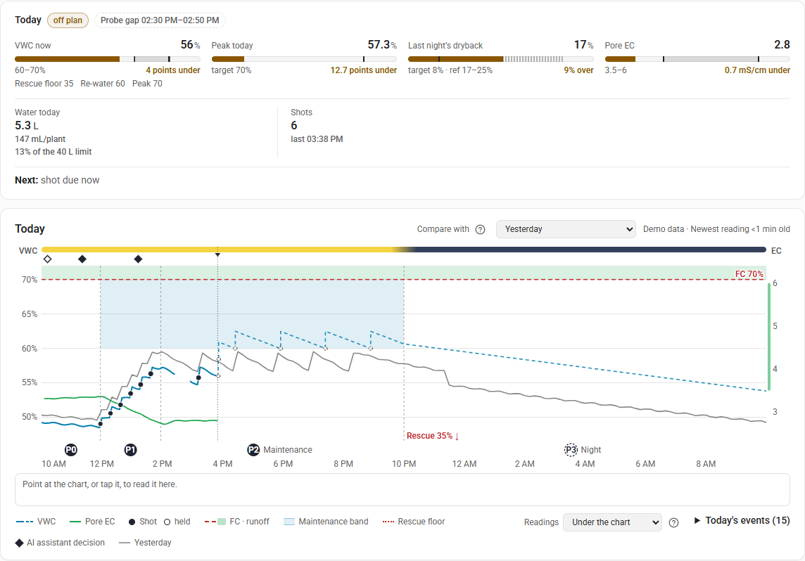
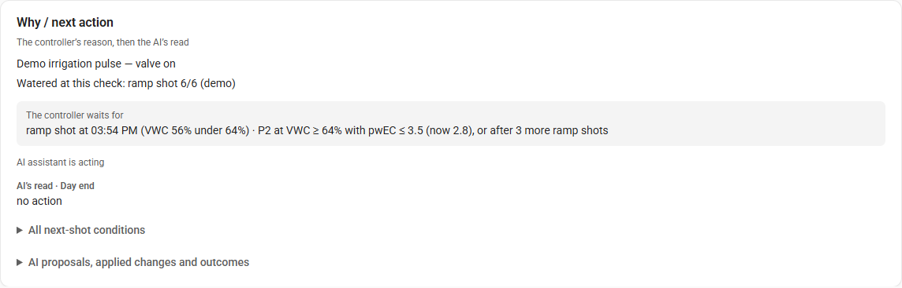
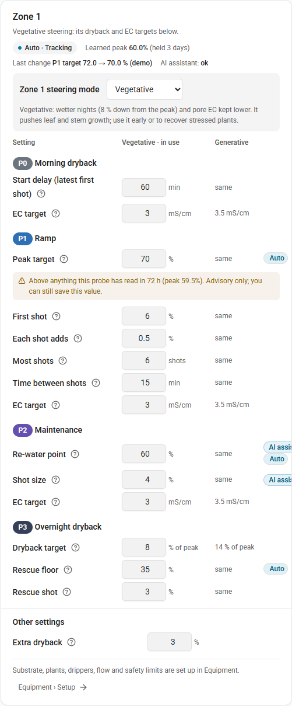
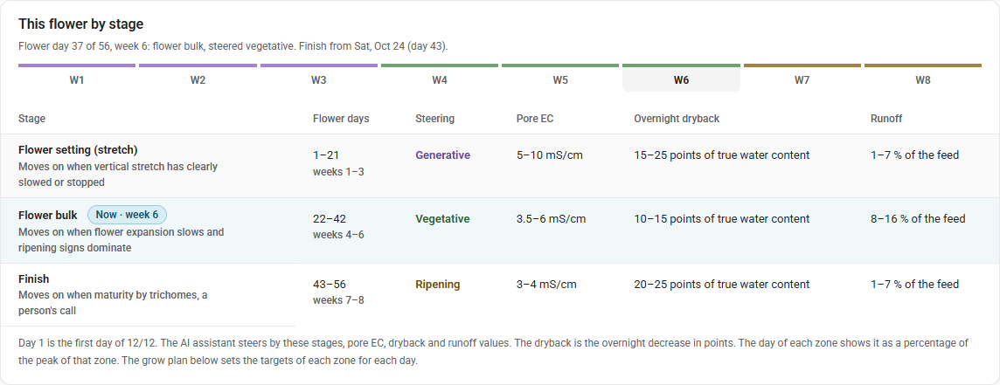
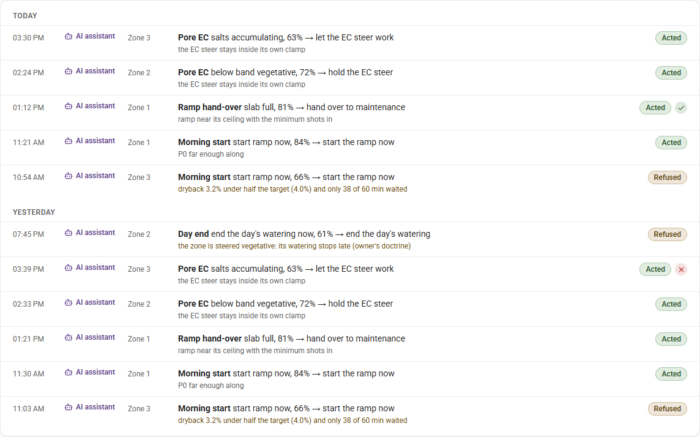
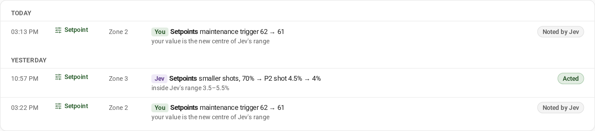
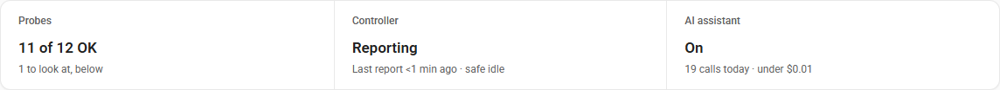
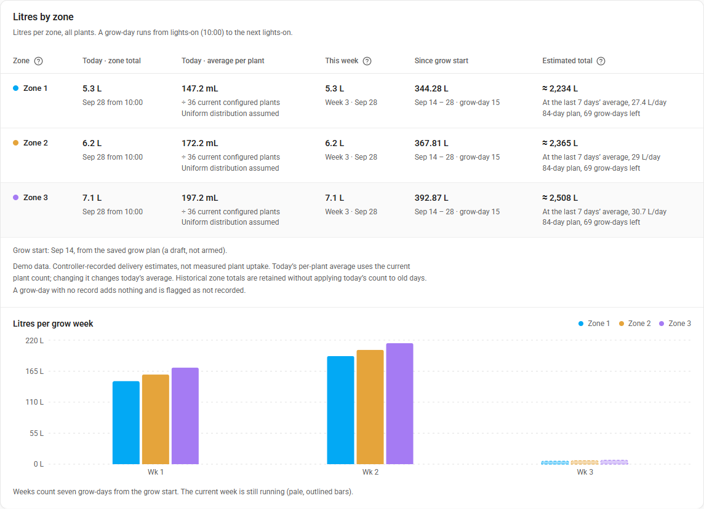
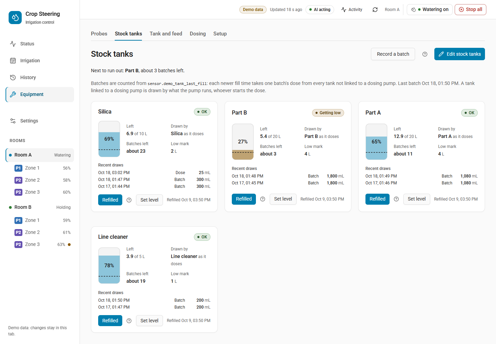
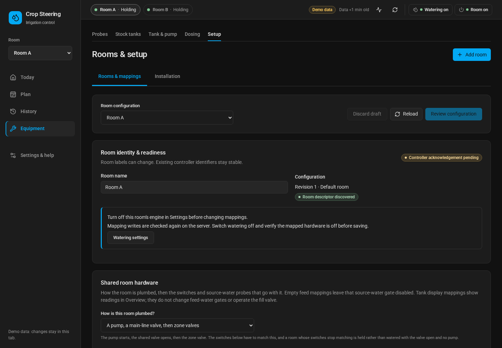

# Crop Steering

**Automatic watering for a grow room, run by Home Assistant, with an AI second opinion on every judgement call.**

Crop Steering runs a grow room's watering from Home Assistant. The controller measures how wet and how salty each group of plants is, decides when they need water and how much, and switches your pump and valves to deliver it. That part is the rules engine. Beside it sits **Jev**, an optional AI model the controller asks whenever a decision needs a grower's judgement rather than a fixed number, and a dashboard that shows every answer Jev gave, what the controller did with it, and whether it worked.

[New to crop steering?](#new-to-crop-steering-start-here) · [What Jev does](#what-jev-does) · [What Jev can never do](#what-jev-can-never-do) · [The dashboard](#the-dashboard-page-by-page) · [Install](#install) · [Turning Jev off](#turning-jev-off-or-taking-a-setting-back) · [Cost](#what-it-costs) · [The full Jev design](docs/JEV.md)

> **Safety first.** This software switches real pumps and valves, unattended, on living plants. Set up each room with watering switched off, check every probe and switch it uses, and do a catch test (measure what actually comes out of the drippers) before you let it water. It does not replace physical safety devices: use valves that close when power is lost, and a float switch or timer that can stop a pump on its own.

## New to crop steering? Start here

Plants grown in rockwool or coco are watered many times a day in small, measured **shots**. How far the growing block is allowed to dry between shots, and how salty it gets, **steers** the plant: kept wetter, it grows leaves and stems (**vegetative** steering); dried back harder, it puts its energy into flowers (**generative** steering). Growers call this crop steering.

Each group of plants on one valve is a **zone**. Probes in the growing blocks read the numbers everything here runs on:

| Word | What it means |
| --- | --- |
| **VWC** (moisture) | How much of the block is water, in %. The controller waters by this number. |
| **Pore EC** | How salty the water in the block is, in mS/cm. It rises as the plants drink and falls when fresh feed washes through. |
| **Dry-back** | How far moisture falls between waterings, overnight or in the morning. |
| **Field capacity** | The wettest the block can get. Water past it runs out of the bottom as **runoff**, which carries salt out with it. |
| **Shot** | One short watering, sized as a percentage of the block's volume. |

Every day runs in four parts, called phases:

| Phase | What happens | Why |
| --- | --- | --- |
| **P0: morning dry-back** | After the lights come on, it waits until the roots have dried by the amount you chose. | Drying in the morning tells the plant to root and gives you control over its growth. |
| **P1: ramp-up** | A series of small shots, a few minutes apart, until moisture reaches your peak target. | Brings the root zone back up gently instead of flooding it. |
| **P2: maintenance** | A top-up shot whenever moisture falls to your re-water point. | Holds the root zone steady through the main part of the day. |
| **P3: overnight** | Routine watering stops before the lights go off; only a rescue shot if a zone gets too dry. | The overnight dry-back is where much of the steering happens. |

Across a flower run the targets also change by **stage**. Jev follows this arc, counted from the day the lights went to 12 hours on and 12 off:

| Stage | Flower days (56-day cultivar) | Steering | Pore EC | Runoff |
| --- | --- | --- | --- | --- |
| **Flower setting** | 1 to 21 | Generative | 5 to 10 mS/cm | 1 to 7 % of the feed |
| **Flower bulk** | 22 to 42 | Vegetative | 3.5 to 6 mS/cm | 8 to 16 % |
| **Finish** | the last 14 days | Ripening | 3 to 4 mS/cm | 1 to 7 % |

## How it works

1. Every minute the controller reads each zone's probes.
2. By your targets, it works out where each zone is in its day and whether a shot is due. This is the rules engine: fixed rules that are right most of the time.
3. When a decision needs judgement ("is the block full yet?", "is this probe stuck?"), it sends Jev a question in the background, with the evidence already worked out as plain facts ("rose 3.1 points after the 10:40 shot and held"). It never waits for the answer.
4. When the answer arrives, code checks it against hard limits, called **the envelope**. If the envelope allows it, the controller acts on it. If not, nothing changes and the reason is logged.
5. Later, code measures whether the action worked, shows you a tick or a cross, and shows Jev its own track record the next time it is asked.

## What Jev does

[Jev](https://developers.cloudflare.com/ai/models/typesafe/jev/) is a decision model from TypeSafe. It does not chat: it picks answers from a fixed list and says how sure it is of each one. The controller asks it eleven kinds of question. Their names are the ones the dashboard uses.

| On the dashboard | When it is asked | The question, in plain words | What the controller may do with the answer |
| --- | --- | --- | --- |
| **Morning start** | P0, every 10 minutes | Has the morning dry-back gone far enough to start watering? | Start the ramp-up early, never later than the plain engine would. |
| **Ramp hand-over** | P1, every 15 minutes | Is the block full, or is the EC rising only because fresh feed is passing through? | Switch to maintenance watering early. |
| **Pore EC** | P2, every 30 minutes, while the room's EC stacking is on | Why did pore EC move: salt building up, the feed changing, or a suspect probe? | Let EC stacking keep nudging the re-water point, hold it, or ease it back, inside its own limits. |
| **Day end** | The last 3 hours before lights-off | Should today's watering stop now? | End the day's watering early, but never for a zone steered vegetative, which keeps watering late. |
| **Probe trust** | Every 30 minutes, after two shots | Is this probe telling the truth, or is it stuck, drifting, out of the block or in the wrong zone? | Set the probe aside: the zone copies a healthy zone, or runs on a cautious timer, for as long as Jev keeps saying so. |
| **Shot landing** | 20 minutes after each shot | Did that shot reach the zone? | Raise alert CS-701 after two misses in a row. It never adds water. |
| **Night low** | Overnight, near the rescue level | Is this real drying, or a probe fault? | Raise alert CS-703. The rescue shot still fires. |
| **Zone comparison** | Hourly with the lights on | Why is this zone drinking far more or far less than the rest of the room? | Raise alert CS-702 with the likely cause. |
| **Stage arc** | Once a day | Is this zone's dry-back and pore EC where today's stage wants them? | Raise advice CS-705. It never changes a setting. |
| **Setpoints** | Once a night, only with Auto setpoints on | Should tomorrow's maintenance shots be a notch smaller or bigger, or start a notch later or sooner? | Move one setting by one small step, inside a range around your own value ([how](#letting-jev-move-setpoints)). |
| **Alert triage** | When an alert is raised, and again after 6 hours | Is this worth a push to your phone, or just a card? | Decide whether its repeats push to your phone. Serious faults always push. |

Three things make the answers safe to act on:

- **Every question is asked twice, worded differently.** Both wordings go to Jev in the same call. The controller acts only when both land on answers that lead to the same action and Jev is sure enough. When they disagree, nothing changes.
- **Every question carries the rules of the craft.** Jev knows nothing about growing by itself, so each question includes the grower's doctrine: 99 rules from the project owner's GrowLabs wiki and 24 from Athena's Grow Guide Handbook, 123 in all, plus the stage arc above. Where the two sources differ, the owner's rules lead.
- **It checks its own work.** Every action goes into a ledger. When the result can be measured (the ramp after a hand-over, pore EC after a hold, the water after a setpoint change), code measures it, and Jev sees that track record the next time.

## What Jev can never do

Code keeps everything physical. An answer from Jev is only a request, and the envelope admits or refuses it with arithmetic Jev cannot do:

- It never switches a pump, valve or main line, never fires a shot, and never works out how long a shot runs.
- It never stops a safety action: the daily minimum and maximum water, the overnight rescue shot, a flush for high EC, or the watchdog.
- It can only move a zone **forward** through its day (P0 → P1 → P2 → P3), and only earlier than the plain engine would. The engine's own moves still happen.
- It never ends the day's watering early for a zone steered vegetative.
- The only numbers it can change are each zone's P2 shot size and re-water point: one small step a night, inside a range around your own value, and only after you switch **Auto setpoints** on.
- It never sets a probe aside on its word alone: that also takes two agreeing answers in a row and evidence code can confirm, and it lapses when Jev stops saying so.
- If Jev is off, slow, out of its daily budget or unsure, the controller runs exactly as the rules engine alone. Nothing ever waits for it.

## The dashboard, page by page

Crop Steering adds a page to the Home Assistant sidebar with five menu entries, **Today**, **Plan**, **History**, **Equipment** and **Settings & help**, and a page for each zone. Every screenshot here comes from the dashboard's built-in demo, with sample data.

### Today: is everything OK?

Today (the screenshot at the top of this page) answers one question on one screen: is the room OK, and does any zone need me?

- **The room's line**: watering on or off, the stage and day of flower (*Flower bulk, day 37 of 56*), the steering (*Vegetative*), the pore EC range this stage wants (*3.5 to 6*), when the lights go off, which phases the zones are in, and any alerts.
- **A card for each zone**: the big number is moisture now and the line beside it is today so far. The bar underneath shows where moisture sits against the **rescue** level, the **re-water** point and the **peak** target. Below that come pore EC, water per plant against the rest of the room, the last shot and what happens next. A card gets a coloured edge and a warning line only when that zone needs you; here, Zone 1's pore EC is under the stage's range.
- **What Jev changed today**: Jev's latest three changes, newest first. **History** has the rest.

On a phone, Today takes about two screens. The first:

### A zone's page: what happened today, and why

Tap a zone's card to open its page. Its chart draws the day as a phase reference chart:

- **The bar along the top**: lights on (yellow) and lights off (dark).
- **The diamonds under it**: Jev's decisions. Filled means the controller acted on it; an outline means advice only, no action, or refused.
- **The blue line**: moisture. Each dot is a shot; a ring is a shot that was held back.
- **The green line**: pore EC, on the right-hand scale. The green bar at the right edge is the stage's EC range.
- **The blue band**: the maintenance band, from the re-water point up to the peak target.
- **The red dashed line**: field capacity, with the runoff zone above it. *Rescue 35%* marks the overnight rescue level.
- **The dashed blue line**: the rest of the day as expected, from how fast this zone has been drying.
- **The grey line**: yesterday, for comparison. **Compare with** switches it to a typical day.
- **P0 to P3** along the bottom: when each phase started.

Next to the chart, **Jev on this zone** says what Jev may change on this zone and within what range, and lists its latest decisions here:

Each row reads: the time, the question (*Ramp hand-over*), Jev's answer and how sure it was (*slab full, 81%*), and what that asked for (*hand over to maintenance*). **Acted** means the controller did it; **No action** means the answer asked for nothing. The tick is the later check: the 01:12 PM hand-over worked.

### Plan: your targets, and what Jev may change

**Plan › Targets** holds every target of a zone, phase by phase. With Auto setpoints on, the green pill at the top reads **Jev manages the P2 shot size and re-water point**, and the two settings Jev may move carry a blue chip with the range it may use. **Turn auto off…** takes them back.

**Plan › Schedule** opens with **This flower by stage**, the stage arc Jev checks every zone against. The highlighted row is today's stage.

### History: everything Jev decided, and whether it worked

**History › Timeline** is one list of the controller's records and Jev's decisions, newest first. Choose **Jev** to see only Jev's. The line above the list counts today's questions, tokens and cost.

- **Acted**: the controller did what Jev asked. **Refused**: the envelope said no, and the orange line underneath says why, such as *the zone is steered vegetative: its watering stops late*. **Advice**: an alert or a suggestion only.
- A **✓** or **✗** beside a decision is the later check of whether it worked.
- **All Jev decisions** adds the answers that asked for nothing.
- A timeout, such as *Workers AI did not answer within 30 s*, is shown once. Jev is asked again, and the controller carries on meanwhile.

Choose **Setpoints** to see Jev's overnight changes next to your own:

A change you make yourself is marked **You**. Jev only notes it, and your new value becomes the centre of Jev's range.

### Equipment: is Jev on?

**Equipment › Probes** starts with three tiles: the probes, the controller, and Jev (**On** or **Not answering**, with today's calls and cost). Below them, every probe with its reading, its last report and whether the zone uses it.

### Settings & help

**Help** explains every alert code in plain words, including the five only Jev raises: **CS-701** water is not reaching a zone, **CS-702** a zone's water per plant is out of line with the room, **CS-703** an overnight low looks like a probe fault, **CS-704** Jev set a zone's probe aside, and **CS-705** a zone is off its stage's arc.

## Letting Jev move setpoints

Setpoints is the one question whose answer changes a number, so it has its own switch and its own limits:

- **Off until you switch it on**: **Turn auto on…** in Plan › Targets, one switch per room.
- **Once a night**: in the first three hours after lights-off, Jev weighs the day's water per plant against the rest of the room, how the shots held, and pore EC against the stage's range. It picks **smaller shots**, **bigger shots**, **re-water later**, **re-water sooner** or **keep**. Code tells it which way the EC and the room point; Jev judges whether to act and which lever to use.
- **One small step**: the P2 shot size by 0.5 %, or the re-water point by 0.5 points. At most one change per zone per night.
- **Fenced in around your value**: the shot size stays within 1 % of the value you set, and never goes under 3 %. The re-water point stays between 2 points under and 1 point over your value, at least 4 points above the rescue level and 2 under the peak target. However many nights in a row it moves, it cannot leave that range.
- **You always win**: change either value yourself and your number becomes the new centre of the range.
- **It backs off by itself**: if a rescue shot fires within 30 hours of a Jev change, the old value goes back, Jev leaves that zone's setpoints alone for 48 hours, and alert CS-404 tells you.
- **One tuner per setting**: Jev moves only the P2 shot size and re-water point. The P1 target and field capacity follow the zone's own probe: the P1 target is the highest reading of the grow-day before, and field capacity the higher of today's and the day before's highest readings, so it rises the same day the probe reads higher. When field capacity moves by a point or more, the P2 re-water point moves by the same points, so the dryback under full stays the size it was set. Each moves at most 1 point a grow-day, so a drifting probe or a flood cannot drag them, and the rescue (P3 emergency) floor never moves; P0 and the overnight dryback are percentages of the day's peak and follow by themselves. P1 ends when a shot at the target no longer raises the zone's highest reading: reach the target, give one more shot, and go to P2 only once a shot stops raising it.

Why so careful: on 26 September 2026 the original learner, running on its own, walked one zone's shots from 3 % down to 1 % (30-second shots every 96 seconds) and ratcheted another zone's targets up over four days. The range around your own value is what stops the first happening again.

## Install

Crop Steering comes in two parts, and automatic watering needs both. They carry the same version number: install and update them together.

| Part | Installed with | What it does |
| --- | --- | --- |
| **The integration** | HACS | Holds your rooms, zones, settings, plans and history, and adds the **Crop Steering** page to the Home Assistant sidebar. It never switches equipment itself. |
| **The controller app** | The Home Assistant app store | Reads your probes every minute, decides every shot, switches the pump and valves with every safety check, and asks Jev. |

### What you need

| | |
| --- | --- |
| **Home Assistant** | **2024.10.0 or newer.** Every change is tested on 2024.10.0 and on 2026.9.3. |
| **The controller app** | Home Assistant OS or Supervised, where it installs from the app store (amd64, aarch64 or armv7) and brings its own Python 3.12. Home Assistant Container and Core have no app store: there the same controller runs as a Docker container (see the [install guide](docs/INSTALL.md)). |
| **HACS** | 1.6.0 or newer for the guided download, or copy `custom_components/crop_steering` into Home Assistant by hand. |
| **Hardware** | A switch Home Assistant can control for each zone's valve (and your pump and main line, if you have them), and a moisture probe per zone. EC probes and tank sensors are optional but recommended. |
| **A Jev key** (optional) | A TypeSafe API key. A Cloudflare account with Workers AI starts Jev only on an install that has already run it; a new install needs the TypeSafe key. Without one, the rules engine runs alone. |
| **AI assistant connector** (optional) | Node.js 22 or newer, on the computer that runs your AI assistant. |
| **Account** | A Home Assistant administrator, to set up rooms and change plans. |

### Steps

> **Already running Crop Steering from this repository?** You do not install again: HACS offers the integration update and the app store offers the controller update, and your rooms, settings and entity ids stay. Take a Home Assistant backup first.

1. **Download the integration with HACS**, then restart Home Assistant. (Or add it by hand: HACS → ⋮ → Custom repositories → `https://github.com/JakeTheRabbit/HA-Irrigation-Strategy`, type Integration.)
   
2. **Add Crop Steering** and name your first room.
   
3. **Add the app repository**, then install **Crop Steering Controller**. Do not start it yet.
   
4. **Give Jev a key.** In Settings → Apps → Crop Steering Controller → Configuration, set `typesafe_api_key`: a TypeSafe API key (it starts with `apikey_`). A new install needs this key to start Jev.

   You can also set `cf_account_id` and `cf_api_token`: your Cloudflare account ID and an API token with the **Workers AI** permission (dash.cloudflare.com → My Profile → API Tokens → Create Token → the Workers AI template). Beside a TypeSafe key, Cloudflare is the second route. On its own it starts Jev only on an install that has already run Jev; on a new install it does not, and the app log says `jev: off`.

   Without a key, the controller runs the rules engine alone and everything else still works.
5. **Tell Jev when flowering started.** `jev_flower_start` is the room's first day of 12/12: a date such as `2026-08-22`, or an `input_datetime` helper. `jev_flower_days` is the cultivar's flowering length (56 unless you change it). This is how Jev knows today's stage.
6. **Start the app**, then open **Crop Steering** in the sidebar. Map your valves, pump and probes in **Equipment › Setup**, check the readings in **Equipment › Probes**, and keep watering switched off until every probe reads correctly. Do a catch test.
7. **Switch watering on** in the top bar. With a key from step 4, Jev joins in as each decision comes up. To let it tune setpoints as well, use **Turn auto on…** in **Plan › Targets**.

The buttons open the right screen; Home Assistant still asks you to confirm each step. Updates arrive the same way: HACS offers the integration and the app store offers the controller. The [install guide](docs/INSTALL.md) covers manual installs, upgrades and rolling back.

## Turning Jev off, or taking a setting back

| You want to | Do this |
| --- | --- |
| Stop Jev changing setpoints | Use **Turn auto off…** in Plan › Targets. The values stay where they are until you change them. |
| Change a value Jev manages | Type your own value in Plan › Targets. It becomes the new centre of Jev's range. |
| Stop one kind of decision | App option `jev_judges`: list the ones to keep, such as `dawn,ramp,salt,probe,shot,night,zones,stage,setpoints,alerts` (everything except `dusk`, the Day end question). |
| Switch Jev off completely | App option `jev_enabled` off, then restart the app. The controller runs the rules engine alone. |
| Cap what it can spend | App option `jev_daily_calls` (5,000 by default; CS-706 at 80 %). Once the day's calls are spent, the rest of that day's decisions are the plain engine's. |

## What it costs

Each question is about 3,000 input tokens. Cloudflare prices Jev at US$0.042 per million input tokens, and output is free; the dashboard uses that price for its figure. A room asks only when there is something to decide, so even a few hundred questions a day cost a few cents. History and Equipment show today's calls, tokens and cost.

## Checked against the real Jev

The repository's `scripts/jev_live_smoke.py` builds realistic situations, sends them to the real Jev with the same evidence and questions the controller uses, and compares the answers, and what the envelope then admits, with what an experienced grower would do.

Seventeen of seventeen as a grower would expect (27 and 28 September 2026)

Twelve of the seventeen:

| The situation | Jev's answer | What code did |
|---|---|---|
| Ramp at its ceiling, EC up only from the feed passing | the EC is just the feed (both phrasings agreed) | brought P2 forward |
| Probe flat for 4 h through three shots while its siblings rose | not tracking: stuck (p 0.92) | set the probe aside |
| EC climbing after dilute shots, feed lower | salt front still passing (p 0.93) | kept steering wetter |
| Two shots, no rise, a sibling rose | water not reaching the zone (p 0.96) | the CS-701 alert, on the second |
| A 3.4-point step at 2 AM near the rescue floor | probe fault (p 0.97) | the CS-703 alert; the rescue still fires |
| Zone on half its siblings' water, probe reading high | wet spot or plants drinking less (both phrasings alert-worthy) | the CS-702 alert |
| 2 h to lights-off, flower setting (generative) | stop now (p 0.82) | brought P3 forward |
| The same zone in flower bulk (vegetative) | stop now | refused: a vegetative zone stops late (the owner's doctrine) |
| A zone left on generative steering in flower bulk | last night's dryback too shallow (p 0.99) | CS-705, naming the steering mismatch too |
| Zone 1 of 27 Sep: 235 % of the room's water, pore EC under the bulk range (28 Sep) | smaller shots tomorrow (p 0.94) | P2 shot 5 % → 4.5 %, inside its range |
| A zone on course: water in line, EC inside the range (28 Sep) | keep (p 0.92) | nothing moved |
| A thirsty zone: 43 % of the room's water, EC over the range (28 Sep) | bigger shots tomorrow (p 0.95) | P2 shot 5 % → 5.5 % |

*p* is how sure Jev was, from 0 to 1. Each question took about 3,000 input tokens. Run the script again any time to check the model you are using.

## Everything else the controller does

The rest is the rules engine, and it all works with or without Jev.

**It waters by what the plants need, not by a timer.** Every zone has its own moisture probe, and usually an EC probe. The controller checks them every minute and waters in shots sized from your pot size, plant count and dripper flow.

**It steers the whole grow, not just one day.** A plan in **Plan › Schedule** sets each zone somewhere between a vegetative profile (more water, gentler dry-backs) and a generative profile (harder dry-backs, pushing flowers), week by week or day by day, and changes the targets automatically at lights-on. Save plans you like as recipes and reuse them for the next run.

**It looks after itself.** It stops and tells you when something is wrong instead of guessing:

- **An off switch for every room**, and a **room off** setting for an empty room: no watering and no alerts.
- **A daily water limit per zone** and a **maximum shot length**, so a stuck sensor can never keep a valve open all day.
- **It checks every switch it turns off actually went off.** If a valve or pump does not, it holds that equipment, stops watering and alerts you.
- **If a moisture probe dies**, the zone is still watered, by copying a working zone or on a cautious timed schedule, until the probe reads again.
- **Optional feed-water checks:** it can refuse to water when the feed water's EC or pH is out of range.
- **Clear alerts.** Every problem shows up as a Home Assistant Repairs card or notification with a code (such as CS-601) that the built-in Help explains: what it means, what happens to watering meanwhile, and what to do.

**It counts the water.** **History › Water use** shows every zone's litres today, this grow week, since the grow started and an estimate for the whole grow, from Home Assistant's long-term statistics.

**It keeps the nutrient stock topped up.** **Equipment › Stock tanks** tracks the concentrates each batch tank is dosed from. Every batch you make takes its dose off each stock tank; when one runs low you get a Repairs card saying roughly how many batches are left. Press **Refilled** when you top it up.

**It compares runs.** **History › Compare runs** lines this run up against an earlier one by grow week, so you can see whether this grow is tracking the last good one.

**It sets up rooms without YAML.** **Equipment › Setup** maps the Home Assistant entities you already have: valves, pump, main line, moisture and EC probes, tank sensors. You enter each zone's pot size, plant count and drippers. Every save is checked first (units, duplicate valves, everything off before a change) and the controller confirms it has picked the new setup up.

**AI assistants (optional).** A separate connector lets an AI assistant such as Claude read your rooms, readings and plans and prepare changes for you to review. It can never switch equipment. See [MCP.md](docs/MCP.md).

## Good to know

- **Jev's answers are judgements, not guarantees.** Every one is logged with how sure Jev was and what code did, so you can check it against what you see in the room.
- **Estimates are labelled as estimates.** Water per zone is worked out from your flow settings and the time each valve was open. It is not measured delivery; a catch test or a flow meter is the only proof of what actually reached the plants.
- **Projections are projections.** The dashed "rest of the day" lines use how fast each zone has been drying. The controller always waters by the probe, not by the projection.
- **It waters by moisture and EC.** It does not dose nutrients or control climate.
- **Settings survive updates.** Updates install in place and keep your rooms, settings, counters, plans and Jev's history.

## Documentation

- [How Jev works in full: every judge, the envelope, the doctrine and the options](docs/JEV.md)
- [User guide: every page of the dashboard](docs/USER_GUIDE.md) and [planning a grow](docs/GROW_PLANS.md)
- [Install, upgrade and roll back](docs/INSTALL.md)
- [Error codes: what each alert means and what to do](docs/ERROR_CODES.md)
- [Troubleshooting](docs/troubleshooting.md)
- [What has been tested, and the known limits](docs/FEATURE_MATRIX.md)
- [Entity reference](docs/ENTITIES.md) · [Sidebar and menu button](docs/HA_SIDEBAR.md)
- For developers: [architecture](docs/REPOSITORY_MAP.md), [testing](docs/TESTING.md), [how releases are made](docs/RELEASING.md) and [contributing](CONTRIBUTING.md)

## Support

Report a problem or ask a question in [GitHub issues](https://github.com/JakeTheRabbit/HA-Irrigation-Strategy/issues). Include the error code if you have one, both version numbers (shown in the Crop Steering sidebar), and what the controller app's log says.

## License

[MIT](LICENSE)
