# Current workspace screenshots

[Open the interactive demo](https://jaketherabbit.github.io/HA-Irrigation-Strategy/dashboard.html?demo=1).

Captured on 18 October 2026 from `www/dashboard.html?demo=1`, with isolated sample data, a fixed 15:50 local clock and the light theme. These are current UI examples, not photographs or live facility readings.

## Overview: all zones

## Overview: selected room

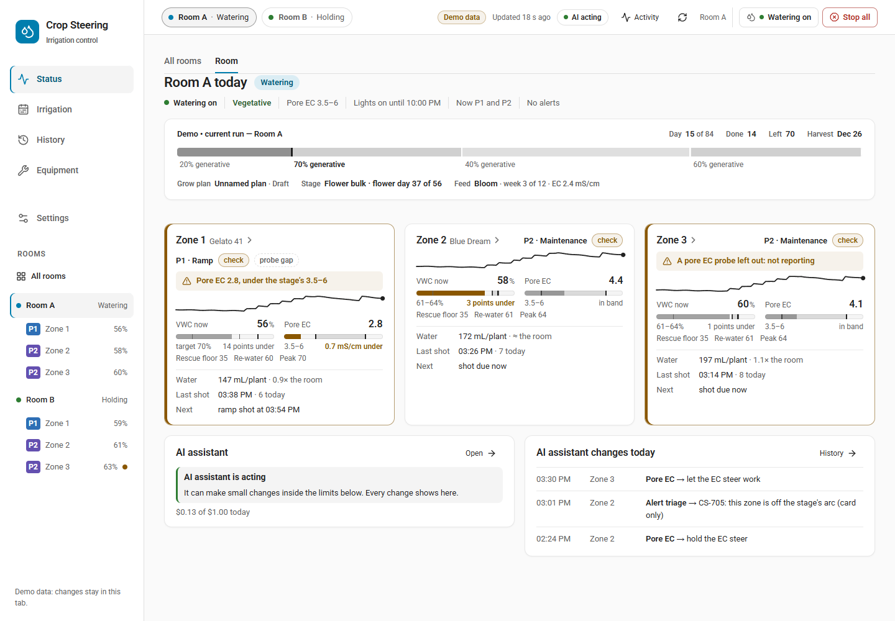

## Tank and pump

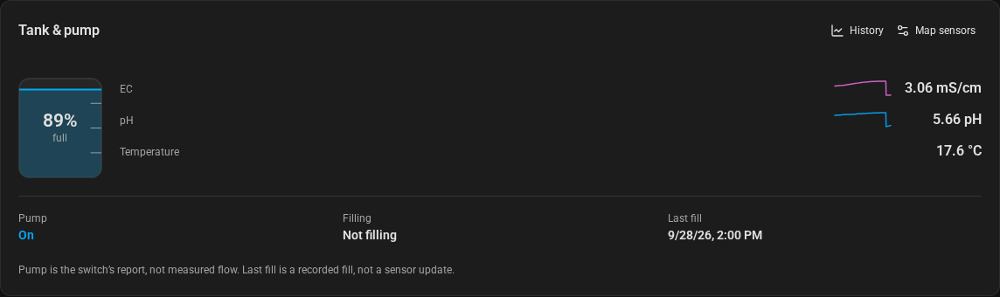

## Tank EC and pH history

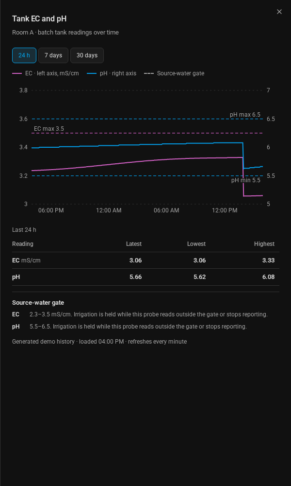

## Tank level and watering

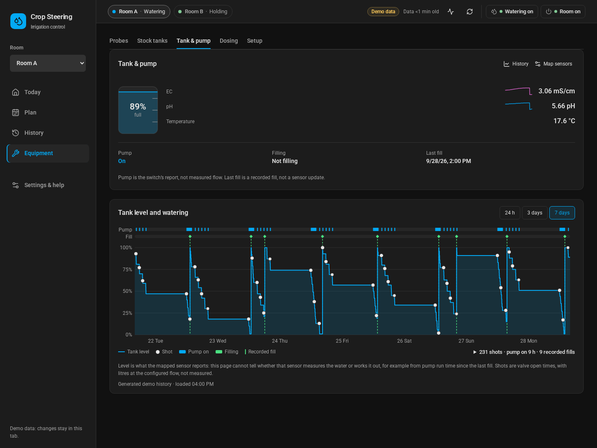

## Water use per zone

## Stock tanks

## Irrigation: Calendar and combined VWC/EC curve

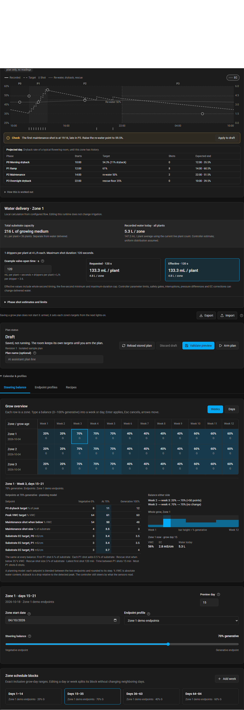

## Irrigation: Current day, recorded evidence and projected day

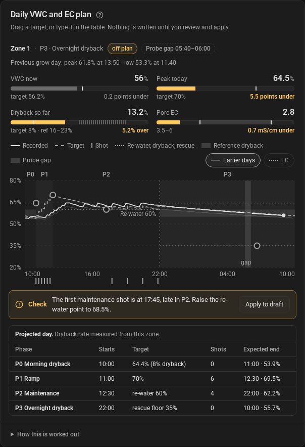

## History: recorded sensor explorer

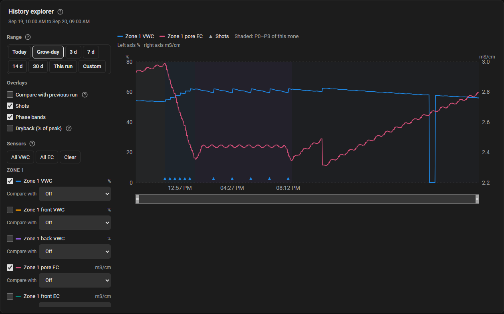

## Irrigation: Current day beside the plan graph

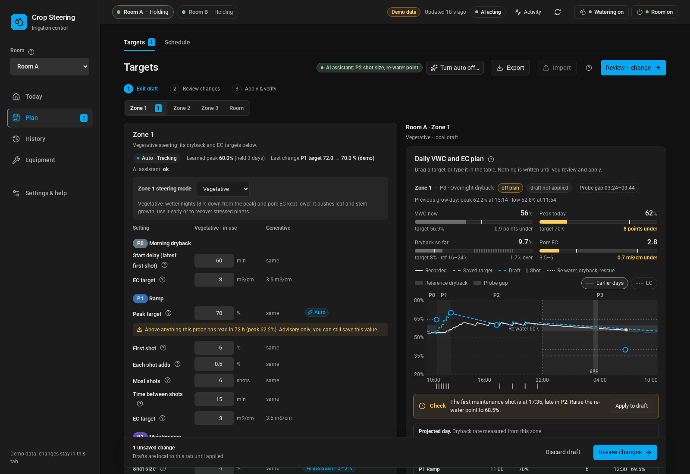

## Room switched off

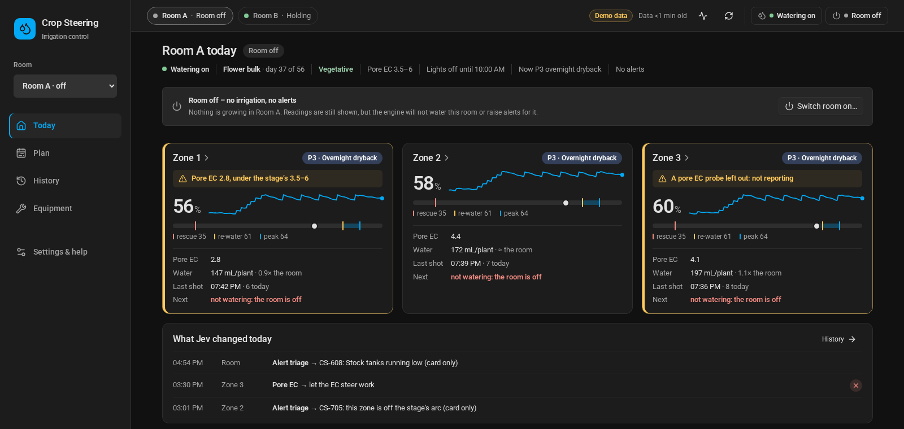

## Recorded run comparisons

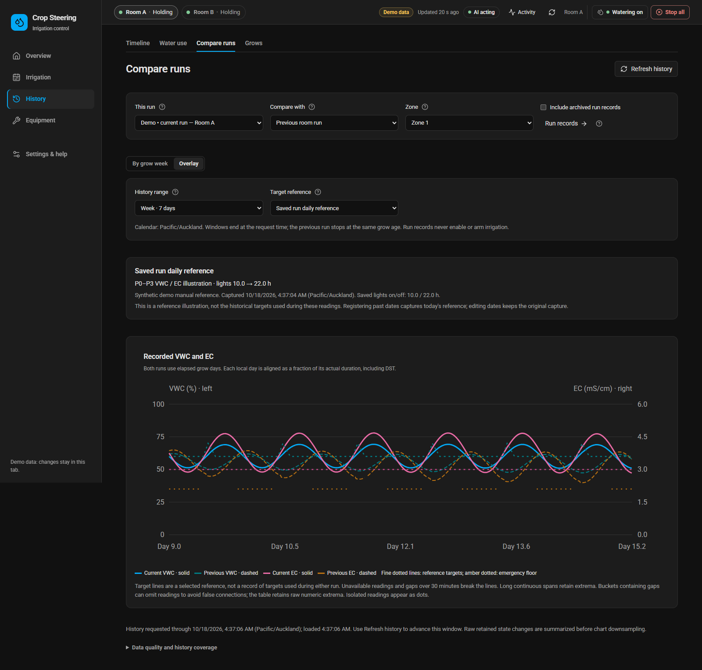

## User-authored recipe library

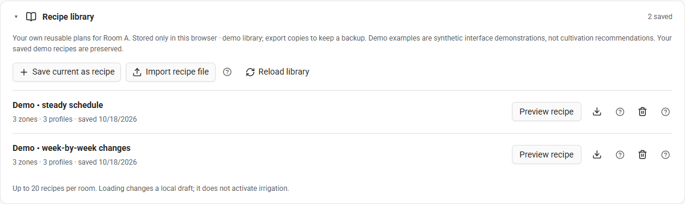

## Rooms and sensor mapping

## Mobile overview

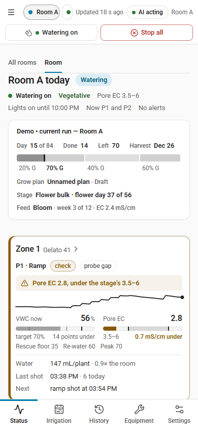

Reproduce every published screenshot with `node frontend/scripts/capture-readme.mjs` after building the frontend. The script reads only the checked-out compiled demo, blocks external and Home Assistant API requests, and fails on browser runtime errors. It writes all 26 screenshots to `img/` and records their route, selector, viewport and source SHA-256 in [the screenshot manifest](../img/screenshots.json). The logo is a brand asset and is not a dashboard capture.

The stable filenames are shared by README, this gallery and the website. Copy the images from this publication set when refreshing the website. Never use screenshots from `output/ha-ui-deploy`, real Home Assistant sessions or private facility data. Browser verification scripts also create test evidence and may overwrite individual images; run the publication capture last, after verification, to publish one consistent set.
