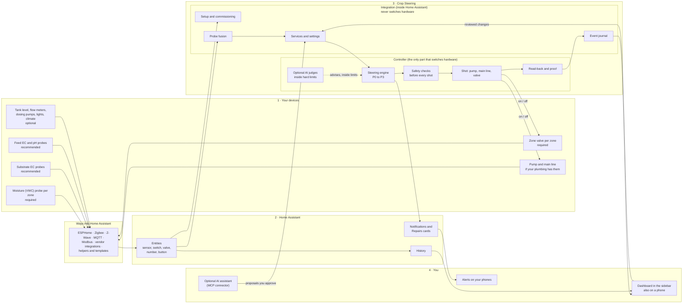

# How Crop Steering connects: the system map

A plain-English map of how any device reaches Crop Steering, what Crop Steering does with it, and who sees the result. It is written against release 3.18.0. For the developer view, with file paths and every service, see the [developer system map](system-map.md) and the [system overview](SYSTEM_OVERVIEW.md).

## The short version

Crop Steering does not talk to devices. It talks to Home Assistant.

1. **Your devices** (probes, valves, pumps, meters, tanks, lights) connect to Home Assistant the way they always have.
2. **Home Assistant** turns every device into an entity: a sensor, a switch, a valve, a number, a button.
3. **Crop Steering** reads those entities, decides when each zone drinks, and runs the pump and valves with safety checks. It has two parts: the **integration**, which lives inside Home Assistant and keeps your setup, and the **controller**, which is the only part that switches hardware.
4. **You** watch it on the dashboard in the Home Assistant sidebar, get alerts on the phones you choose, and can let an AI assistant prepare changes for you to approve.

If Home Assistant shows a device as the right kind of entity, with a unit Crop Steering understands, Crop Steering can use it. How the device got into Home Assistant does not matter.

## The map

Solid lines carry readings and commands. The dotted line is advice: the optional AI judges can only answer questions the controller asks, and code checks every answer against hard limits.

## Three lines that are never crossed

- **The AI cannot run a pump or a valve.** Neither the AI judges inside the controller nor an AI assistant connected through MCP has any way to start a shot, switch hardware or stop a safety action.
- **The integration never switches hardware.** Only the controller does, and only after the safety checks pass.
- **An unreadable kill switch counts as off.** So does an unreadable room switch. When something cannot be read, Crop Steering assumes the safe answer.

## One shot, from reading to record

| Step | What happens |
| --- | --- |
| 1. Sense | Devices update Home Assistant. The integration combines each zone's probes into one moisture and one EC reading, leaving out probes that are silent or out of range. |
| 2. Decide | The engine finds the zone's phase and decides whether to water and how much. A zone on a timer follows its program. |
| 3. Check | A fixed list of checks runs in order. The first one that fails holds the shot and records why, with an alert code. |
| 4. Act | Pump on, then main line, then the zone valve. During the shot the controller keeps checking the kill switch and holds. |
| 5. Prove | Each switch is read back on and then off. With a flow meter, the water counted is compared with the meter. A later check looks at whether the moisture rose. |
| 6. Record | The shot, any hold, and every setting change go into one journal. The dashboard, History and alerts read from it. |

## What each device needs to be

| Role | Needed? | Home Assistant entity | Units |
| --- | --- | --- | --- |
| Moisture (VWC) probe | Required, at least one per zone | `sensor` | %, m³/m³ |
| Zone valve | Required, one per zone | `switch`, `valve` or `input_boolean` | — |
| Pump, main-line valve | If your plumbing has them | `switch`, `valve` or `input_boolean` | — |
| Substrate EC probe | Recommended | `sensor` | mS/cm, dS/m, µS/cm |
| Feed EC and pH probes | Recommended | `sensor` | EC units above; pH |
| Tank level or low float | Optional | `sensor` (distance) or `binary_sensor` | distance units |
| Flow meter | Optional | `sensor` | — |
| Dosing pumps | Optional, up to 8 per room | volume `number` and start `button` (or `script`) | — |
| Waste valve | Optional | `switch` | — |
| Lights | Optional | `light` or `switch` | — |
| Air temperature, humidity, VPD; AC and dehumidifier state | Optional, read only | `sensor`, `climate`, `switch` | — |
| External interlocks | Optional | any entity | — |
| CO2, light level, camera, leaf and root-zone temperature | Optional, dashboard only | `sensor`, `camera` | — |

The [entity reference](ENTITIES.md) lists every entity Crop Steering creates.

## The smallest setup that works

- A Home Assistant host, 2024.10 or newer: Home Assistant OS or Supervised for the controller app, or Container or Core plus Docker for the controller container.
- One switch or valve entity for the zone. A smart plug or a solenoid is enough for the valves-only layout.
- One moisture probe that reads in % or m³/m³.
- Lights-on and lights-off hours set.
- Physical safety the software does not replace: valves that close when power is lost, a float switch or timer that can stop the pump without software, and a physical shutdown you can reach.

## What is not on this map

- Pairing devices or flashing firmware. Home Assistant does that.
- Lights on 24 hours (equal on and off hours).
- EC probes that only report ppm or ppt. ppm is a display unit only.
- Several zones watering at the same moment. The controller opens one zone at a time.
- Valves or pumps exposed as anything other than a switch, valve or `input_boolean`.
- Dosing pumps that cannot time their own dose from a volume and a start.
- Climate, CO2 or light on/off control. Lights can only be dimmed on dry substrate, if you opt in.
- More than 24 zones per room, 32 probes per reading or 8 dosing pumps per room.
- AI or MCP control of pumps, valves, engine switches or plan activation.
- Yield or potency scores.
- Release 3.18.0 has not yet been run on real plumbing. Start on one zone with a catch test.
- The software is not an emergency stop.

What comes next is in the [roadmap](../ROADMAP.md).
