# Illustrated pilot storyboard

[Open the visual storyboard](index.html) · [Printable PDF](storyboard.pdf)

27 scenes across five pilot lessons. Images are filming illustrations or precise teaching diagrams, not installation evidence. Timing is proposed, not a recorded runtime.

## A1 — Before the buttons: water, roots and air

### A1-01 — The question

**Proposed time:** 00:00–00:11 · **Camera:** Medium shot, locked camera

**Action:** Open beside one unplanted pot. Leave space for the title.

**On-screen text:** Before the buttons

**Accuracy/staging:** Keep the question short; no dashboard montage.

**Narration:**

“Before we touch the dashboard, what are we actually trying to manage inside this pot?

### A1-02 — Inside the root zone

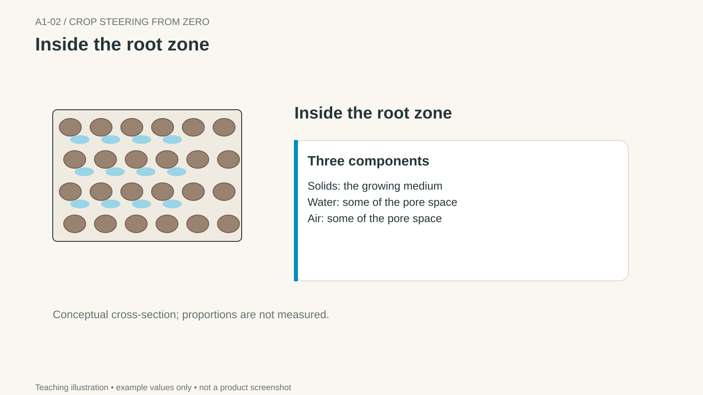

**Proposed time:** 00:11–01:01 · **Camera:** Graphic, slow push-in

**Action:** Reveal solids, then water, then air as they are named.

**On-screen text:** Solids · water · air

**Accuracy/staging:** Conceptual proportions; do not imply a measured air fraction.

**Narration:**

The answer starts with three things: solid material, water, and air. The material could be coco, stone wool, or another growing medium. We’ll call that material the substrate. You don’t need to remember a long definition. It’s the material surrounding the roots.
Between its solid parts are spaces. Some spaces contain water. Some contain air. Roots need access to water, and they also need oxygen. Giving a pot more water is not automatically an improvement. The amount it holds, how it drains and how well air returns all matter.

### A1-03 — Watch water arrive and drain

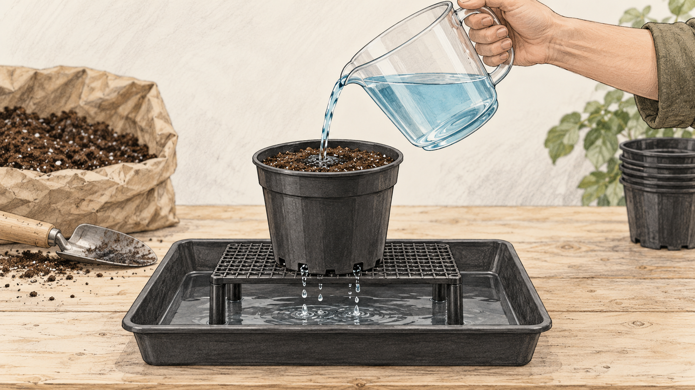

**Proposed time:** 01:01–01:39 · **Camera:** Bench close-up

**Action:** Show a small pour and actual drainage into a tray.

**On-screen text:** Some stays. Some drains.

**Accuracy/staging:** Use spare medium. Identify any time compression.

**Narration:**

Watch this spare container. We add water. Some stays in the medium, and some drains into the tray. Later, water content can fall as the plant uses water and water evaporates. Drainage also changes the amount of water in the pot. We shouldn’t call every drop that disappears ‘water the plant drank.’

### A1-04 — Pause before adding water

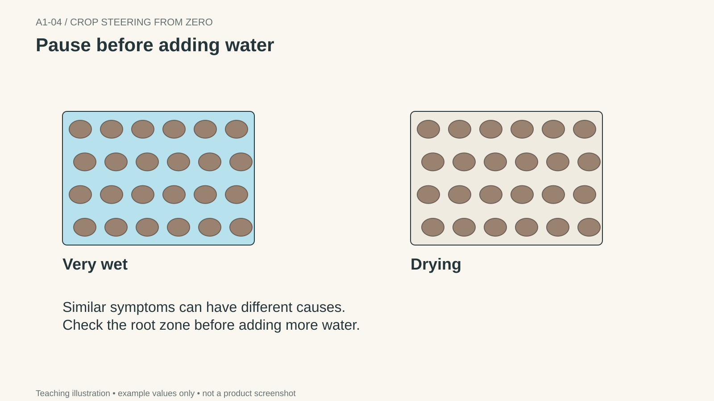

**Proposed time:** 01:39–02:21 · **Camera:** Two-state teaching graphic

**Action:** Ask the question; hold before revealing the answer.

**On-screen text:** More water — or check first?

**Accuracy/staging:** Do not diagnose crop symptoms from one cartoon.

**Narration:**

Here’s your first question. Imagine a pot that has stayed very wet. Should we assume more irrigation will help just because the leaves look unhappy?
Pause here and choose: yes, or we need to check what is happening first.
[Pause.]
We need to check. Similar-looking symptoms can have different causes. The graph helps us ask better questions; it doesn’t diagnose every root problem for us.

### A1-05 — What steering and sensing can do

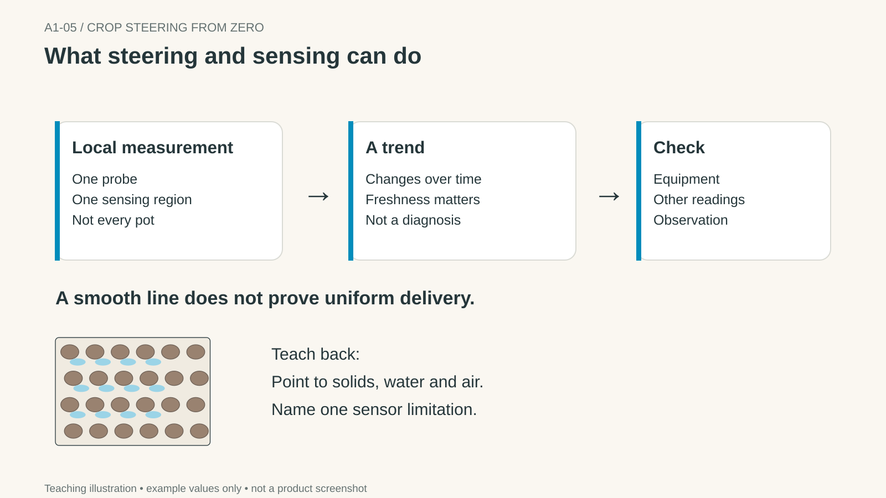

**Proposed time:** 02:21–04:11 · **Camera:** Graphic, then return to presenter

**Action:** Explain steering, sensor limits and the learner teach-back.

**On-screen text:** Measure · check · observe

**Accuracy/staging:** Reveal each card in order. Do not promise yield or stress benefits.

**Narration:**

Crop steering means managing conditions to influence how the crop grows. In this course we’ll concentrate on irrigation: when water arrives, how much arrives, and what happens between events. We’ll also keep the environment in view because light, temperature and humidity change demand.
You’ll hear ‘vegetative’ and ‘generative.’ We’ll explain those later. For now, steering is a direction of management, not a promise of a particular yield, and it doesn’t mean drying plants as hard as possible. Keeping roots functioning comes first.
A sensor gives us information from a particular location. It doesn’t see every root or every pot. A healthy-looking number can still hide a blocked dripper somewhere else. That’s why we’ll combine readings, equipment checks and observation.
You do not need a room full of expensive equipment to learn this. The demo lets you practise the software without touching a real pump. If you are building a system, the equipment playlist starts with one zone and proves it before adding more.
Your task: point to the solids, water and air in this drawing. Then say one thing our sensor cannot tell us. If you can do that, you have the starting point. Next, we’ll turn one confusing number—VWC—into something you can actually picture.”

## A2 — VWC: what does 60% actually mean?

### A2-01 — Recall before the reveal

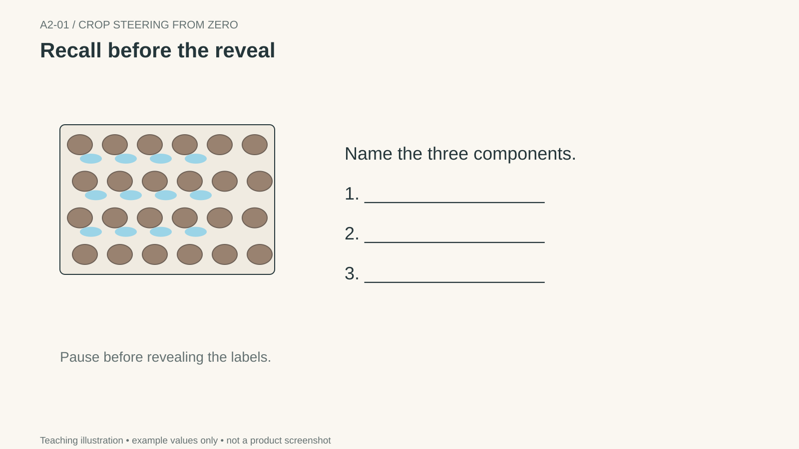

**Proposed time:** 00:00–00:18 · **Camera:** Full-screen teaching graphic

**Action:** Ask for the three components, then reveal labels.

**On-screen text:** Name the three parts

**Accuracy/staging:** Give a real recall pause before the answer.

**Narration:**

“Last time we put three labels inside a pot: solids, water and air. Can you name them before I reveal them?
[Pause and reveal.]

### A2-02 — Six out of ten

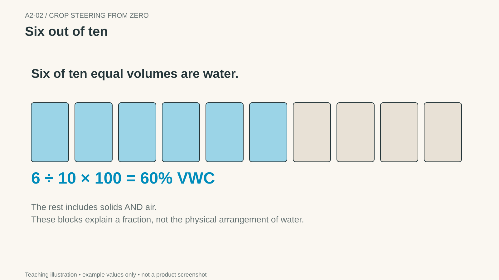

**Proposed time:** 00:18–01:09 · **Camera:** Progressive ten-volume diagram

**Action:** Colour exactly six equal blocks as water.

**On-screen text:** 60% VWC = 6 / 10 by volume

**Accuracy/staging:** Explain the simplified fraction; blocks are not actual pore geometry.

**Narration:**

Now let’s explain VWC. The letters stand for volumetric water content. It tells us how much of a sample’s total volume is water.
Imagine a representative chunk of growing medium. Divide its total volume into ten equal parts for this drawing. If six parts are water, the water occupies six out of ten, or sixty percent, of the total volume. That is sixty percent VWC.
This is a simplified picture. Real water is distributed through spaces in the medium, not lined up in neat blocks. The blocks help us understand the fraction.

### A2-03 — Put litres beside the fraction

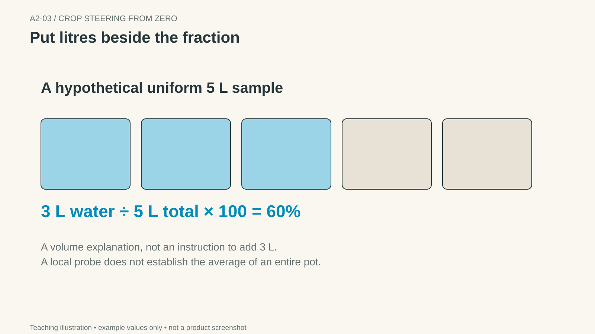

**Proposed time:** 01:09–01:37 · **Camera:** Graphic, one calculation

**Action:** Reveal 5 L total, then 3 L water, then the equation.

**On-screen text:** 3 L ÷ 5 L × 100 = 60%

**Accuracy/staging:** This is a hypothetical uniform sample, not an instruction to water.

**Narration:**

If an evenly represented five-litre sample were at sixty percent VWC, three litres of that total volume would be water. Five multiplied by zero point six is three. That is a volume explanation, not an instruction to add three litres to a five-litre pot.

### A2-04 — The probe sees a region

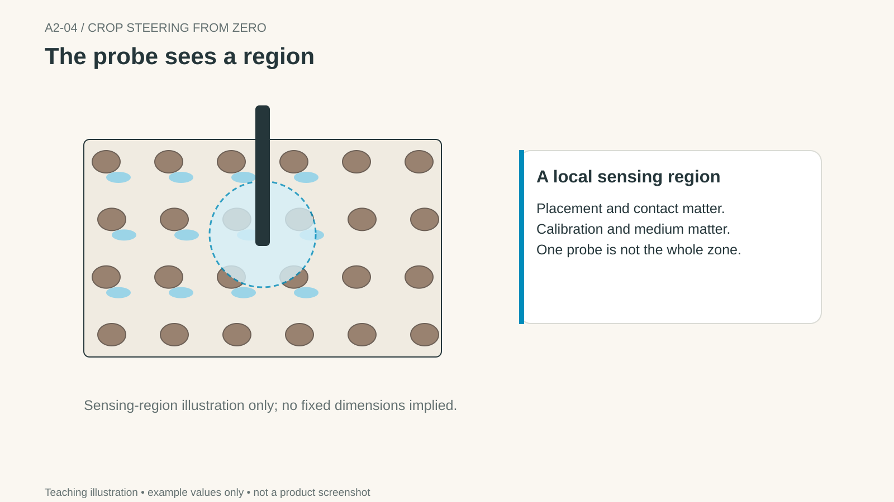

**Proposed time:** 01:37–02:49 · **Camera:** Probe-region graphic with answer reveal

**Action:** Explain solids/air and usable-water misconceptions before showing local sensing.

**On-screen text:** Local reading ≠ entire zone

**Accuracy/staging:** Do not imply a real probe has this exact sensing radius.

**Narration:**

Here is the important question. If sixty percent is water, is the other forty percent all air?
[Pause.]
No. The rest includes solid material as well as air. The reading alone does not give us a full measurement of the air space.
And sixty percent VWC does not mean the plant has sixty percent of its usable water left. Some water is held more tightly than other water. Different media behave differently. This number is not a fuel gauge showing exactly how long the plant can go without irrigation.
Look at where the probe sits. It senses a local region. Contact with the medium, installation, calibration and location affect what the number means. A reading near one emitter might not represent a dry pot at the end of a row. Later we’ll check whether our locations represent the zone.

### A2-05 — Teach it back

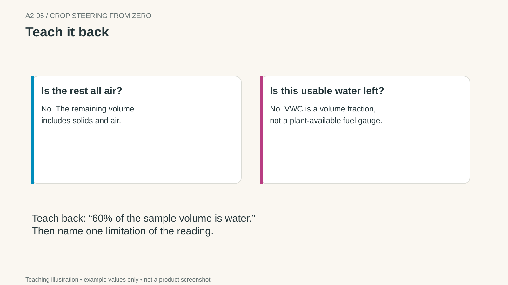

**Proposed time:** 02:49–04:09 · **Camera:** Question/answer cards

**Action:** Ask whether 40% is automatically dry, then invite the learner sentence.

**On-screen text:** What does 60% mean?

**Accuracy/staging:** No universal target. Pause before each answer.

**Narration:**

Now imagine a reading of forty percent. Is that automatically too dry?
[Pause.]
We don’t have enough information. We need the medium, its validated references, the crop and the conditions. There is no universal VWC number that means ‘perfect’ for every system.
For now, don’t try to pick a target. Practise explaining the measurement. Complete this sentence: ‘Sixty percent VWC means…’
[Pause.]
One good answer is: ‘About sixty percent of the measured sample’s total volume is water.’ Add: ‘That doesn’t tell me the exact usable water left for the plant, and one sensor doesn’t prove the whole zone is the same.’
Keep that sentence. It will stop a lot of confusing advice from sounding more certain than it is. In the next lesson, we’ll see why ‘a full pot’ and ‘one hundred percent VWC’ are not the same thing.”

## A3 — When is a pot full? Capacity versus saturation

### A3-01 — What does full mean?

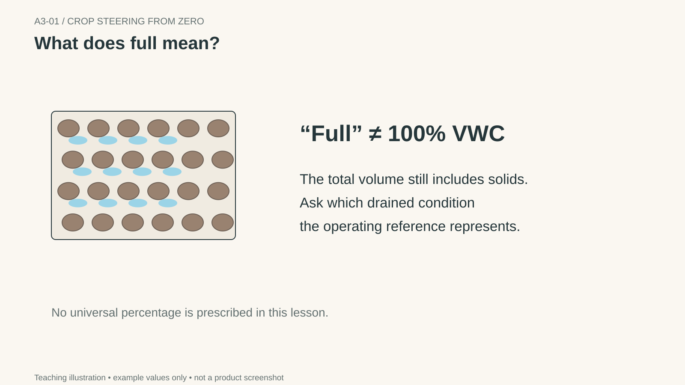

**Proposed time:** 00:00–00:28 · **Camera:** Teaching graphic, no dashboard

**Action:** Ask the question and recall the solid fraction.

**On-screen text:** Full of what?

**Accuracy/staging:** Do not equate useful capacity with 100% VWC.

**Narration:**

“When someone says ‘bring the pot back to full,’ full of what?
Last lesson we saw that VWC measures water as a fraction of the total sample volume. The sample also contains solid material. So a properly watered container does not need to read one hundred percent VWC.

### A3-02 — Saturation is a physical state

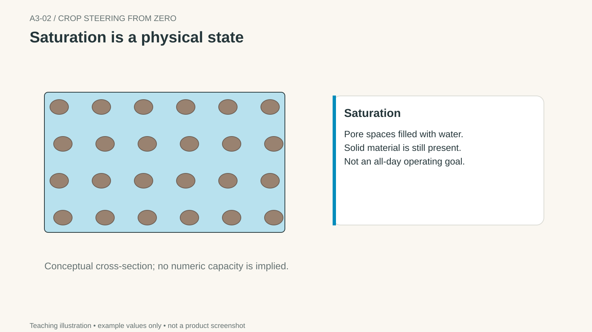

**Proposed time:** 00:28–00:53 · **Camera:** Conceptual cross-section

**Action:** Show water in pores while solids remain visible.

**On-screen text:** Pores full of water

**Accuracy/staging:** Not a recommended all-day condition.

**Narration:**

Let’s separate two physical states. First is saturation. In this simplified drawing, the pore spaces are filled with water. The solid medium is still here. Saturation is not a goal to maintain around roots all day.

### A3-03 — Observe drainage

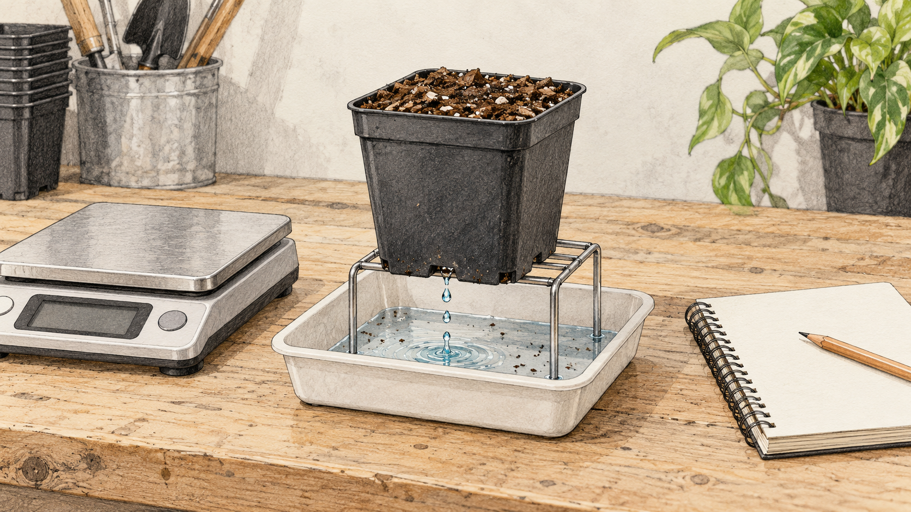

**Proposed time:** 00:53–02:32 · **Camera:** Bench close-up with inserts

**Action:** Watch drainage; cut to notebook/weight only as supporting observations.

**On-screen text:** Define and repeat your method

**Accuracy/staging:** Record conditions and elapsed time; no universal drainage interval.

**Narration:**

Now look at this spare pot over a tray. Water can drain away. After a defined drainage procedure, some water remains held in the medium and some air space has returned. The amount retained depends on the medium and container conditions, including container height.
For containers, the useful term is container capacity. You may hear growers call their operating reference ‘field capacity,’ and you will see field-capacity wording in the program. Field capacity originally describes a field-soil condition; a pot or block is a different physical setup. In this course, always ask what drainage method and reference the grower actually means.
We are not going to announce that every pot finishes draining after the same number of minutes. Use a documented method suitable for your medium and system. Record the container, medium, starting condition, drainage interval and probe setup. Repeat the check. If results vary, investigate before treating one number as a reliable reference.
A useful demonstration can include weight and visible drainage alongside a suitable sensor reading. None of those excuses poor sensor contact or an unrepresentative probe location.

### A3-04 — Physical state or entered setting?

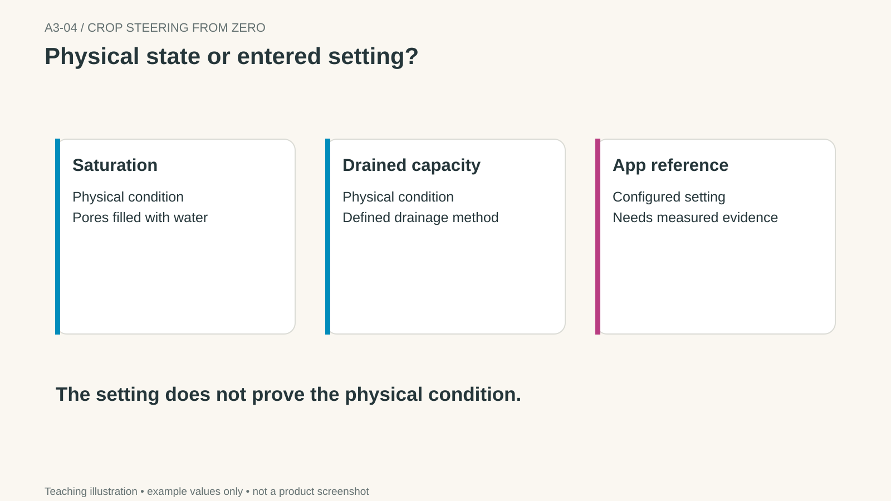

**Proposed time:** 02:32–02:54 · **Camera:** Three-card graphic

**Action:** Separate saturation, drained capacity and software reference.

**On-screen text:** A reference needs evidence

**Accuracy/staging:** A field in the app is not proof of correct measurement.

**Narration:**

Here is the third thing to separate: the setting in the dashboard. A configured field-capacity reference is a number someone entered. Its presence on the screen does not prove the medium was measured correctly.

### A3-05 — An example is not your target

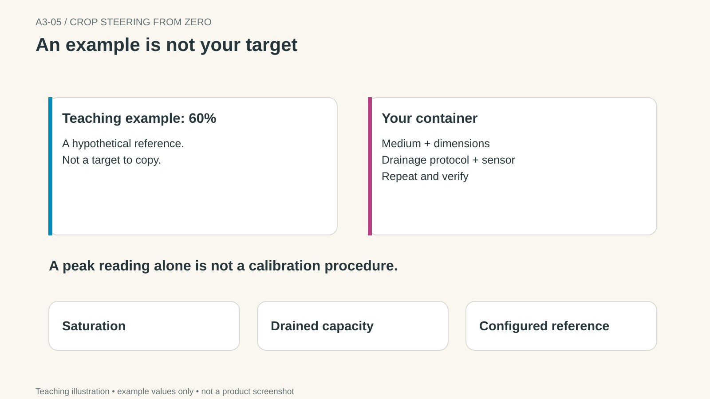

**Proposed time:** 02:54–04:28 · **Camera:** Question, then card-sort activity

**Action:** Pause, reject target copying, sort the cards and hand off to dryback.

**On-screen text:** Example only — not a recipe

**Accuracy/staging:** Retain medium/container/protocol context; do not adopt highest-ever reading.

**Narration:**

Imagine our teaching example uses sixty percent as a reference. Does your medium now need the same number?
[Pause.]
No. That number belongs to an example. Your reference needs evidence for your medium, container and measurement method. It is also not automatically the highest reading the sensor has ever shown. A temporary peak, poor contact or an implausible reading is not a calibration procedure.
Before the next lesson, arrange these three cards. One: saturation, where pore spaces are filled with water. Two: drained container capacity under stated conditions. Three: the software's configured reference. Say which are physical conditions and which is a setting.
[Pause and reveal.]
Saturation and drained capacity describe physical conditions. The configured reference is a setting intended to represent a useful measured condition. Keeping those separate helps us avoid turning a guess into an instruction to irrigate.
Next, we’ll look at water content falling between events. That’s dryback—and we’ll learn why a drop of fifteen percentage points is not the same as fifteen percent relative dryback.”

## B1 — Read water and EC on the same graph

### B1-01 — Start with time

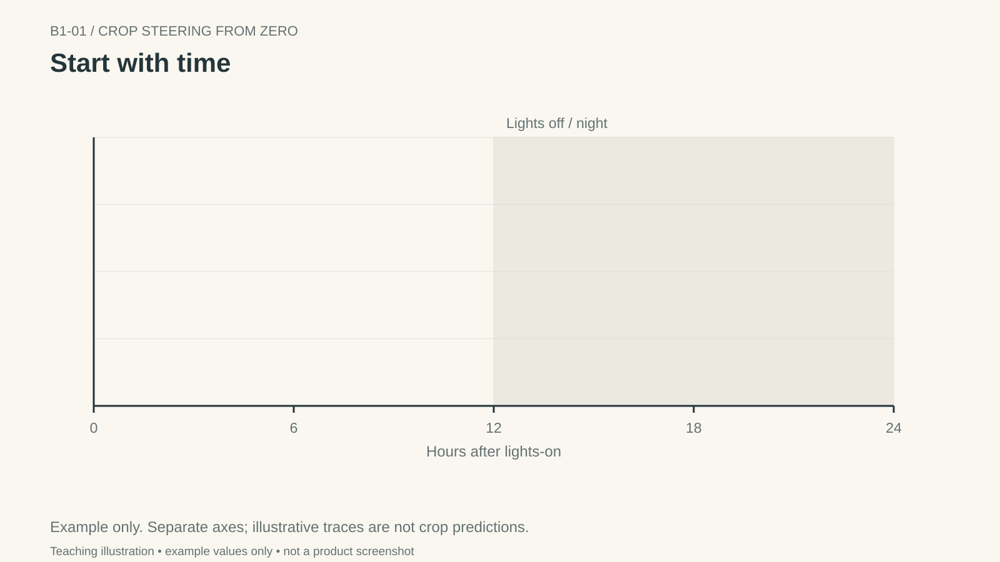

**Proposed time:** 00:00–00:27 · **Camera:** Progressive graph, static axes

**Action:** Reveal time and night shading before any data.

**On-screen text:** Time moves to the right

**Accuracy/staging:** Elapsed hours after lights-on, not arbitrary clock hours.

**Narration:**

“A graph can look complicated because it shows several questions at once. Let’s build this one slowly.
Along the bottom is time. Moving right means later. The shaded area is the night period in this example. It does not mean the sensor stopped measuring.

### B1-02 — Add water content

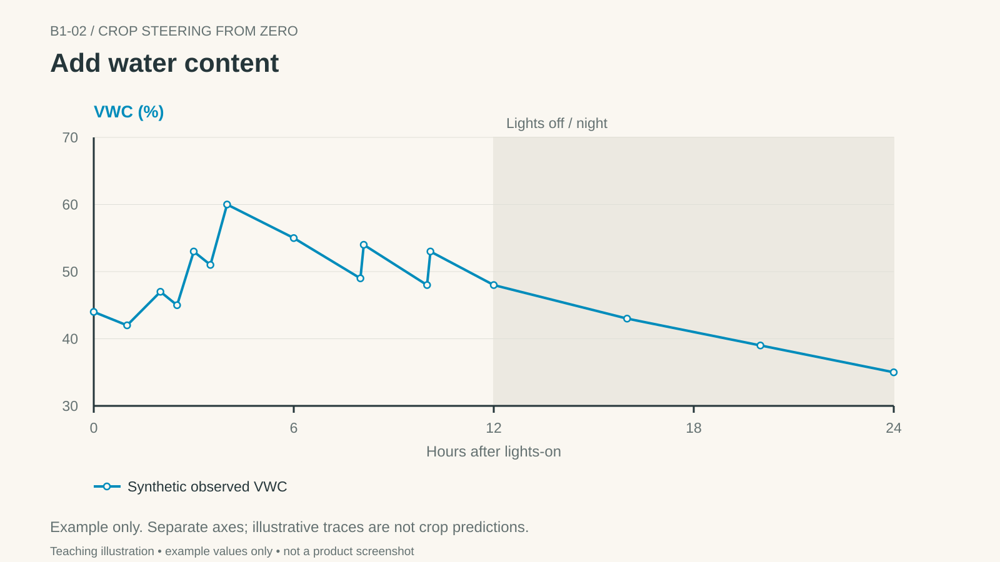

**Proposed time:** 00:27–00:56 · **Camera:** Graph, point highlight

**Action:** Reveal the blue VWC trace and its left-hand scale.

**On-screen text:** VWC uses the left axis (%)

**Accuracy/staging:** Synthetic teaching data, not a private grow capture.

**Narration:**

First, add the water-content line. Read it against the VWC scale on the left. This point says the measured water content was sixty percent at that time. The solid line joins example observations. In a live system, always check how fresh the readings are and whether there are gaps.

### B1-03 — Add EC and a second scale

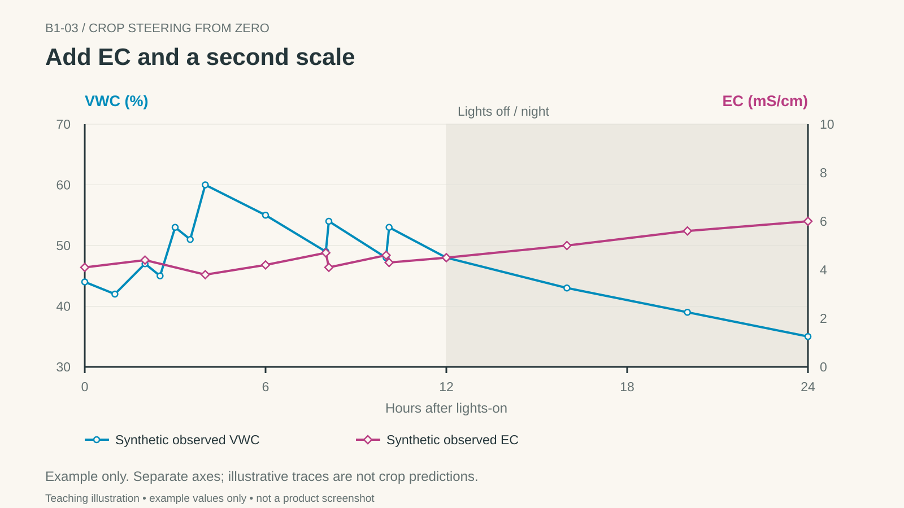

**Proposed time:** 00:56–01:42 · **Camera:** Graph, alternate axis highlights

**Action:** Reveal EC with its own scale; ask about crossing lines.

**On-screen text:** EC uses the right axis (mS/cm)

**Accuracy/staging:** Name the actual measurement type when filming; never silently rename bulk EC.

**Narration:**

Now add EC, using the scale on the right. The unit here is millisiemens per centimetre. Check which EC measurement is actually mapped: feed, bulk substrate and pore-water EC are not interchangeable labels.
If the water and EC lines cross on the screen, does that mean the values are equal?
[Pause.]
No. They use different units and different scales. Their position shows each quantity changing over time. You cannot subtract one line from the other.

### B1-04 — Events, observations and references

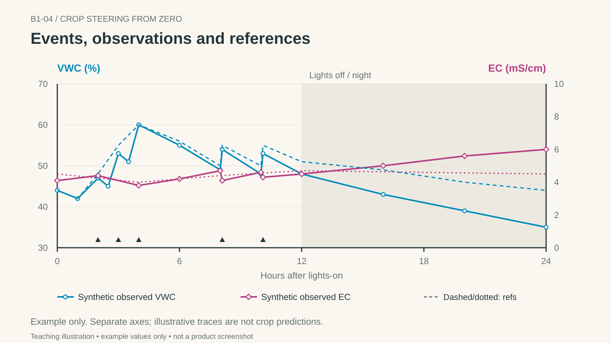

**Proposed time:** 01:42–02:39 · **Camera:** Graph, reveal one layer at a time

**Action:** Add event triangles, then clearly dashed references.

**On-screen text:** Observed ≠ reference

**Accuracy/staging:** A plausible shape is not proof of cause or a crop forecast.

**Narration:**

These markers show irrigation events. Water content may rise after water reaches the probe, then fall between events. EC can change too, but it does not have to form a perfect opposite image of water content. Delivery, mixing, drainage, temperature, the measurement method and the crop all matter. A line alone does not prove why something changed.
Next we add a reference. This is the shape the planning view illustrates from the chosen settings. A measured trace tells us what was observed; a reference tells us what the software is illustrating. They need different labels even if they happen to sit on top of each other.

### B1-05 — Continue into night; move a threshold

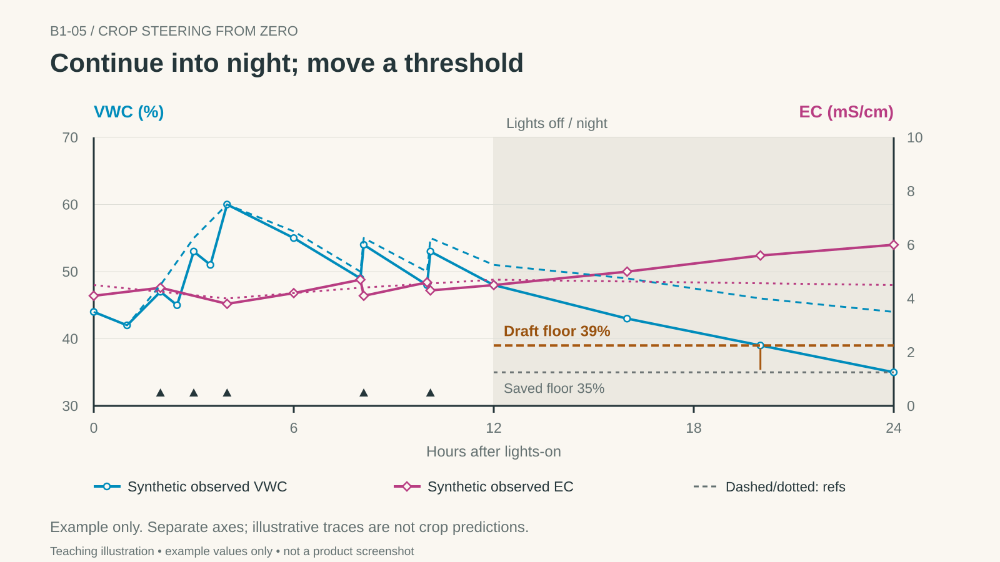

**Proposed time:** 02:39–03:45 · **Camera:** Graph, then version-checked demo capture

**Action:** Follow continuous references into morning; animate only the draft floor upward.

**On-screen text:** Draft floor moves; observations stay

**Accuracy/staging:** Dashed overnight EC joins references. The saved floor remains for comparison.

**Narration:**

Follow the reference into the night. It should continue into the next morning's reference rather than appearing to jump across an unexplained gap. That continuity makes the day readable. It does not turn the line into a validated prediction of tomorrow's crop.
There is a particular trap with the overnight EC reference. The program joins the last daytime reference to the next morning's reference. It is not a separately scheduled P3 EC target or a calculation proving how the salts will behave overnight.
Now watch this demo edit. We raise the P3 emergency VWC floor in the local draft. Its threshold line moves immediately. The saved reference is still visible for comparison. The measured example crop does not move just because we moved a threshold.

### B1-06 — Explain what changed

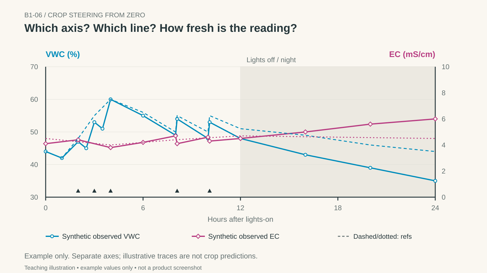

**Proposed time:** 03:45–04:38 · **Camera:** Question hold, then graph labels

**Action:** Ask the three-way question, reveal the answer and complete axis checks.

**On-screen text:** A draft, not a guaranteed shot

**Accuracy/staging:** Keep review/apply/readback separate. Do not imply historical values moved.

**Narration:**

What did we change: yesterday's water content, the local draft of a safety threshold, or a guaranteed irrigation event?
[Pause.]
The local draft of a threshold. Applying reviewed changes is a separate action. Whether irrigation occurs depends on the controller's conditions and protections. This floor is not an ordinary overnight target to chase.
Your task: point to the time, VWC scale, EC scale, one irrigation marker and one reference. Then find the reading's age. Next, we’ll build the P0 to P3 day so those phase labels have a purpose.”

## C1 — What you need: the smallest useful system

### C1-01 — Five functions, not a shopping spree

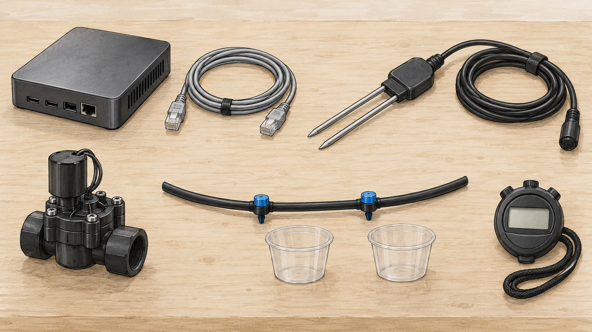

**Proposed time:** 00:00–00:31 · **Camera:** Overhead equipment lay-flat

**Action:** Reveal the functions before discussing brands.

**On-screen text:** Host · measure · deliver · control · prove

**Accuracy/staging:** Illustrative props, not a tested model-specific shopping cart.

**Narration:**

“You don’t need to buy everything you have ever seen on a grow dashboard. Start with one zone and five functions: something to run the program, a way to measure water content, a way to deliver water, a way to control it, and a way to make it safe and prove it works.

### C1-02 — Host and measurement paths

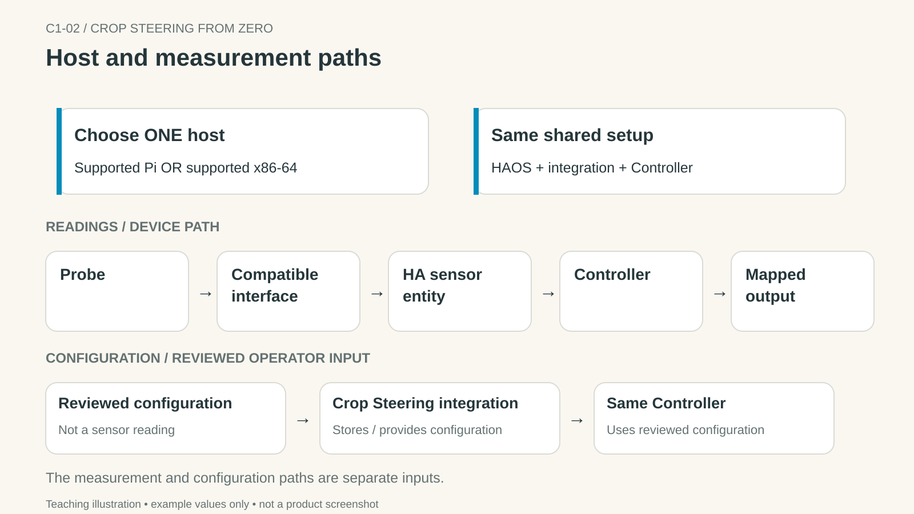

**Proposed time:** 00:31–02:09 · **Camera:** Graphic with equipment inserts

**Action:** Introduce either host, HA entities, both program components and identified sensors.

**On-screen text:** Choose one host; verify the probe

**Accuracy/staging:** EC type matters. A compatible interface is not proven calibration.

**Narration:**

First is the host. In this course you can use a supported Raspberry Pi installation or a supported dedicated Intel NUC or other x86-64 computer. You only need one route. It needs the right power supply, storage and a reliable network. The next two videos are alternatives; you do not have to watch both.
Home Assistant connects devices and gives their readings and controls names called entities. Crop Steering uses those readings and controls. The Crop Steering integration and the separate Controller app are both part of the setup. Installing a dashboard alone does not make a watering controller.
Second is measurement. Start with a compatible moisture probe installed in a representative place. Verify the exact sensor, interface, units and medium suitability. Some probes need a separate bridge. Matching wire colours is not a compatibility test. A working probe in one pot also does not prove all the pots get equal water.
Root-zone EC is useful for the complete water-and-EC picture, but it is a different measurement. Identify whether a sensor gives bulk or pore-water EC. A tank's feed EC cannot just be renamed as root-zone EC. Air temperature and humidity help explain demand too.

### C1-03 — Draw the actual water path

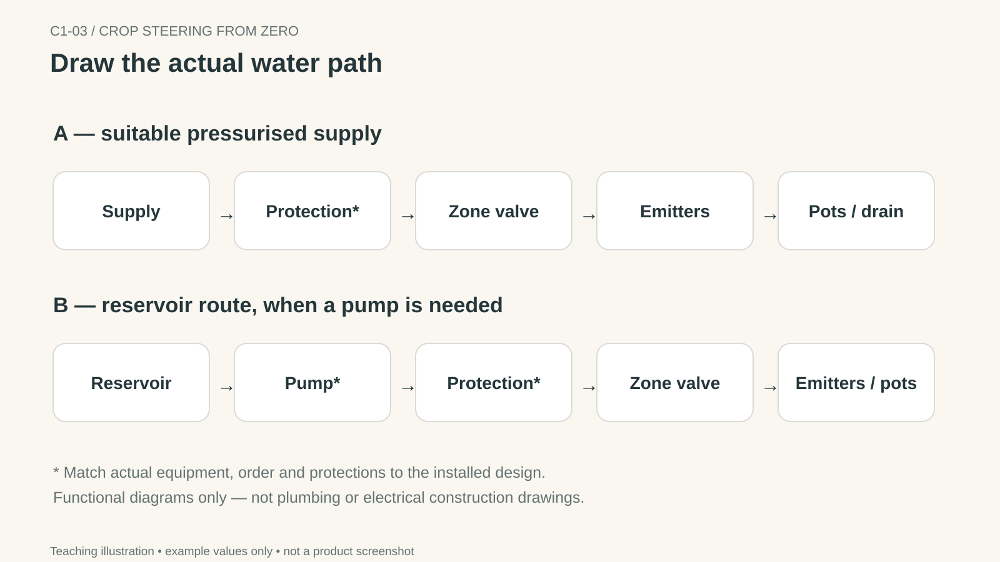

**Proposed time:** 02:09–02:44 · **Camera:** Two functional diagrams

**Action:** Show pressurised supply separately from a reservoir/pump path.

**On-screen text:** A pump is conditional

**Accuracy/staging:** Installed order/protections must be designed for the actual equipment.

**Narration:**

Third is the water path. If you already have a suitable pressurised supply, you might control a zone valve without adding a pump. If you use a reservoir and need a pump, the design must include that pump and its protections. Filtration, pressure regulation, drainage and backflow or siphon protection must suit the actual equipment and local requirements.

### C1-04 — Safe control and proof

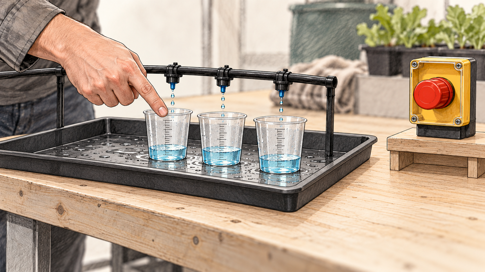

**Proposed time:** 02:44–03:52 · **Camera:** Catch-test close-up; separate dry control insert

**Action:** Explain rated controls, one owner per output, catch volumes and physical shutdown.

**On-screen text:** Measure delivery. Prove stopping.

**Accuracy/staging:** No mains demonstration. Illustrative stop prop does not certify protection; keep controls dry.

**Narration:**

Fourth is safe control. Use correctly rated, appropriately installed hardware. A pump's starting load matters. Do not assume a household smart plug is suitable because its headline watt rating looks big enough. Have the appropriate competent installer handle electrical work. We are not doing mains wiring in this course.
Only one controller should own each physical pump or valve. If an old irrigation system can still trigger the same valve, resolve that before enabling the new controller.
Fifth is proof and protection. Have accessible physical shutdown, suitable independent protection and a safe place for test water. Software OFF is not your emergency isolator. We use catch cups and a stopwatch to check delivery, then observe that water actually stops. A changed icon is not enough.

### C1-05 — Essentials, conditional, later

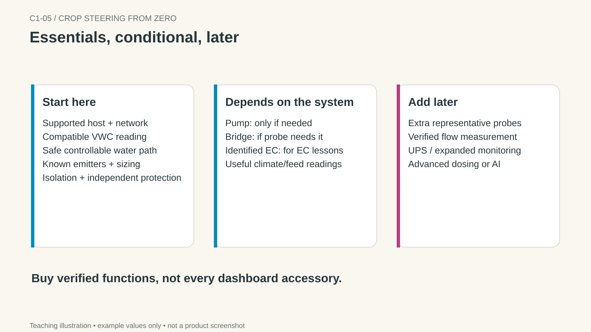

**Proposed time:** 03:52–04:15 · **Camera:** Three-column graphic

**Action:** Place additional monitoring and advanced features in context.

**On-screen text:** Build one proven zone first

**Accuracy/staging:** Do not describe AI/dosing/thermal cameras as beginner requirements.

**Narration:**

Tank level, feed EC, pH and temperature monitoring can make operation easier. More probes and a verified flow meter can help later. Automated dosing, thermal cameras and AI are not requirements for your first working zone.

### C1-06 — Your own layout

**Proposed time:** 04:15–05:11 · **Camera:** Overhead learner worksheet

**Action:** Pause for drawing; circle unknown functions and choose a host route.

**On-screen text:** Sketch · label · check

**Accuracy/staging:** Use exact-model compatibility sheet before buying or energising.

**Narration:**

Pause and draw your water path. Label the supply, any pump, the zone valve, the emitters and the drainage. Then draw the probe and the controller separately. Circle anything you cannot yet identify, especially the physical shutdown and who owns each output.
[Allow drawing pause.]
Use the equipment sheet to check exact models before buying. Next, choose either the Pi or the x86-64 host video. After that, both routes rejoin. We’ll install, map and prove one zone before expanding.”
