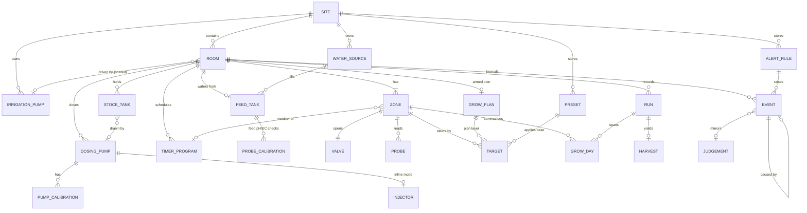
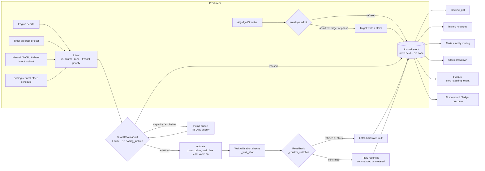
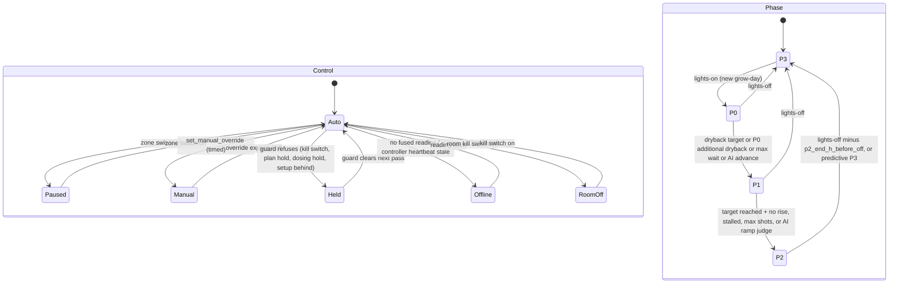
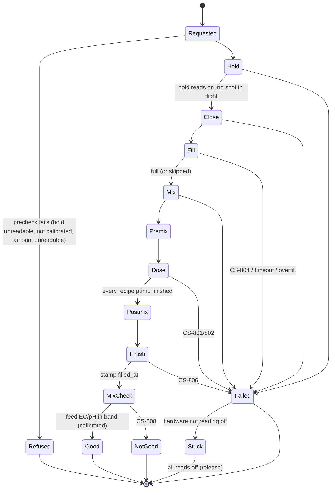
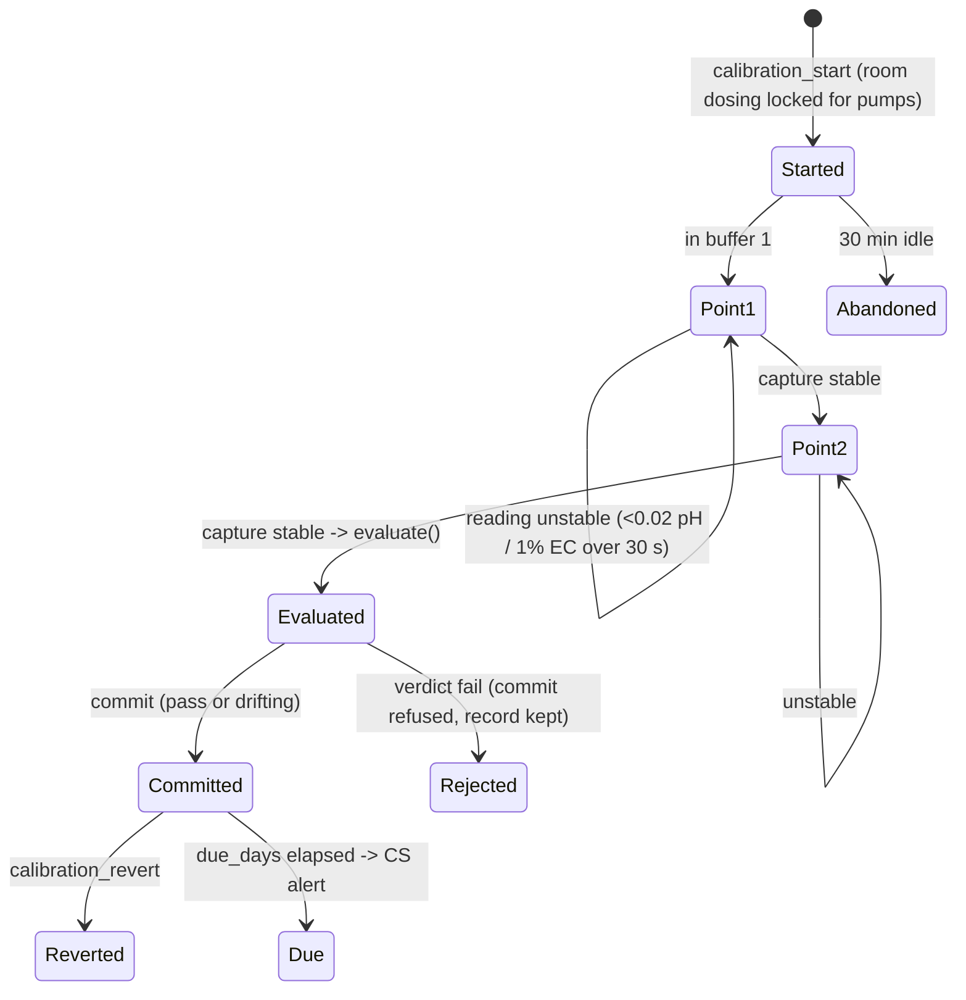
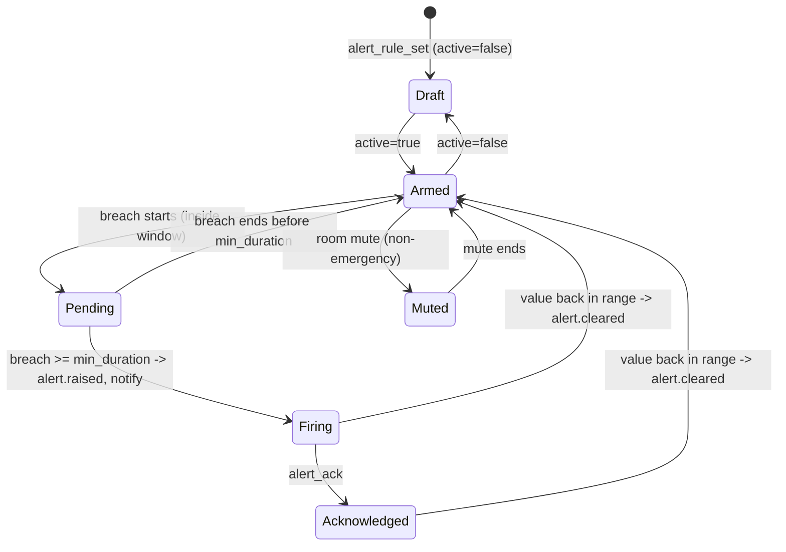

# HA-IS unified schema: Intent → Guard → Act → Prove → Record

Status: design spec, 2026-10-22. Scope: the irrigation and fertigation domain of HA-Irrigation-Strategy (integration, f2_control controller, engine, frontend) and the contract AiGrow consumes. Users/roles, tasks, IPM, compliance and climate *control* stay in AiGrow; climate *readings* are inputs only.

Grounded in: `custom_components/crop_steering/{const,room,setup_api,strategy,strategy_model,run_store,grow_day_store,harvest_store,setpoint_log,overlays,calibration,dosing,dosing_api,stock,stock_api,notify_api,notify_catalog,plumbing}.py`, `services.yaml`, `addons/f2_control/f2_control/{controller,dosing_runner,safety_ops,shot_audit,auto_setpoints,setpoint_supervisor,tank_level,zone_history}.py`, `brain/{ledger,envelope,powers}.py`, `crop-steering-engine/src/crop_steering_engine/core.py`, `docs/{ENTITIES,DOSING,MCP,SYSTEM_OVERVIEW}.md`, and the parity plan `docs/archive/superpowers/plans/2026-10-22-growlink-aroya-parity.md` (G1–G17).

Names in `code` exist today. Names marked **NEW** do not exist yet.

---

## 1. The idea in one paragraph

Today HA-IS already has every hard part: a pure `decide()`, a long chain of fail-closed checks in `_execute_shot`, read-back on every switch, a claim event that says who wrote a setpoint (`crop_steering_setpoint_write`), and a ledger for AI verdicts. The parts are scattered, though. Each feature keeps its own history: `setpoint_log`, stock `history`, dosing `history`/`last_batch`, calibration history, the brain `Ledger`, `activity_log.feed`, `shot_log_app`, `zone_history`. Each feature also sends its own hardware path through checks it picked for itself. The core idea is to make the shape the code already follows into the contract: **every program produces an Intent, every Intent passes one ordered Guard chain, every actuation is Proven by read-back, and every outcome (admitted, held, refused, done, failed) becomes one Event in one per-room Journal.** Programs share one **Target** model: the engine, grow plans, presets, timer programs, the learner and the AI all read and write the same canonical keys (`strategy_model.PARAMETERS`). Targets have exactly two overlay layers, the armed plan snapshot and the expiring AI overlay, which are the two that already exist. Every feature in G1–G17 that sounds new is a fold over the Journal: the timeline (G5), change history (G8), flow reconciliation (G4), the alert inbox (G6), stock drawdown, the AI scorecard, and run comparisons. So the parity work is mostly new *readers* of one stream plus three new *producers*: timer programs, threshold rules and the calibration wizard. It is not twelve new subsystems. The engine stays pure, the integration still never touches hardware, and the controller still drives everything. What changes is that "what happened, why, by whom and was it proven" has exactly one answer.

Three invariants follow, and they are non-negotiable:

1. **No actuator moves except through `GuardChain.admit()`.** This covers shots, rescues, flushes, test shots, timer shots, doses, batches, primes and calibrations.
2. **No event without a source.** Every Event names the actor (`engine|timer|plan|manual|ai|learner|safety|mcp|aigrow|automation|system`) and carries correlation ids back to the Intent, Program, plan revision and proposal token.
3. **No write counts until it is read back.** Setup, plan, preset, calibration commit and actuator writes all report `readback: verified|refused|unread`. This extends the `apply_proposal` and `_confirm_switches` semantics to everything.

---

## 2. Domain model

### 2.1 Ownership rules (unchanged and made explicit)

| Layer | Owns | Persistence |
|---|---|---|
| Integration (`custom_components/crop_steering`) | Configuration, Programs, Targets (as `number.*` entities), Records, the Journal store, threshold-rule evaluation, notification routing | HA `Store` per room (`crop_steering.<thing>.<entry_id>`); site store `crop_steering.notify`; **NEW** site store `crop_steering.site`; **NEW** SQLite journal |
| Controller (`f2_control`) | Live state (phase, peak, counters, in-flight), the Guard chain, actuation, read-back, CS-coded alerts, AI judges + `Ledger` | `/data/state.json`, `/data/dosing_state.json`, `/data/ledger.jsonl`; **NEW** `/data/journal_outbox.jsonl` |
| Engine (`crop_steering_engine`, vendored in both) | Pure decisions (`decide`, `waiting_for`, `validate_params`); **NEW** pure `timers.project()`, `guards` arithmetic, `flow.reconcile()` | none |
| Frontend (`frontend/src`) | Nothing authoritative. It renders projections returned by services. | browser `localStorage` for view prefs only |

The controller → integration channel stays REST: it reads published descriptors (`sensor.crop_steering_<px>engine_config`, `…dosing_config`) and calls response services (`ha_service_response`). Integration → controller stays "publish a descriptor and let the controller adopt it by revision".

### 2.2 Identity

| Thing | Id format | Source |
|---|---|---|
| Site | `site:<ha instance uuid>` | HA `core.uuid` |
| Room | `room:<prefix>` (`room:` = default room, `room:f2_` …) | existing `room_prefix(entry)`; config entry = room |
| Zone | `<room_id>/zone:<n>` (n = 1..24) | existing int zone keys |
| Probe | the HA `entity_id` | existing (zone `vwc_sensors`/`ec_sensors`) |
| Irrigation pump, main line, valve | the switch `entity_id` (site-unique; two rooms mapping the same entity **share** it) | existing `pump_switch`, `main_line_switch`, `zone_switch` |
| Dosing pump | `<room_id>/pump:<slug>` | existing `dosing._pump` id (`^[a-z0-9_]{1,24}$`) |
| Stock tank | `<room_id>/stock:<id>` | existing stock tank id |
| Feed tank | `<room_id>/tank:main` (**NEW** id; today the implicit batch tank) | |
| Program, rule, preset, calibration session | ULID | **NEW** |
| Event | ULID + per-room monotonic `seq` | **NEW** |
| Run | existing run uuid | `run_store` |

### 2.3 Place hierarchy: Site → Room → Zone → Probe

**Site** (**NEW** store `crop_steering.site`, integration)

| Field | Type | Notes |
|---|---|---|
| `id` | str | `site:<uuid>` |
| `schema_version` | int | starts at 2 (v1 = today's scattered stores) |
| `units` | `{ec: "mS/cm"\|"ppm500"\|"ppm700", temp: "C"\|"F", volume: "L"\|"gal", clock: 12\|24}` | display only (G15). The API is always canonical. |
| `irrigation_pumps` | `IrrigationPump[]` | site-wide because pumps are shared across rooms (G1) |
| `water_sources` | `WaterSource[]` | optional |
| `presets` | `Preset[]` | G10, moved from browser-local |
| `alert_rules` | `AlertRule[]` | G6. Room-scoped by field, stored site-wide like `notify`. |
| `revision` | int | optimistic concurrency, like every store |

**Room** (config entry + `engine_config` descriptor; integration)

| Field | Type / unit | Existing source |
|---|---|---|
| `id`, `name`, `slug`, `prefix` | str | `room_prefix`, `room_name`, `room_slug` |
| `active` | bool | setup `active` |
| `kill_switch` | entity_id | `room.resolve_gate` (Engine Enabled / `LEGACY_KILL_SWITCH`) |
| `setup_revision` | int | `setup_revision` |
| `plumbing` | `valves_only\|pump_valves\|mainline_valves\|pump_mainline_valves` | `plumbing.PLUMBING_LAYOUTS` |
| `pump` | → IrrigationPump id | `hardware.pump_switch` |
| `main_line` | entity_id | `hardware.main_line_switch` |
| `waste_valve` | entity_id | `hardware.waste_switch` |
| `lights` | `{entity, on_hour, off_hour}` | `light_entity`, `lights_on_hour`/`lights_off_hour` |
| `substrate` | `generic\|rockwool\|coco` | `SUBSTRATES` |
| `drainage` | `unknown\|flood_table\|free_drain` | `DRAINAGE_TYPES` |
| `feed_tank` | → FeedTank | tank hardware keys |
| `climate_inputs` | `{temperature, humidity, vpd, leaf_temperature, co2, ppfd, dli}` entity_ids | read-only; climate control is AiGrow's |
| `hvac_units` | ≤12 entity_ids | runoff estimator inputs, read-only |
| `ai_powers` | map key→bool | `AI_POWERS` switches |
| `modes` | `{steering: Vegetative\|Generative, runoff_estimator, shot_check, no_touch, setpoint_step_scope}` | selects |

**Zone** (setup `zones[n]` + per-zone entities; live state in controller `room.state[n]`)

| Field | Type / unit | Owner |
|---|---|---|
| `id`, `n`, `name`, `cultivar`, `active` | | integration setup |
| `valve` | entity_id | setup `zone_switch` |
| `exclusive_group` | str\|null | **NEW** (G1): zones in one group never run together |
| `irrigation_mode` | `steering\|timer\|off` | **NEW** `select.crop_steering_<px>zone_N_irrigation_mode` (G7); default `steering` |
| `sizing` | `{plant_count:int, substrate_volume:L, drippers_per_plant:int, dripper_flow_rate:L/h}` | setup `SIZING` |
| `probes` | `Probe[]` (vwc, ec, temperature) | setup `vwc_sensors`/`ec_sensors`/`substrate_temperature_sensor` |
| `fusion` | `{vwc_method, ec_method: Median\|Average\|Lowest\|Highest, vwc_primary, ec_primary, vwc_unused[], ec_unused[]}` | `PROBE_METHODS`, `PROBE_CHOICE` |
| `flow_meter` | entity_id\|null | **NEW** (G4); falls back to the room meter |
| `live` | `ZoneLive` | controller `/data/state.json` |

**ZoneLive** (controller, published as `sensor.*_zone_N_*_app`): `phase P0..P3`, `control` (see §6.1), `vwc %`, `vwc_settled %`, `ec mS/cm`, `ec_settled`, `peak_vwc %`, `dryback_pct` (relative % of peak), `dryback_rate %/h`, `shot_count`, `daily_vol L`, `minutes_since_shot`, `p1_reached`, `p1_flat_shots`, `ec_flushing`, `backed_up`, `auto_setpoints {state, learned_peak, gain}`, `cwsi`, `safety_status`. These are the engine's `ZoneSnapshot` fields plus publish-only extras. Nothing here is new. ZoneLive is named so AiGrow can read one object instead of 25 entities.

**Probe** (setup + **NEW** per-probe calibration)

| Field | Type | Notes |
|---|---|---|
| `entity_id` | str | identity |
| `quantity` | `vwc\|ec\|temperature\|ph` | |
| `ec_type` | `unknown\|pore\|bulk` | `EC_TYPES` (CS-504 forbids mixing) |
| `offset` | float, unit of quantity | **NEW** (G9) user offset, audited |
| `curve` | `{kind: none\|linear\|quadratic, a, b, c, preset: rockwool\|soilless}` | **NEW** (G9); raw→VWC only where raw permittivity is exposed |
| `health` | `ok\|silent\|stuck\|out_of_range\|far` | fusion/probe health (CS-1xx, `PROBE_FAR`, `PROBE_STALE_SECONDS`) |
| `transport` | `ha\|esphome\|modbus\|4_20ma` | **NEW** metadata only (G13). Everything still enters through an HA entity. |

Corrected value = `curve(raw) + offset`. Fusion keeps its own internal step-free offsets on top. Published as **NEW** `sensor.<probe_object_id>_corrected` only when an offset or curve is set, so existing installs publish nothing new.

### 2.4 Supply side: Water source → Feed tank → Stock tanks → Pumps/Injectors → Valves

**WaterSource** (**NEW**, site, optional): `id`, `kind: ro|mains|well|rain`, `ec_sensor`, `ph_sensor`, `fill_valve` (today `dosing.batch.fill_valve`). It feeds FeedTanks.

**FeedTank** (room; today implicit)

| Field | Type / unit | Existing source |
|---|---|---|
| `id` | `<room>/tank:main` | **NEW** id |
| `capacity_l` | L | tank estimate size (`safety_ops`) |
| `level` | `{distance_sensor, full_mm, empty_mm, low_float, float_low_state}` | `TANK_LEVEL_FIELDS` |
| `min_pct` | % | reservoir minimum (8/12 %) |
| `overfill_pct` | % | 102 % cutoff |
| `feed_ec_sensor`, `feed_ph_sensor`, `tank_ec_sensor`, `tank_ph_sensor`, `tank_temperature_sensor` | entity_ids | hardware keys |
| `calibration` | `{feed_ph, feed_ec}` → active ProbeCalibration | `calibration.PROBES`; **NEW**: applied |
| `bands` | `{ec: [lo,hi] mS/cm, ph: [lo,hi]}` | irrigation EC/pH bands (mix check CS-808) |
| `last_fill` | ts | `tank_last_fill_sensor` |
| `drawdown_l_per_pct` | L/% | learned (`tank_level.py`) |

**StockTank** (`crop_steering.stock.<entry_id>`, unchanged): `id`, `name`, `volume_ml`, `low_pct`, `pump` → DosingPump, `per_batch_ml`/`dose_entity`, `refilled_at`. Drawdown = Σ `dose.given_ml` events (already true via `stock_draw`).

**DosingPump** (`crop_steering.dosing.<entry_id>.pumps[]`; extended)

| Field | Type / unit | Status |
|---|---|---|
| `id`, `name`, `volume_entity`, `start_entity`, `dosing_entity`, `power_entity`, `flow_entity`, `max_ml` | | existing |
| `role` | `nutrient\|ph_up\|ph_down\|additive` | existing `PH_ROLES` generalised to **NEW** `solution_type` |
| `model` | `{catalog_id, dial}` → `nominal_ml_min` | **NEW** (G3) pump catalogue (e.g. H.E. Anderson A3/P1/P2/H4) |
| `calibrated_ml_min` | mL/min | **NEW** stored value; `flow_entity` stays as an override for back-compat |
| `calibrations` | `PumpCalibration[]` (≤30) | **NEW** |
| `primed_at` | ts | **NEW** |
| `mode` | `batch\|inline` | **NEW** (G12); default `batch` |
| `inline_ratio_ml_per_l` | mL/L | **NEW** (G12) |

**IrrigationPump** (**NEW** explicit; site store, keyed by `pump_switch` entity)

| Field | Type / unit | Notes |
|---|---|---|
| `entity_id` | str | identity; shared across rooms when mapped twice |
| `max_flow_lph` | L/h | capacity |
| `max_concurrent_zones` | int, default **1** | Today the controller is synchronous, so shots are already serial. Default 1 reproduces that exactly. |
| `prime_s`, `main_line_lead_s` | s | today per-zone `pump_prime_time`, `main_line_lead_time` numbers; stay per-zone overrides |
| `flow_meter` | entity_id\|null | G4 room/line meter |

**Valve** = zone `valve` + `exclusive_group`. Worst-case demand per zone = `plant_count × drippers_per_plant × dripper_flow_rate` (L/h, the existing hydraulic formula). `setup_save` rejects a config whose largest concurrently-allowed zone sum exceeds `max_flow_lph`.

**Injector** (**NEW**, G12, model only until hardware exists): `id`, `pump` → DosingPump in `inline` mode, `mix_delay_s`, `monitor: {ec_sensor, ph_sensor, tolerance_ec, tolerance_ph}`, `air_pressure_sensor?`, `abort_action: flush|stop`.

### 2.5 Programs: what produces Intents

| Program | Stored in | Produces | Status |
|---|---|---|---|
| **SteeringProgram** | per-zone `number.*`/`select.*` + `p2_mode` | engine `decide()` → shot Intents (P1 ramp, P2 top-up/timed/dilute/flush, P3 emergency/hold, watchdog, min-daily floor) | existing. "The engine" *is* the steering program. |
| **TimerProgram** | **NEW** `crop_steering.timers.<entry_id>` | timer shot Intents for zones in `irrigation_mode=timer` | G7 |
| **GrowPlan** | `crop_steering_strategy_<entry_id>` | a Target snapshot at each lights-on (draft → armed → active) | existing `strategy_*` |
| **Preset / Recipe** | `crop_steering_recipes_<entry_id>` (stage recipe) + **NEW** site `presets[]` | applies Targets (+ optional TimerPrograms + dosing feed recipe) | existing `apply_recipe`; G10 server presets |
| **FeedSchedule** | `dosing.feed` (weeks → recipe) | batch Intents (by request) | existing |
| **Manual** | services | shot/dose/batch/prime/calibrate Intents | existing `test_shot`, `set_manual_override`, `dosing_request`; **NEW** `intent_submit` |
| **AI judges** | controller `brain/judges/*` | Directives → `envelope.admit()` → Target writes or phase advances | existing |

**TimerProgram** (**NEW**)

```json
{ "id": "01J…", "room_id": "room:veg_", "name": "Mothers AM",
  "zones": [1,2,3], "type": "recycle",            // one_off | recycle | simple
  "duration_s": 120, "interval_min": 30,          // recycle
  "frequency_per_day": null, "start_at": null,    // simple / one_off
  "window": {"kind": "custom", "from": "08:00", "to": "12:00"}, // all | lights_on | lights_off | custom
  "sync_time": "08:00", "active": true, "revision": 3 }
```

Projection is pure (**NEW** `crop_steering_engine.timers.project(program, lights, start, end) -> [PlannedIntent]`) and shared by the controller (to fire) and the integration (to draw the timeline).

### 2.6 Targets: the one model everything steers by

A **Target** is one canonical parameter key at one scope.

| Field | Type | Notes |
|---|---|---|
| `key` | one of `strategy_model.PARAMETERS` (+ `p0_additional_dryback`, `p2_mode`, `p2_timed_*`, `min_daily_volume`, `p3_dryback_target` …) | the same keys `ZoneParams` reads |
| `scope` | `room` \| `zone:n` | zone overrides room (`number.crop_steering_zone_N_*` over `number.crop_steering_*`) |
| `value`, `unit` | float, `%`/`% rel`/`mS/cm`/`L`/`min`/`count` | canonical units |
| `bounds` | `[lo, hi]` | `ENGINE_BOUNDS` / `MOISTURE_RANGES`, one table |
| `layer` | `base` \| `plan` \| `overlay` | see below |
| `writer` | actor | `operator\|learner\|brain\|safety\|plan\|preset\|mcp\|aigrow\|automation` (`setpoint_log.CONTROLLER_WRITERS` + HA user) |
| `expires` | ts\|null | overlays only |

Resolution, decided and matching today's code: **effective = overlay ?? plan ?? base**, then clamp to bounds, then apply the step limit (`_step_bounded`, `SETPOINT_STEP_SCOPES`).
- **base** is the `number` entity. The operator, `apply_recipe`/presets, the Auto setpoints learner and MCP/AiGrow all write it.
- **plan** is the armed plan's versioned, expiring per-zone snapshot, adopted at lights-on (`strategy_runtime`). While it is active it replaces base for the keys it carries.
- **overlay** is an AI write with `expires` (`overlays.py`). It goes back to base at the next lights-on unless kept or undone.

Every resolution change emits `target.changed` (§4). Steering mode (Vegetative/Generative) selects between `MODE_KEYS` pairs before resolution. The steering slider and Auto setpoints are writers, not layers. That keeps the model at three layers, all of which already exist.

### 2.7 Guards: one ordered chain

`GuardChain` (**NEW** module `addons/f2_control/f2_control/guards.py`, pure arithmetic in `crop_steering_engine.guards`) wraps the checks that `_execute_shot`, `_blocked`, `_act_zone` and `dosing_runner` already make, in this fixed order. The first refusal wins and emits `intent.held` with the guard id and CS code.

| # | Guard id | Applies to | Today | Code |
|---|---|---|---|---|
| 1 | `auth` | all | `_AuthGate` | CS-6xx |
| 2 | `kill_switch` | all | `room_gate` / `_room_active` | — |
| 3 | `setup_behind` | all | `setup_revision` adoption hold | |
| 4 | `hardware_latch` | all | `_hardware_fault_block` (read-back failure latch) | CS-3xx |
| 5 | `inflight` | all | `shot_inflight` / `_reconcile_inflight` | |
| 6 | `plumbing` | shots | `plumbing_hold`, `_undrivable` | CS-313 |
| 7 | `zone_paused` / `manual_override` | shots | zone switch, `set_manual_override` | |
| 8 | `no_touch` | AI only | `NO_TOUCH_OPTIONS` | |
| 9 | `plan_hold` | steering shots | `_strategy_preflight` (exempt: `PLAN_HOLD_EXEMPT`) | |
| 10 | `dosing_hold` | shots | `_dosing_hold`, batch hold under `_shot_lock` | |
| 11 | `source_water` | shots, batch | feed pH/EC gate, fail-closed on a dead probe; **NEW**: reads *calibrated* values (G2) | CS-9xx |
| 12 | `tank_min` / `tank_overfill` | shots / fill | `_tank_short`, `_tank_hold`, 102 % cutoff, fill timeout | CS-9xx |
| 13 | `daily_cap` | shots (not P3 rescue below floor) | `max_daily_volume`, `_alert_daily_cap`, `_max_run_hold` | CS-2xx |
| 14 | `min_interval` | EC corrections, P2, P3 | `p2_min_interval_min`, `p2_time_between_min`, `p3_time_between_min` | |
| 15 | `waste_closed` | shots | `_close_waste` | |
| 16 | `pump_capacity` | shots | **NEW** (G1): Σ running zone demand + this ≤ `max_flow_lph` and count ≤ `max_concurrent_zones` | **NEW** CS-214 "shot delayed: pump capacity" |
| 17 | `exclusive_group` | shots | **NEW** (G1) | CS-214 |
| 18 | `calibration_valid` | dose, batch, inline | **NEW**: pump calibrated (flow > 0.05 mL/s already refuses); feed probe calibration not `fail` | CS-8xx |
| 19 | `dosing_lockout` | dose, pH correct | CS-809 pH lockout, `hold_entity`, mix-power check | CS-8xx |

Guards 16–17 **queue** rather than refuse: the Intent waits in a FIFO per pump, ordered by priority (`rescue` > `steering` > `timer` > `manual`), and emits `intent.queued`. Everything else refuses for this pass, and the next pass re-decides. That is how the engine works today, so a held shot is never "owed".

### 2.8 Events, Judgements and Records

- **Events**: one schema (§4). Kinds: `intent.queued|held|refused`, `shot.started|completed|aborted`, `dose.completed`, `batch.step|completed|failed`, `phase.changed`, `target.changed`, `config.changed`, `plan.saved|armed|activated|disarmed|expired`, `calibration.started|captured|committed|reverted`, `pump.primed|calibrated`, `flow.reconciled`, `stock.drawn|refilled`, `alert.raised|cleared|acknowledged`, `ai.judgement|outcome`, `run.saved|archived`, `harvest.recorded`.
- **Judgement** (AI): the controller `Ledger` row stays authoritative for the judges' own memory and outcome checks (`/data/ledger.jsonl`, 2000 rows). Each row is mirrored as `ai.judgement` with `ledger_id`, `judge`, `label`, `action` (`admitted|refused|advice`), `power`, `evidence`, `check_at`. The outcome write-back is mirrored as `ai.outcome`. The envelope's `admit()` is guard #0 for AI Directives: the notch budget, phase order, P3 floor and `AI_POWERS`.
- **Records**: `Run` (`run_store`, ≤100 per room, date range, zones, cultivars, reference snapshots), `Harvest` (`harvest_store`, keyed by run id), `GrowDay` (`grow_day_store`, one summary per zone per grow-day, ≈3 years). They stay as their own stores. They are long-lived, curated and comparable, and the Journal is not a substitute for them. `GrowDay` is in effect a nightly fold of the Journal plus Recorder statistics.

### 2.9 Alerts

**AlertRule** unifies coded and threshold alerts:

| Field | Type | Notes |
|---|---|---|
| `id` | `CS-xxx` (builtin) or ULID (threshold) | builtin rules come from `notify_catalog.KINDS` and `error-codes.json` |
| `kind` | `builtin\|threshold` | builtin: only `routing`/`mute` editable |
| `room_id`, `zones` | | |
| `source` | `zone.vwc\|zone.ec\|zone.temperature\|feed.ph\|feed.ec\|tank.level\|stock.pct\|zone.flow_ratio\|controller.heartbeat` | climate sources deliberately excluded (G6) |
| `op`, `threshold`, `unit` | `above\|below`, float | canonical units |
| `window` | `all\|lights_on\|lights_off\|custom{from,to}` | |
| `min_duration_s` | int | |
| `severity` | `info\|warning\|emergency` | matches `DIGEST_GROUPS` |
| `routing` | notify kind id | via the existing per-phone matrix (`notify_api`) |
| `active` | bool | |

The integration evaluates threshold rules (state subscriptions, no hardware). The controller keeps raising builtin CS alerts. Both emit `alert.raised`/`alert.cleared` and route through `crop_steering.notify`. **NEW** `binary_sensor.crop_steering_rule_<id>` per threshold rule, and `sensor.crop_steering_<px>alerts_open` (the inbox: state = count, attribute `alerts`).

### 2.10 Calibration

**ProbeCalibration** (feed pH/EC; `crop_steering.calibration.<entry_id>`, extended): `id`, `probe` (`feed_ph|feed_ec`), `points [{reference, reading, stable_s}]`, `slope_pct`, `offset`, `verdict pass|drifting|fail` (existing `evaluate()`), **NEW** `applied: bool`, `committed_by`, `due_days` (default 30), `superseded_by`. Applied correction: `corrected = anchor + (raw − anchor − offset) / (slope_pct/100)`, published as **NEW** `sensor.crop_steering_<px>feed_ph_corrected` / `feed_ec_corrected`. The raw sensor is untouched. The source-water gate, mix check and pH auto-correct read the corrected value when `applied` is true.

**PumpCalibration** (**NEW**, G3): `id`, `pump`, `run_s`, `measured_ml`, `ml_min`, `previous_ml_min`, `at`, `by`.

---

## 3. Diagrams

### 3.1 Entity relationships



### 3.2 Actuation path



---

## 4. The one event schema

Every action emits exactly one event per state transition. The controller writes it to `/data/journal_outbox.jsonl` *before* acting, as `intent.*`. This is the same discipline `dosing_state.json` and `shot_inflight` already follow. The controller flushes the outbox to the integration with `crop_steering.journal_append` (idempotent on `id`). The integration persists the event, assigns `seq`, and re-fires it on the HA bus as `crop_steering_event`. Integration-side producers (setup, plans, rules, calibration commit, presets) write straight to the Journal.

```json
{
  "v": 1,
  "id": "01JBQ7Z6M3X0Q8WQ8G9H2C4T7N",
  "seq": 182331,
  "ts": "2026-10-22T07:41:03.120+13:00",
  "room_id": "room:f2_",
  "zone": 3,
  "kind": "shot.completed",
  "outcome": "ok",
  "code": null,
  "source": {
    "actor": "engine",
    "detail": "P1 ramp shot 4",
    "program_id": null,
    "user_id": null,
    "judge": null,
    "client": "f2_control/3.17.0"
  },
  "correlation": {
    "intent_id": "01JBQ7Z5…",
    "causation_id": "01JBQ7Z5…",
    "batch_id": null,
    "run_id": "b1f0…",
    "plan_revision": 12,
    "setup_revision": 41,
    "proposal_token": null,
    "ledger_id": null
  },
  "data": {
    "phase": "P1",
    "size_pct": 4.0,
    "duration_s": 61.2,
    "elapsed_s": 61.2,
    "commanded_l": 9.84,
    "metered_l": 9.31,
    "vwc_before": 51.2,
    "ec_before": 4.1
  },
  "readback": {
    "status": "verified",
    "entities": ["switch.f2_pump", "switch.f2_valve_3"],
    "at": "2026-10-22T07:42:05.010+13:00"
  }
}
```

Field rules:
- `source.actor` ∈ `engine|timer|plan|manual|ai|learner|safety|mcp|aigrow|automation|system`. MCP and AiGrow calls are identified by a `client` field on the service call. An HA user with no client is `manual`, and no user is `automation`. This reuses the `setpoint_log` attribution rule.
- `outcome` ∈ `ok|queued|held|refused|aborted|failed|partial`. `code` carries the CS code whenever the outcome is not `ok`.
- `data` is kind-specific and in canonical units. Examples: `dose.completed {pump, ml, given_ml, flow_ml_s}`; `batch.step {step: hold|close|fill|mix|premix|dose|postmix|finish, recipe}`; `target.changed {key, scope, layer, old, new, expires, reason, expected}`; `config.changed {store, section, diff[]}`; `calibration.committed {probe|pump, slope_pct, offset, ml_min, verdict}`; `alert.raised {rule_id, value, threshold, title}`; `ai.judgement {judge, label, action, power, evidence}`; `phase.changed {from, to, how}`.

Storage: **NEW** `custom_components/crop_steering/journal.py` keeps an SQLite file at `<config>/crop_steering/journal.db`, using stdlib `sqlite3` in the executor, with one table `events` indexed on `(room_id, ts)`, `(room_id, kind, ts)` and `(correlation.intent_id)`. HA `Store` JSON is the wrong tool here: it rewrites whole files, and 24 zones × ~30 shots a day is about 260k rows a year. Retention: `shot.*`, `intent.*` and `flow.*` 400 days; change, calibration, AI, alert, run and harvest kinds forever. Recorder still owns continuous readings, and the Journal holds discrete facts only.

What derives from it (all response services, all pure folds):

| View | Fold |
|---|---|
| Timeline (G5) | `shot.*` + `intent.held/queued` (done, error, warning blocks) ∪ `timers.project()` + controller `projection_app` (planned) ∪ room lights window |
| Change history (G8) | `target.changed`, `config.changed`, `plan.*`, `calibration.committed/reverted`, `pump.calibrated`, preset applies, rule changes |
| Flow reconciliation (G4) | per `shot.completed`: `metered_l / commanded_l` → `flow.reconciled {ratio}`; meter rise with no `shot.started` open → leak |
| Stock drawdown | Σ `dose.completed.given_ml` per linked pump (the existing `stock_draw` key becomes the event id) |
| Alert inbox | open `alert.raised` without a matching `cleared`/`acknowledged` |
| AI scorecard | `ai.judgement` ⋈ `ai.outcome` on `ledger_id` |
| Shot audit table | last N `shot.completed` per zone + verdict (replaces in-memory `shot_log_app`, which becomes restart-proof) |
| Run aggregates | events in `[run.start, run.end]` for the run's zones |

---

## 5. Public API contract for AiGrow

### 5.1 Envelope and semantics

Every response-bearing service accepts `api: 2` and then answers with:

```json
{ "api": 2, "ok": true, "room_id": "room:f2_", "revision": 42,
  "readback": {"status": "verified", "at": "…"},
  "event_ids": ["01JB…"], "data": { } }
```

Errors: `{"api":2,"ok":false,"error":{"code":"stale_revision|invalid|forbidden|guard_refused|unavailable","message":"…","current_revision":42}}`.

Semantics:
- **Optimistic concurrency.** Every write takes `expected_revision`. This is today's pattern in `setup_save`, the stock, dosing and harvest stores, and `apply_proposal`.
- **Read-back.** `readback.status=verified` means the service re-read the persisted store, the published descriptor or the entity and it matched. For anything the controller must adopt, `adopted_by_controller` arrives later as a `config.changed` event with `outcome: ok` once the heartbeat reports the new revision (`setup_revision` behind/ahead logic in `resolve_gate`).
- **Idempotency.** `intent_submit` and `journal_append` take a client-chosen `id`. A repeat returns the first result.
- **Back-compat.** Omitting `api` returns today's v1 shape unchanged. `setup_api.API_VERSION` goes 1 → 2.
- **Auth.** Reads need any signed-in user and writes need an admin (`admin.async_require_admin`). This is unchanged, and AiGrow uses an admin long-lived token.

### 5.2 Services

Existing services are kept with unchanged names and v1 shapes: `apply_recipe`, `save_recipe`, `set_manual_override`, `setup_read|create|save|commission|remove`, `strategy_get|save|preview|activate|disarm`, `runs_get|save|archive|import|set_harvest`, `harvests_get`, `setpoint_log_get`, `overlay_get|keep|undo`, `calibration_get|record`, `stock_get|save|refill|record_batch|draw`, `dosing_get|save|request`, `notify_get|save|test`, `notify`, `test_shot`, `stop_all`, `brain_ask`, `brain_prompt_*`, `grow_day_record`, `grow_days_get|backfill`, `display_get|save`, `history_connection_get|save`, `history_long`, `whats_new_*`.

**NEW** services:

| Service | Request | Response `data` | G |
|---|---|---|---|
| `journal_append` (controller only) | `{room_id, events:[Event≤50]}` | `{accepted:[id], duplicate:[id], seq_max}` | core |
| `journal_query` | `{room_id, since, until?, kinds?[], zones?[], actor?, limit≤500, cursor?}` | `{events[], cursor}` | core |
| `timeline_get` | `{rooms[], start, end (≤48 h), zones?[]}` | `{rooms:[{room_id, lights:[{on,off}], rows:[{zone, blocks:[{id, kind: shot\|held\|queued\|planned\|alert, status: done\|planned\|error\|warning, start, end, litres, source, code}]}]}], errors:{count, markers[]}}` | G5 |
| `history_changes` | `{room_id, since, zone?, key?}` | `{changes:[{ts, actor, key\|section, scope, old, new, reason, event_id}]}` | G8 |
| `intent_submit` | `{id, room_id, zone, kind: shot\|flush, litres\|size_pct\|duration_s, reason}` | `{intent_id, outcome: queued\|held\|refused, guard?, code?}` | manual/AiGrow |
| `supply_get` / `supply_save` | `{expected_revision, irrigation_pumps[], water_sources[], zone_groups:{zone→group}}` | supply + `capacity_check:{worst_case_lph, ok}` | G1 |
| `pump_prime` | `{room_id, pump, seconds≤120}` | `{event_id, outcome}` | G3 |
| `pump_calibrate` | `{room_id, pump, seconds}` | `{session_id, ran_s}` | G3 |
| `pump_calibration_commit` | `{session_id, measured_ml}` | `{ml_min, previous_ml_min}` | G3 |
| `calibration_start` | `{room_id, probe: feed_ph\|feed_ec, solutions:[4,7]\|[1.413,2.77]}` | `{session_id}` | G2 |
| `calibration_capture` | `{session_id, point:0\|1}` | `{reading, stable: bool, stable_s}` | G2 |
| `calibration_commit` / `calibration_revert` | `{session_id}` / `{room_id, probe}` | `{slope_pct, offset, verdict, applied}` | G2 |
| `probe_offset_set` | `{room_id, entity_id, offset?, curve?, expected_revision}` or `{…, match_handheld: 52.0}` | `{offset, corrected_now}` | G9 |
| `alert_rule_set` / `_delete` / `_test` / `alert_ack` | AlertRule / `{id}` / `{id}` / `{room_id, alert_event_id}` | rule + `{summary_sentence}` | G6 |
| `timer_program_set` / `_delete` | TimerProgram / `{id}` | program + `{preview: planned blocks next 24 h}` | G7 |
| `preset_list` / `preset_save` / `preset_apply` / `preset_delete` | `{scope: targets\|timers\|feed\|all, from: room\|zone}` / `{preset_id, to, preview: bool}` | `{diff[], applied?}` | G10 |
| `copy_config` | `{from, to[], sections[], preview: bool}` | `{diff[], applied?}` | G10 |
| `dashboard_create` | `{rooms[], template}` | `{dashboard_url}` | G11 |
| `system_status_get` | `{}` | `{controller, addon_version, rooms:[{room_id, entities:[{entity_id, last_seen, ok}], pct_online, alerts_open}]}` | G17 |

### 5.3 Entities: naming convention and new ones

The convention is unchanged: `<domain>.crop_steering_<prefix><key>`, and per zone `<domain>.crop_steering_<prefix>zone_N_<key>`. The default room has an empty prefix. Controller-published mirrors end in `_app`. Nothing is renamed.

**NEW**: `sensor.crop_steering_<px>pump_load_pct`, `binary_sensor.crop_steering_<px>shot_queued` (G1); `sensor.crop_steering_<px>feed_ph_corrected`, `feed_ec_corrected`, `binary_sensor.crop_steering_<px>calibration_due` (G2); `sensor.crop_steering_<px>dosing_pump_<id>_ml_min`, `…_last_calibrated` (G3); `sensor.crop_steering_<px>zone_N_flow_ratio` (G4); `binary_sensor.crop_steering_rule_<id>`, `sensor.crop_steering_<px>alerts_open` (G6); `select.crop_steering_<px>zone_N_irrigation_mode` (G7); `sensor.<probe>_corrected` (G9); `select.crop_steering_<px>dosing_mode` and `sensor.crop_steering_<px>inline_status` (G12); `sensor.crop_steering_<px>grow_day`, `_days_to_harvest`, `_stage` (G16); `sensor.crop_steering_system_health` (G17); `sensor.crop_steering_<px>projection_app` (controller's next-24 h planned Intents, attribute `intents`).

### 5.4 HA bus events

- `crop_steering_event`: every Journal event, the §4 schema verbatim. This is the one subscription AiGrow needs.
- `crop_steering_setpoint_write`: kept (controller → integration claim). It is internal, not part of the contract.
- `crop_steering_dosing_changed`, `crop_steering_stock_changed`: kept dispatcher signals (internal).

### 5.5 MCP surface (`mcp-server/`)

Existing tools are kept: `list_rooms`, `get_room_configuration`, `get_room_status`, `search_candidate_entities`, `get_room_plan`, `get_room_runs`, `preview_setup`, `preview_plan`, `apply_proposal`.

**NEW** read tools: `get_timeline`, `get_changes`, `get_events` (journal_query), `get_alert_rules`, `get_supply`, `get_system_status`.

**NEW** preview tools, each returning a `proposal_token`: `preview_timer_program`, `preview_alert_rule`, `preview_preset_apply`, `preview_copy_config`, `preview_probe_offset`, `preview_supply`.

All writes still go only through `apply_proposal`, which re-reads after writing and stamps `source.actor="mcp"` and `correlation.proposal_token` on the resulting events. MCP never gets `intent_submit`, `pump_prime`, `pump_calibrate` or the calibration wizard steps. Those move hardware or need a person at the tank.

---

## 6. State machines

### 6.1 Zone

Two orthogonal parts. **Control** says who may water. **Phase** says where the engine is in the grow-day. Rescue is a P3/watchdog *shot kind*, not a phase.



Mode `irrigation_mode` sits above both. `steering` runs the engine, `timer` runs TimerPrograms (phases are still tracked for display and rescue, so the P3 emergency floor stays armed unless mode is `off`), and `off` admits only manual Intents. In `Offline` the P3 emergency still fires through `_rescue_past_dead_probe`, and the min-daily floor is sensor-independent by design.

### 6.2 Dosing batch (existing `dosing_runner`, now journaled)



Every arrow emits `batch.step` with the same `batch_id`. A `stop` from any state goes to Failed with `outcome: aborted`.

### 6.3 Calibration wizard (G2 probes, G3 pumps)



Pump calibration is the same machine with one point. `pump_calibrate` runs for N s under guards 1–5 and 18–19, and `pump_calibration_commit(measured_ml)` gives `ml_min`.

### 6.4 Alert rule lifecycle



Builtin CS rules use the same machine. The controller drives Pending→Firing with its own debounce (`_alert_due`, `CARD_QUIET_S`).

---

## 7. Migration

The principle: **additive first, and absent means "as before".** That is the same rule every store in this codebase already follows ("a room from before X reads as none").

| Step | Change | Files | Back-compat |
|---|---|---|---|
| M0 Journal | Add the SQLite journal, `journal_append`, `journal_query`, and the `crop_steering_event` bus event | **NEW** `journal.py`, `journal_api.py`; `__init__.py`, `services.py`, `services.yaml`, `const.py` | Nothing reads it yet, and a journal that fails to open only logs (watering never depends on it) |
| M1 Controller emits | Outbox plus flush each pass, with events emitted beside the existing `activity_log`, `shot_log_app`, `ledger` and dosing history. Nothing is removed. | **NEW** `journal_out.py`; `controller.py` (`_execute_shot`, `_record_phase`, `_alert`, `_auto_write`), `dosing_runner.py`, `brain_bridge.py` | An old integration without `journal_append` → the outbox is capped at 5000 lines and drops oldest, and the controller is unchanged otherwise |
| M2 Backfill | On first start, import `setpoint_log`, stock `history`, dosing `history`, calibration history and overlays as events, with ids derived from row ids so the import is idempotent | `journal.py` importers | Source stores stay authoritative and untouched |
| M3 Guard chain | Refactor the existing checks into the ordered `GuardChain` with identical semantics, then add guards 16–19 | **NEW** `guards.py`, `crop_steering_engine/guards.py`; `controller.py`, `dosing_runner.py` | Default `max_concurrent_zones=1` and no groups mean no behaviour change. `addons/f2_control/tests` pins the existing held-reasons word-for-word. |
| M4 New producers | Site store (supply, presets, rules, units), timer programs, threshold rules, calibration wizard, pump prime/calibrate, probe offsets | **NEW** `site_store.py`, `timers_api.py`, `alert_rules.py`, `pump_api.py`; `calibration.py`, `dosing.py`, `setup_api.py`, `select.py`, `sensor.py`, `binary_sensor.py` (**NEW** platform), engine `timers.py` | A missing store means none. `irrigation_mode` defaults to `steering`. `calibration_record` stays, as a manual two-point with `applied:false`. |
| M5 API v2 | Envelope on every response service when `api:2` | `setup_api.py` and every `*_api.py` | v1 shape returned without `api` |
| M6 Projections | `timeline_get`, `history_changes`, flow reconciliation, alerts inbox, `system_status_get`, grow entities | **NEW** `timeline.py`, `changes.py`; `health.py`, `sensor.py` | Read-only |
| M7 Frontend | Timeline page, History › Changes, Status page, wizards; presets moved off `localStorage` (imported on first load through `preset_save`) | `frontend/src/pages/*` | Old pages keep working on the old services |
| M8 MCP | New read and preview tools | `mcp-server/src` | Existing tools unchanged |

Things that never change: entity ids, store keys, the `engine_config` and `dosing_config` descriptor contracts (only new attributes are added), `/data/state.json` fields (only new keys are added), and `crop_steering_setpoint_write`. Uninstall/downgrade: the journal DB and site store are ignored by older versions.

Tests: `tests_ha` upgrade-from-snapshot gains "upgrade, then the journal backfills and history_changes equals the old setpoint_log". `addons/f2_control/tests` gains guard-order and outbox-replay tests. The engine gains `timers.project` and `flow.reconcile` property tests.

---

## 8. Unique to HA-IS vs parity-added

| Capability | Origin | Lives in schema as |
|---|---|---|
| Closed-loop P0–P3 engine | Unique | SteeringProgram → `decide()` → Intent; `phase.changed` |
| Dryback / peak detection, relative dryback | Unique | ZoneLive `peak_vwc`, `dryback_pct`, `dryback_rate` |
| P1 stall / extra-shot exit, P0 additional dryback | Unique | Target keys + `phase.changed.how` |
| Multi-probe fusion, outlier drop, primary/unused | Unique | Zone `fusion`, Probe `health` |
| Probe health (silent/stuck/out-of-range/far) | Unique | Probe `health`; CS-1xx builtin AlertRules |
| EC stack / dilute / flush, EC PID | Unique | Target keys (`ec_target_*`, `p2_dilute_ratio`, `ec_flush_target`); shot `data.kind` |
| Source-water gate | Unique | Guard 11 `source_water` |
| Rescue floor, watchdog, min-daily floor | Unique | Intent priority `rescue`; Target `p3_emergency_*`, `min_daily_volume` |
| Steering slider (veg↔gen) | Unique | Room `modes.steering` → `MODE_KEYS` selection |
| Auto setpoints learner, setpoint supervisor | Unique | Writer `learner` on base Targets; `target.changed` |
| Grow plans draft → arm → lights-on snapshot | Unique | GrowPlan → Target `plan` layer; `plan.*` events |
| AI judges + envelope + powers + ledger | Unique | Directive → `envelope.admit` (guard 0) → Judgement mirrored as `ai.judgement/outcome` |
| AI overlays with Keep/Undo | Unique | Target `overlay` layer with `expires` |
| Batch dosing: mix check, mix-power, dead-head, read-back | Unique | Batch state machine; guards 18–19; `batch.step` |
| pH auto-correct with lockout | Unique | Guard 19; dose Intents `source.actor=safety` |
| Stock drawdown, low-stock | Unique | StockTank; fold of `dose.completed.given_ml` |
| CS-coded alerts, Repairs, per-phone routing, digest, mute | Unique | AlertRule `kind=builtin`; notify routing |
| Read-back-verified writes | Unique | `readback` on every Event and response |
| Runs, harvests, grow-day summaries, comparisons | Unique | Records (`run_store`, `harvest_store`, `grow_day_store`) |
| CWSI, runoff estimator, water-vs-VPD, shot audit | Unique | ZoneLive extras; shot audit = Journal fold |
| Daily water caps, timed override, kill switch, zone pause | Unique | Guards 2, 7, 13; Zone Control machine |
| MCP previewed changes | Unique | §5.5 proposal tokens; `source.actor=mcp` |
| G1 Pump capacity / exclusive valves | Parity | IrrigationPump, Zone `exclusive_group`; guards 16–17 + queue |
| G2 Applied feed pH/EC calibration | Parity | ProbeCalibration `applied`; `*_corrected` sensors; guard 11 reads them |
| G3 Pump prime / calibrate | Parity | DosingPump `model`, `calibrated_ml_min`, PumpCalibration; `pump_*` services |
| G4 Flow reconciliation | Parity | `flow_meter` on pump/zone; `flow.reconciled`; `zone_N_flow_ratio` |
| G5 Irrigation timeline | Parity | `timeline_get` fold + `timers.project` + `projection_app` |
| G6 Threshold alert rules | Parity | AlertRule `kind=threshold`; rule lifecycle |
| G7 Timer programs | Parity | TimerProgram; `irrigation_mode` select; same guards |
| G8 Change history | Parity (half exists in `setpoint_log`) | `history_changes` fold over `target.changed` + `config.changed` + … |
| G9 Probe offsets / curves | Parity | Probe `offset`, `curve`; `probe_offset_set` |
| G10 Server presets / copy | Parity | Site `presets[]`; `preset_*`, `copy_config` with preview |
| G11 Dashboards | Parity | `dashboard_create` writes HA Lovelace; no new model |
| G12 Inline injection | Parity (hardware-gated) | DosingPump `mode=inline`, Injector; guard 18 |
| G13 Modbus / sensor kit | Parity | Probe `transport` metadata + setup unit/scale checks |
| G14 Probe placement guidance | Parity | Help content linked from CS-1xx rules |
| G15 Units (PPM 500/700, °F) | Parity | Site `units`; API canonical |
| G16 Grow summary entities | Parity | GrowPlan → `grow_day`, `days_to_harvest`, `stage` sensors |
| G17 System status | Parity | `system_status_get`, `system_health` sensor (fold over entity freshness + open alerts) |

The bottom line for AiGrow: subscribe to `crop_steering_event`, read `timeline_get` / `history_changes` / `system_status_get`, and write through revisioned, read-back services. One stream, one gate, one target model, and every number traceable to who set it and whether the water arrived.
