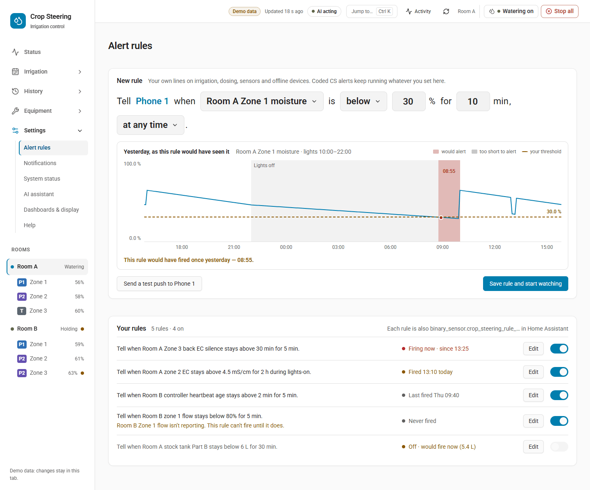
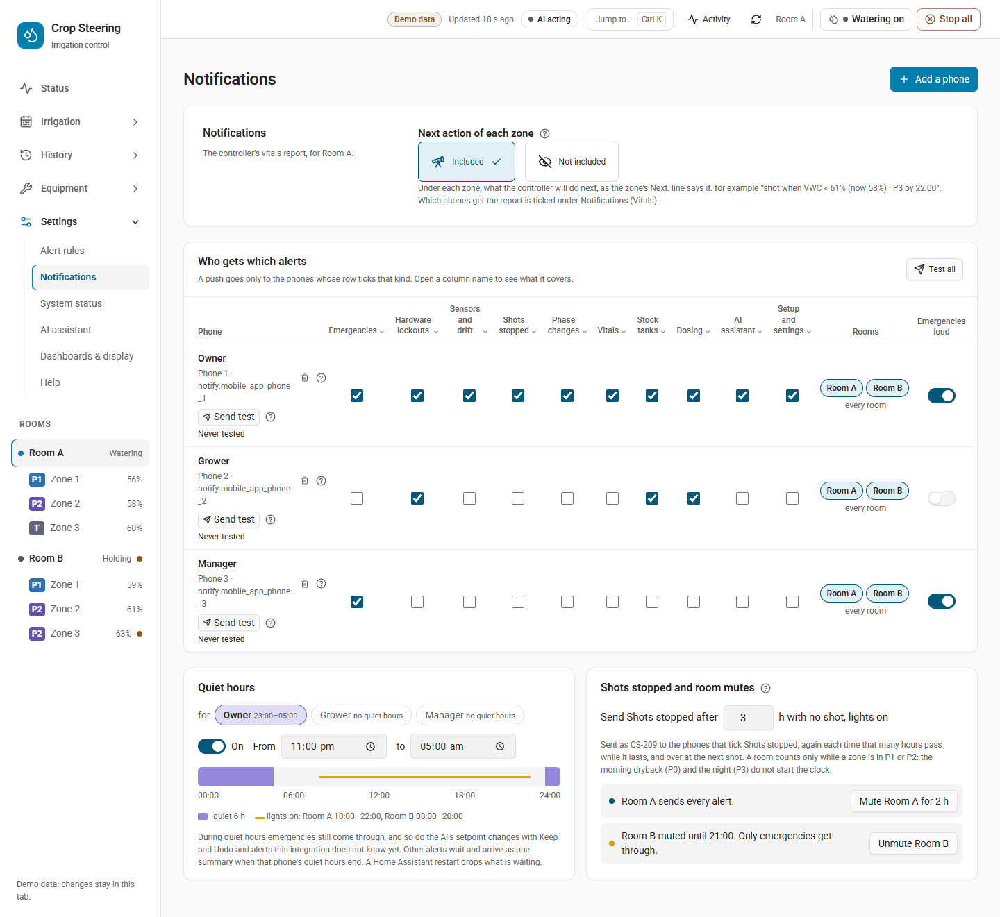

# Alerts: rules, the inbox and quiet hours

**Bottom line:** you can set your own alert rules, such as "tell me when F2 tank level stays below 30% for
10 min". A rule only sends a notification. It never starts, stops or holds a shot. Before you save a rule
you can replay it over yesterday's readings to see how often it would have fired. Each room's open alerts,
from your rules and from the controller, appear in one inbox, and any signed-in user can acknowledge
them. Each phone can have quiet hours. During quiet hours, pushes that are not critical wait and arrive
as one digest when the quiet hours end. Urgent pushes, including rules routed to `emergency`, always come through.

Who gets which alert on which phone: [Notifications](../NOTIFICATIONS.md).

What still protects the crop is unchanged. Your irrigation pH and EC limits
(`number.crop_steering_<prefix>irrigation_ph_min/max`, `irrigation_ec_min/max`), the kill switch and the
controller's holds stop watering exactly as before. An alert rule adds a message and nothing else.

- [Alert rules](#alert-rules)
- [Preview: replaying a rule over history](#preview-replaying-a-rule-over-history)
- [The alerts inbox and acknowledging](#the-alerts-inbox-and-acknowledging)
- [Quiet hours](#quiet-hours)
- [Services reference](#services-reference)

---

## Alert rules



Find them under **Settings › Alert rules**. This is the default page of the Settings section.

### What a rule is

A rule watches one source in one room. It fires when the value stays **above** or **below** a threshold
for at least `min_duration_s` seconds, inside its time window. The page shows each rule as a sentence:

> Tell when F2 tank level stays below 30% for 10 min during lights-on.

| Source | What it reads | Unit | Extra field needed |
|---|---|---|---|
| `zone.vwc` | `sensor.crop_steering_<prefix>vwc_zone_<n>` | % | `zones` |
| `zone.ec` | `sensor.crop_steering_<prefix>ec_zone_<n>` | mS/cm | `zones` |
| `zone.temperature` | The zone's mapped substrate temperature sensor | °C | `zones` |
| `zone.flow_ratio` | `sensor.crop_steering_<prefix>zone_<n>_flow_ratio`, shown as % | % | `zones` |
| `feed.ph` | `sensor.crop_steering_<prefix>feed_ph_corrected` once a calibration is applied, otherwise the sensor named as `feed_ph_sensor` in the engine config | pH | none |
| `feed.ec` | `sensor.crop_steering_<prefix>feed_ec_corrected` once a calibration is applied, otherwise the sensor named as `feed_ec_sensor` in the engine config | mS/cm | none |
| `tank.level` | `sensor.crop_steering_<prefix>tank_level` | % | none |
| `stock.pct` | A stock tank's level as a share of its capacity | % | `tank_id` |
| `stock.litres` | A stock tank's level | L | `tank_id` |
| `controller.heartbeat` | Seconds since `sensor.crop_steering_<prefix>ai_heartbeat` last updated | s | none |
| `probe.silence_s` | Seconds since a probe last gave a number | s | `entity_id` |

If no calibration is applied and the engine config names no feed sensor, a `feed.ph` or `feed.ec` rule
reads nothing and stays `armed`.

Climate sources (room temperature, humidity, VPD, CO2) cannot have rules. A rule using a `room.` or
`climate.` source is refused.

When a rule watches several zones, it uses the worst reading: the lowest for a `below` rule and the
highest for an `above` rule.

### Rule fields

| Field | Values | Default |
|---|---|---|
| `room_id` | A room such as `room:f2_` | required |
| `source` | One of the sources above | required |
| `zones` | List of zone numbers, for zone sources | `[]` |
| `op` | `above` or `below` | required |
| `threshold` | A number, in the source's unit | required |
| `min_duration_s` | 0 to 86400 whole seconds | `0` |
| `window` | `all`, `lights_on`, `lights_off`, or `{kind: custom, from: "HH:MM", to: "HH:MM"}` | `all` |
| `severity` | `info`, `warning`, `emergency` | `warning` |
| `routing` | A notification kind: `emergency`, `hardware`, `sensors`, `watering`, `phases`, `vitals`, `stock`, `dosing`, `jev`, `setup` | `sensors` |
| `active` | `true` or `false` (the On switch) | `true` |

`lights_on` and `lights_off` follow the room's lights-on and lights-off hours. A custom window may cross
midnight, but its start and end must differ.

**Severity is only a label.** It is stored and shown, and nothing uses it to decide anything. How loud
the push is depends on **routing**:

- `routing: emergency` is pushed as urgent. Room mutes, digests and quiet hours never hold it.
- Any other routing is a normal push to the phones that tick that kind under
  **Settings › Notifications**. Room mutes, digests and quiet hours apply to it.

### How a rule behaves

| State | Meaning |
|---|---|
| `draft` | Switched off (`active: false`) |
| `armed` | Watching. The value is in range, or outside the window |
| `pending` | Breaching, waiting out `min_duration_s` |
| `firing` | Has fired. The alert is open |
| `acknowledged` | Fired and acknowledged, still breaching |
| `muted` | The room is muted and the rule is not routed to `emergency` |

- Rules are checked whenever a watched entity changes, whenever stock changes, and every minute. Ages
  such as heartbeat and probe silence grow without a state change, so the every-minute check matters for them.
- A reading that is missing or `unavailable` never fires a rule and never clears one.
- When a rule fires, it writes `alert.raised` to the room's journal and sends one push. When the value
  comes back in range, it writes `alert.cleared`. A rule that has fired keeps firing until the value
  comes back or the rule is switched off, even if the time window ends or the room is muted. Switching
  off a firing or acknowledged rule (`active: false`) also writes `alert.cleared` and closes its alert.
- A mute does more than silence a rule's push: while the room is muted, a non-emergency rule does not fire at all.
- Rule states are kept in memory. After a Home Assistant restart every rule starts again at `armed`. If
  the value is still out of range, the rule fires again once `min_duration_s` has passed.

### The rule's entity

Each rule is a binary sensor named after it, for example `F2 tank level below 30%`:

- entity `binary_sensor.crop_steering_rule_<id in lower case>` (unique_id `crop_steering_rule_<id>`,
  which keeps the rule id as stored, an upper-case ULID)
- **on** while the rule is `firing` or `acknowledged`, and off otherwise
- attributes: `rule_id`, `room_id`, `source`, `op`, `threshold`, `unit`, `state`, `firing_since`

Use it in your own automations. Acknowledging does not turn it off; it stays on until the value comes
back or the rule is switched off. Deleting a rule removes its entity.

### Saving, switching, deleting

Saving a rule needs an administrator, and so do deleting it and sending a test push. Listing,
previewing and testing without sending are open to any signed-in user.

On the page, a save is read back before it is shown. Turning the On switch and deleting take effect
straight away and offer **Undo**. Each change is written to the journal as `config.changed` (section
`alert_rules`), so it appears under **History › Changes** and can be put back from there.

All rules on the site share one revision. `alert_rule_set` and `alert_rule_delete` take
`expected_revision` (from `alert_rule_list`). If someone changed the rules in the meantime, the save is
refused with "Alert rules changed elsewhere. Reload before saving."

---

## Preview: replaying a rule over history

Before you save, the page replays the draft over yesterday's recorded readings. It shows the spans where
the rule would have fired, and you can drag the dashed threshold line to try another value. Arrow Up
and Arrow Down move it one step; hold Shift to move ten steps. The replay uses the same breach, duration and window logic as the
live rule, but it does not know about past room mutes. A preview can show fires that the live rule
would not have sent because the room was muted at the time.

The answer gives a sentence such as:

- "This rule would have fired 2 times yesterday — 03:10, 14:45."
- "It wouldn't have fired in the last 24 h. Lowest was 34%."
- "That's 18 messages a day. Try a longer wait or a lower threshold." (shown when it would fire more
  than 10 times)
- "There's no history for this in the last 24 h."

It also lists `ignored` spans: breaches that would not have fired, each with a reason:

- `shorter than min_duration`: the value came back too soon.
- `outside window`: the breach was outside the rule's window.

The replay reads Home Assistant's recorder. With no recorder there is no history, and the preview says so.
`hours` can be 1 to 168 (a week); the default is 24. A long series is cut down to 1440 points, and each
point keeps the worst value.

**Test a rule** with `alert_rule_test`. Without `send` it only replays. With `send: true`, which needs
an administrator, it also sends one push titled `Test: <rule name>` through the normal routing. The
answer's `delivery` lists each phone with `ok` and an `error`. A phone in quiet hours shows "held for
the phone's digest or quiet hours", and a muted room shows "The room is muted".

---

## The alerts inbox and acknowledging

Each room has one sensor listing its open alerts:

- `sensor.crop_steering_<prefix>alerts_open`. Its state is the number of open alerts.
- Its `alerts` attribute lists them newest first, each with `event_id`, `ts`, `code`, `title`, `zone`,
  `entity_id` and, for a rule, `rule_id`.

The open alerts also show beside the devices they concern on **Settings › System status**, each with an
**Acknowledge** button.

### When an alert is open

The inbox includes alerts from your rules and from the controller. An alert opens with its
`alert.raised` and stays open until one of these happens:

1. It clears (`alert.cleared`): for a rule, when the value comes back in range or the rule is switched off.
2. Someone acknowledges it (`alert.acknowledged`).
3. For a controller alert, its Home Assistant notification (`f2_<key>`) is dismissed.

A raise that repeats while the alert is already open does not add a second entry; the first one stays.

**After a restart, stale alerts stay open.** Home Assistant keeps notifications only in memory. After a
restart the inbox cannot tell whether a notification was dismissed, so a controller alert stays open
until its notification is seen again and then dismissed, or until it is acknowledged. A stale alert is
safer than one that drops silently.

The sensor updates on every stored `alert.*` event and every 5 minutes. If the journal cannot be read,
the sensor shows `unavailable`. Nothing in the inbox touches irrigation.

### Acknowledging

**Any signed-in user can acknowledge an alert, not only an administrator**, so staff on the floor can
acknowledge alarms.

```yaml
action: crop_steering.alert_ack
data:
  room_id: "room:f2_"
  alert_event_id: "01JB7Q3M2V8K5N0R4T6W9XYZAB"   # event_id from the alerts attribute
```

- The journal records an `alert.acknowledged` event that says who acknowledged it, and the alert leaves the inbox.
- For a rule, the rule's state becomes `acknowledged`. Its binary sensor stays on until the value
  comes back, and the rule does not push again for the same breach.
- An alert that is not in that room's journal is refused. So is one that is already closed ("The alert
  … is already closed"). If the journal is down the acknowledgement is refused and nothing changes; try again.

---

## Quiet hours



Each phone (a notification recipient) can have quiet hours, `{from: "HH:MM", to: "HH:MM"}`. They use
Home Assistant's time zone. They may cross midnight (`22:00` to `06:00`). The start time is
included and the end time is not. Start and end must differ. Every phone starts with no quiet hours.

**What waits and what comes through:**

| Push | During the phone's quiet hours |
|---|---|
| An urgent push | Sent at once |
| A code in the Emergencies kind (such as CS-601, CS-801) that is not marked urgent | Not held by quiet hours, but a phone with digest on still holds it |
| A rule routed to `emergency` | Sent at once |
| A known non-critical code, event or rule push | Held |
| The controller's non-critical "not watering" warnings (e.g. CS-206, CS-316) | Held |
| A code or event this version does not know | Not held by quiet hours, but a phone with digest on still holds it |
| An AI setpoint push with Keep / Undo, to a phone without digest | Sent at once (a digest has no buttons) |

Held pushes join that phone's digest queue, even if the phone does not normally take a digest. They go
out as **one push as soon as quiet hours end**. The queue is checked every minute. A later push with
the same key replaces the one waiting. The digest groups items by severity.

How quiet hours combine with other settings:

- **Digest:** a digest that falls due during quiet hours waits until they end.
- **Room mute:** a mute comes first. While a room is muted, only an urgent push is sent for it, so
  nothing is held for later either. An Emergencies-kind code that is not marked urgent is dropped too.
- Only an urgent push gets past every hold: quiet hours, digest and room mute.
- **Restart:** the queue is kept in memory only. A restart drops what is waiting, just as it does for a digest.

### Setting quiet hours

The Notifications page does not edit quiet hours yet; set them with `crop_steering.notify_save`. Saving
from the page keeps each phone's quiet hours as they are. First read the current setup:

```yaml
action: crop_steering.notify_get
response_variable: notify
```

Then send every row back, adding `quiet_hours` where you want them:

```yaml
action: crop_steering.notify_save
data:
  expected_revision: 7            # revision from notify_get
  recipients:
    - service: notify.mobile_app_grower_phone
      kinds: [emergency, hardware, sensors, watering, stock]
      rooms: ["f2_"]
      quiet_hours: {from: "22:00", to: "06:00"}
    - service: notify.mobile_app_night_staff
      kinds: [emergency, hardware]
      quiet_hours: null           # no quiet hours
```

`rooms` takes room prefixes: `""` for the default room, or for example `"f1_"`. An automation, like an
administrator, can save every row. A signed-in user who is not an administrator can save the kinds,
rooms, high-priority flag, digest and quiet hours of their own phone's row only.

### Testing several phones at once

`notify_test` takes one phone (`service`) or a list of up to 20 phones (`services`), but not both:

```yaml
action: crop_steering.notify_test
data:
  services: [notify.mobile_app_grower_phone, notify.mobile_app_night_staff]
```

The answer is `{results: [{service, sent, error}]}`, with one row per phone. Anyone can test their own
phone; testing someone else's phone needs an administrator.

---

## Services reference

| Service | Who | Fields | Answer |
|---|---|---|---|
| `crop_steering.alert_rule_list` | any signed-in user | `room_id` (optional) | `{rules: [rule + summary_sentence, state, last_fired, firing_since, current_value], revision}` |
| `crop_steering.alert_rule_preview` | any signed-in user | `rule`, `hours` (1–168, default 24) | `{summary_sentence, series, fires: [{start, fired_at, end}], ignored: [{start, end, reason}], count, min, max, sentence}` |
| `crop_steering.alert_rule_test` | any signed-in user; `send: true` needs admin | `id` or `rule`, `hours`, `send` | `{summary_sentence, replay, delivery?: [{service, ok, error}]}` |
| `crop_steering.alert_rule_set` | administrator | `rule` (with `id` to change an existing rule), `expected_revision` | `{rule, summary_sentence, revision}` |
| `crop_steering.alert_rule_delete` | administrator | `id`, `expected_revision` | `{id, revision}` |
| `crop_steering.alert_ack` | any signed-in user | `room_id`, `alert_event_id` | `{room_id, alert_event_id, event_id}` |
| `crop_steering.notify_save` | administrator or automation; own row for others | `expected_revision`, `recipients` (rows may carry `quiet_hours`), `digest_hours`, `mutes`, `idle_hours` | the stored setup |
| `crop_steering.notify_test` | administrator or the phone's own user | `service` or `services` | `{sent, error}` or `{results: […]}` |

The alert services also accept the common API fields `api`, `client` and `proposal_token` (see
[MCP.md](../MCP.md) for the `api: 2` answer format). With `api: 2`, a test push that a phone did not
receive comes back as an `unavailable` error that names the phone.

Example: preview a rule for a stock tank running low over two days.

```yaml
action: crop_steering.alert_rule_preview
data:
  hours: 48
  rule:
    room_id: "room:f2_"
    source: stock.pct
    tank_id: "bloom_a"
    op: below
    threshold: 15
    min_duration_s: 600
    routing: stock
```

Then save it, using the `revision` from `alert_rule_list`:

```yaml
action: crop_steering.alert_rule_set
data:
  expected_revision: 3
  rule:
    room_id: "room:f2_"
    source: stock.pct
    tank_id: "bloom_a"
    op: below
    threshold: 15
    min_duration_s: 600
    routing: stock
```

Journal events to watch in automations (`crop_steering_event` on the bus):

- `alert.raised`, with data `rule_id`, `value`, `threshold` and `title` for a rule, or `key` for a controller alert
- `alert.cleared`
- `alert.acknowledged`, with data `alert_event_id` plus `rule_id` or `key`

Related: [NOTIFICATIONS.md](../NOTIFICATIONS.md) (who gets which kind),
[ERROR_CODES.md](../ERROR_CODES.md) (what each CS code means),
[UPGRADING.md](../UPGRADING.md#alerts) (the upgrade report row).
