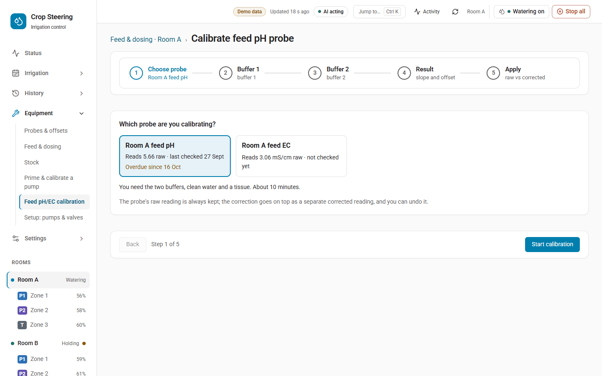
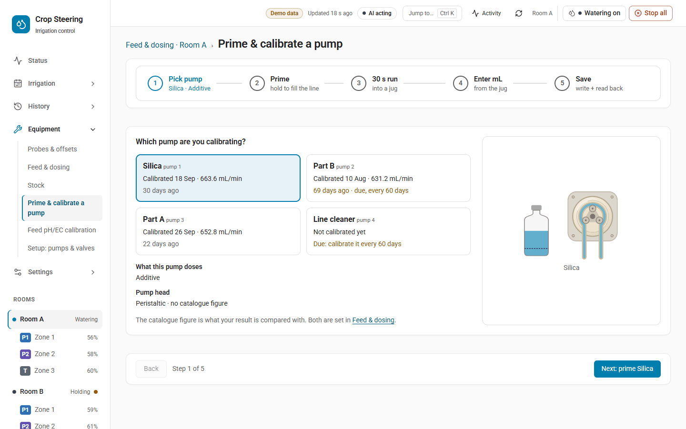

# Calibration

**Bottom line:** three kinds of calibration change the numbers the system works from:

- a **moisture probe offset** (and optionally a curve), so a probe reads what your handheld meter reads;
- a **2-point feed pH/EC calibration**, so the feed-water probes read true in buffer solutions;
- a **dosing pump calibration**, so a pump without a flow sensor doses the right volume.

Each one is checked before it is applied, stored and written to the journal. A probe offset is also
read back from storage after it is saved. Two of them
hold things on purpose while they run, and that is safety-critical:

- While a **feed probe calibration session** is open, the probe sits in a buffer, so its reading is
  not used as the feed. Batches and pH auto-correct wait. In a room with a feed EC or pH band set,
  the source-water gate holds that room's shots until the session ends.
- If a **dosing pump does not read off** after a prime, calibration run or stop, the controller
  latches the room (**CS-801**). Its shots are held and the off is sent again every 2 s until the pump
  reads off. A latch from a prime or calibration run survives a controller restart; one from a
  stand-alone stop is held in memory only.

Where to do it today:

| Calibration | Dashboard | Services |
|---|---|---|
| Moisture probe offset (match handheld) | **Equipment › Probes & offsets** | `crop_steering.probe_offset_set` |
| Moisture probe curve | Shown read-only on **Equipment › Probes & offsets** | `crop_steering.probe_offset_set` (`curve`) |
| Feed pH/EC 2-point wizard | **Equipment › Feed pH/EC calibration** | `crop_steering.calibration_start` … `calibration_commit` |
| Feed probe check (judged only, never applied) | **Equipment › Probes & offsets › Feed probe calibration** | `crop_steering.calibration_record` |
| Dosing pump prime and calibrate | **Equipment › Prime & calibrate a pump** | `crop_steering.pump_precheck`, `pump_prime`, `pump_stop`, `pump_calibrate`, `pump_calibration_commit` |

An AI assistant or an automation can call the same services from **Developer Tools › Actions** in
Home Assistant, with **Return response** ticked.

## Who can do what

| Service | Who may call it |
|---|---|
| `calibration_get`, `calibration_status` | Any signed-in user |
| `calibration_record`, `calibration_start`, `calibration_capture`, `calibration_commit`, `calibration_revert`, `calibration_abandon`, `probe_offset_set` | Administrator |
| `pump_precheck` | Anyone (it only reads) |
| `pump_stop` | Any signed-in user, or an automation |
| `pump_prime`, `pump_calibrate`, `pump_calibration_commit` | Administrator |

The MCP server reaches `probe_offset_set` only through a reviewed proposal (`preview_probe_offset`,
then `apply_proposal`, with writes enabled). It cannot start, capture or commit a feed calibration, and it cannot prime, calibrate or stop a pump.

---

## Moisture probe offsets and curves

### What an offset does

An offset is a number of percentage points added to one moisture probe's reading. Say your handheld
meter reads 52 % at the same spot where the probe reads 49 %: the offset is +3.

The offset is applied **before** the zone's probes are combined (fused) into the zone's VWC. So it
changes the VWC the engine steers on, the zone's dryback and every shot decision based on them.
Watch the zone for a while after you change one.

Limits:

- An offset is between -20 and +20 points. A handheld match that needs more than 20 points is
  refused: the probe reads too far from the handheld, so check the probe and where it sits instead.
- The corrected reading must stay inside 0–100 %.
- Setting the offset to 0 with no curve removes the probe's entry.

A probe with an offset or a curve also gets its own sensor, `sensor.<probe object id>_corrected`
(for example `sensor.f2_z1_vwc_a_corrected`). It shows the corrected value in %, with attributes
`source`, `raw`, `offset`, `curve` and `set_at`. It goes unavailable while the raw probe is
unavailable, so an old value is never shown in its place.

### Match a handheld meter (dashboard)

1. Open **Equipment › Probes & offsets** and pick the room.
2. Press **Match handheld** on the probe's row.
3. Take a handheld reading at the same spot and depth as the probe, and type it in (0 to 100).
4. The page asks the integration for a preview. It shows the offset it would set and what the zone
   would read with it. Nothing is saved yet.
5. Press **Apply +N offset to <probe>** in the Review & apply bar. The write names the store's
   revision. If someone changed the offsets meanwhile, it is refused and you reload. After the save,
   the page reads the offset back with `calibration_get`.

### Curves

A curve turns a raw probe reading that is **not** moisture into moisture in %. Only a probe that
reports dielectric permittivity can take one. Its unit must name ε, epsilon, permittivity or
dielectric. A probe that already reports % is refused with "This probe already converts to
moisture. A curve only applies to raw readings." Any other unit is refused as well.

Two curves exist:

| Curve | Fitted over | Worst error of the fit |
|---|---|---|
| `generic_soilless` | permittivity 3–30 (coir and peat blends) | 0.42 points |
| `generic_rockwool` | permittivity 10–60 (wet slabs) | 2.7 points |

Both are quadratic fits of the Topp et al. (1980) equation for mineral soil. They are **generic
approximations, not substrate calibrations**. Every answer that sets a curve carries this warning.
After you pick a curve, match a handheld meter so the offset corrects the reading at the moisture
you steer around.

The dashboard shows the room's curve in use and why a curve does not apply, but it does not set
one. To set or clear a curve, call the service (`curve: none` clears it).

### `crop_steering.probe_offset_set`

| Field | Required | Meaning |
|---|---|---|
| `room_id` | yes | Canonical room id, for example `room:abc123` |
| `entity_id` | yes | One of the room's moisture probes |
| `offset` | one of these three | Points, -20 to +20 |
| `match_handheld` | | Handheld reading 0–100. The offset becomes handheld minus the probe's bare reading. You cannot send it together with `offset`. |
| `curve` | | `generic_soilless`, `generic_rockwool`, or `none` to clear |
| `preview` | no | `true`: answer with the effect and save nothing |
| `expected_revision` | for a write | The revision a preview returned |

A preview answers `offset`, `curve`, `corrected_now`, `fused_before`, `fused_after` (what the
zone would read), `excluded_after` (probes the fusion would leave out, and why), `diff` and
`revision`. A write answers the same without `preview` and `diff`, with the new `revision`.
`fused_before` and `fused_after` are estimates. They mirror the zone's fusion without its learned
memory of the probes.

```yaml
action: crop_steering.probe_offset_set
data:
  room_id: room:abc123
  entity_id: sensor.f2_z1_vwc_a
  match_handheld: 52
  preview: true
```

Each write is read back from storage. If the read-back does not match, the old value is put back
and the call fails with "The probe offset did not read back from storage. It was not applied."
A successful write is journaled as `config.changed`, with `store: calibration` and
`section: probe_user_offsets`, so it can be seen and put back from **History › Changes**.

---

## Feed pH/EC 2-point calibration



### What it does

The wizard watches the room's raw feed pH or EC probe while it stands in two reference solutions.
From the two points it works out:

- **slope** (%): 100 % means each step reads true;
- **offset**: how far the probe is out at the anchor (pH 7, or EC 0 mS/cm);
- a **verdict**: pass, drifting or fail.

| Verdict | Slope | Offset (pH units, or mS/cm) |
|---|---|---|
| pass | 95–105 % | within ±0.1 |
| drifting | 90–110 % | within ±0.3 |
| fail | anything else | |

A commit **applies** a pass or drifting result. A fail is recorded but **never applied**. The call
then fails with a message telling you to clean or replace the probe and calibrate again.

The raw sensors are never changed. Applying a calibration does two things:

- `sensor.crop_steering_<prefix>feed_ph_corrected` and `sensor.crop_steering_<prefix>feed_ec_corrected`
  read the corrected value. They are unknown while no calibration is applied.
- The room's `sensor.crop_steering_<prefix>engine_config` carries `feed_calibration`
  (`{ph|ec: {gain, bias, calibrated_at}}`), the same correction as `raw × gain + bias`.

The controller reads the corrected sensor while it is live. Otherwise (for example right after a
restart) it applies gain and bias to the raw reading itself. While a calibration is in force, the
controller never uses the raw number uncorrected. It saves the calibration in its own state, so
the correction holds even across a restart with Home Assistant down.

### Default solutions and rules

| Probe | Default solutions | Smallest gap between them |
|---|---|---|
| `feed_ph` | pH 7.0 and pH 4.0 | 1.0 pH |
| `feed_ec` | 1.413 and 2.77 mS/cm | 0.5 mS/cm |

You can pass your own two values in `solutions`. They must be inside the probe's range (pH 0–14,
EC 0–20) and the minimum gap apart.

A point is captured only once the reading has held still for **30 s**:

- pH: it moved less than 0.02 over the last 30 s;
- EC: it moved less than 1 % of its mean over the last 30 s.

A start is refused if the probe has not reported for 2 minutes ("No reading from the feed pH probe
for 2 min. Check it's plugged in.").

### Step by step (services)

1. **Start.** `calibration_start` with `room_id`, `probe: feed_ph` (or `feed_ec`) and optionally
   `solutions`. It answers with `session_id`, `solutions`, `raw_entity_id`, `temperature_entity_id`
   (the room's tank temperature sensor, if one is set), `dosing_paused: true` and `expires_at`. A new
   start replaces any probe session already open in the room.
2. **First solution.** Rinse the probe and put it in the first solution (pH 7.0 by default). Poll
   `calibration_status` with the `session_id`. It answers `reading`, `raw`, `stable`, `drift`,
   `stable_s`, `points_captured` and `expires_at`. Status only reads: it never captures and never
   extends the session.
3. **Capture point 0.** `calibration_capture` with `session_id` and `point: 0`. If the reading is not
   steady yet, nothing is stored. Under API v2 the call fails with `guard_refused`, "The reading is
   not steady yet: nothing was captured." `force: true` captures it anyway, and the point is marked
   `forced` in the record.
4. **Second solution.** Rinse, move to the second solution, wait for `stable`, then capture
   `point: 1`.
5. **Commit.** `calibration_commit` with `session_id`. It answers `record_id`, `slope_pct`, `offset`,
   `verdict`, `applied: true` and the store `revision`. The session closes.

To stop without applying anything, call `calibration_abandon` with the `session_id`. A session also
ends by itself **30 minutes after its last start or capture**. After that, every step answers
"Calibration session expired. Start again."

```yaml
action: crop_steering.calibration_start
data:
  room_id: room:abc123
  probe: feed_ph
```

### Putting one back

`calibration_revert` with `room_id` and `probe` takes the applied calibration off the probe and
puts back the one it replaced, if there was one. If not, the probe reads raw again. It also closes
any open probe session in the room. It answers `reverted_record_id`, `record_id` (the one now in
force, or null) and `applied`.

### Due reminders

A calibration committed by the wizard, or a check saved with `calibration_record`, is due again
**30 days** later. A failed one does not reset the clock. When a probe is due:

- `binary_sensor.crop_steering_<prefix>calibration_due` turns on (attributes `probes`, `due_at`);
- a Repairs card is raised, [CS-612](../ERROR_CODES.md#cs-612).

Records made before this release have no due date and never go due.

### The check on Probes & offsets is not the wizard

**Equipment › Probes & offsets › Feed probe calibration** saves a check made by hand with
`calibration_record`: you enter the two references and what the probe read in each, and it shows the
verdict. Such a record **only judges the probe. It is never applied** and does not change any
reading.

### Safety: what waits while a session is open

While a feed probe session is open, the room's `sensor.crop_steering_<prefix>dosing_config` carries
`calibrating` (`{probe, session_id, until}`), and the controller treats that probe as sitting in a
buffer:

- **Batches** and **pH auto-correct** wait ("feed probe calibration in progress").
- A **single dose** by hand still goes ahead.
- **Pump primes and calibration runs** are refused (`pump_precheck` blocker `calibrating`).
- **Shots:** the source-water gate does not read the feed probe. If the room has a feed band set
  for that probe's quantity (EC or pH), the room's shots are **held** with reason
  "feed probe calibration in progress". There is no grace period and no rescue past it. Without a
  band, the gate is off and shots carry on.
- **Fail-closed:** if the room has a feed sensor and a feed band set for that quantity, and
  `dosing_config` cannot be read while a calibration is applied to it, shots are held with
  "source-water pH/EC calibration state unreadable … holding (fail-closed)". Without a band, an
  unreadable `dosing_config` holds nothing.

Finish, abandon or let the session expire to release these holds. If you walk away, everything
resumes within 30 minutes of the last capture.

### Journal events

`calibration.started`, `calibration.captured` (each captured point, and each `calibration_record`
check), `calibration.committed` (with `applied` and `superseded_record_id`) and
`calibration.reverted`.

---

## Dosing pump prime and calibrate



### What it does

A **prime** runs one dosing pump's power switch for 1–30 s to fill its line. A **calibration run**
runs it for 5–120 s into a measuring jug. You then enter the mL it gave. That becomes the pump's
`calibrated_ml_min`, which is measured mL ÷ the seconds it actually ran × 60.

What the calibrated flow is used for:

- When the pump has **no flow entity**, `calibrated_ml_min` is the flow doses are sized from.
- When the pump's flow entity is a `number` or `input_number`, the commit also sets it to the new
  flow in mL/s and reads it back (`flow_entity_written`). A flow entity always wins over
  `calibrated_ml_min`. A `sensor` flow entity is never written.

A pump keeps its newest 30 calibrations, each with the previous flow.

The pump needs its own **power switch** (`power_entity`). Without one, or while that switch is
missing or `unavailable`, a timed run is refused.

### Step by step (services)

1. **Check.** `pump_precheck` with `room_id` and `pump`. It answers `{ok, blockers}`. Each blocker
   has a `code` and a `message`:

   | Code | Message |
   |---|---|
   | `no_power_entity` | No power switch: a timed run needs the pump's own power switch (also raised when the switch is set up but its state is missing or `unavailable`) |
   | `batch_running` | Room dosing is running |
   | `mix_pump_on` | Mix pump is on |
   | `tank_filling` | Tank is filling |
   | `calibrating` | Feed probe calibration in progress |
   | `pump_calibrating` | Another pump's calibration is still open |
   | `controller_offline` | Controller is offline |

   `controller_offline` is raised when the controller's heartbeat is older than 10 minutes.

2. **Prime** (optional). `pump_prime` with `room_id`, `pump` and `seconds` (1–30). The controller
   refuses a prime of a pump that has no usable flow yet ("<pump> is not calibrated"). On a new pump,
   calibrate first.
3. **Calibrate.** Put the pump's outlet in a measuring jug. Call `pump_calibrate` with `room_id`,
   `pump` and `seconds` (5–120). It answers `session_id`, `request_id` and `outcome: requested`. If a
   blocker stands, it answers `outcome: refused` with the `blockers` (API v2: `guard_refused`).
4. **Wait for the run to end.** The controller takes the request within 2 s, switches the power on,
   reads it back on, runs for the seconds asked and switches it off, then reads it back off. The
   time it ran (`ran_s`) is reported in `sensor.crop_steering_<prefix>dosing` under
   `handled_results`. `dosing_get` shows the open session with `ran_s` and `result`.
5. **Measure and commit.** Read the jug. Call `pump_calibration_commit` with `room_id`, the
   `session_id` and `measured_ml`. It answers `ml_min`, `previous_ml_min` and `flow_entity_written`.
   A commit before the run is reported is refused ("Wait for the pump to stop"), and so is one for a
   run that did not run.

A report restarts the session's 30 minutes, so you have time to read the jug.

```yaml
action: crop_steering.pump_calibrate
data:
  room_id: room:abc123
  pump: part_a
  seconds: 60
```

### Stopping a run

`pump_stop` with `room_id` and `pump` ends that pump's prime or calibration at its next 1 s check.
It switches the power off and reads it back. It never ends a batch, dose or pH correction (use the
room **Stop** for those).

A stop for a pump while **another** pump's request is still waiting is turned into a room stop,
which switches off every pump. A waiting dose or batch can only be replaced by an administrator's
or an automation's stop.

`calibration_abandon` ends a pump's calibration session early, but only after its run has been
reported. Before that, stop the pump first.

### What a timed run is refused for, or stopped by

A run does not start while:

- a dosing hardware fault is latched (CS-301);
- a shot is in flight in the room;
- a batch holds the room;
- another hold is open (a feed probe session, or another pump's calibration or prime);
- the room's kill switch is off.

A request older than 120 s is never acted on.

During the run, the controller checks every second and stops the run if the kill switch goes off, a
hardware fault latches or a shot starts in the room.

### What waits while a run is open

- While a pump's calibration session is open, and for a prime's run plus 60 s after it is
  reported, `dosing_config` carries `calibrating` with that pump.
- Doses and batches are refused: "A dosing pump is being calibrated or primed: doses and batches
  wait until it is done".
- Primes and calibrations of other pumps are refused.
- **Shots are not held by an open pump session.** A pump-only entry does not touch the
  source-water gate.

A run that went into the jug is not counted as stock drawn from the tank.

### CS-801: a pump that does not read off

After every prime, calibration run or `pump_stop`, the controller switches the pump's power off
and reads it back. If it does not read off at the end of a **prime or calibration run** the
controller was running:

- the run is reported as `stuck` (`ran_s: 0`) and journaled as `dose.completed` with outcome
  `failed` and code `CS-801`;
- a critical alert is raised, [CS-801](../ERROR_CODES.md#cs-801) (Dosing pump overrun), titled
  "a dosing pump does not read off after a prime" or "… after a pump calibration";
- the room is **latched**: its shots are held with the reason "dosing hardware still on:
  <entity>", and new doses, batches and timed runs are refused;
- the controller sends the off again every 2 s and repeats the alert every 30 minutes, titled
  "a dosing pump does not read off";
- the latch is written to the controller's `dosing_state.json`, so it holds across a controller
  restart.

A `pump_stop` with no timed run going works differently. If the pump does not read off, the stop
answers "stopped; <entity> does not read off" (not `stuck`), no `dose.completed` is journaled, and
the alert is titled "a dosing pump does not read off after a stop". The room is latched the same
way, but **only in the controller's memory**: nothing is written to `dosing_state.json`, so that
latch does not survive a controller restart.

The latch clears **by itself** once the power reads off. Then the room waters again. The room
**Stop** sends the off again too. If the pump is still running, switch it off by hand, and check the
tank before the next dose.

### Journal events

`dose.completed` (with `data.kind` `prime` or `calibrate`, `seconds`, `ran_s` and `result`:
`done`, `stopped`, `stuck` or `refused: …`), `pump.primed` (journaled for every prime, with outcome
`refused` or `aborted` when it did not run; the pump's `primed_at` is stamped only when `ran_s` is
above 0)
and `pump.calibrated` (with `ml_min`, `previous_ml_min`, `run_s` and `measured_ml`). The pump's
`history` in `sensor.crop_steering_<prefix>dosing` lists each prime and calibration.

For the controller's side of a timed run, see [DOSING.md › A timed run](../DOSING.md#a-timed-run-prime-calibrate).
