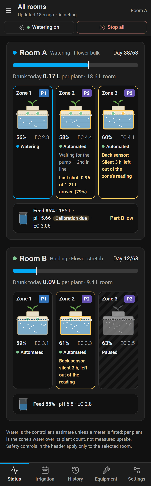
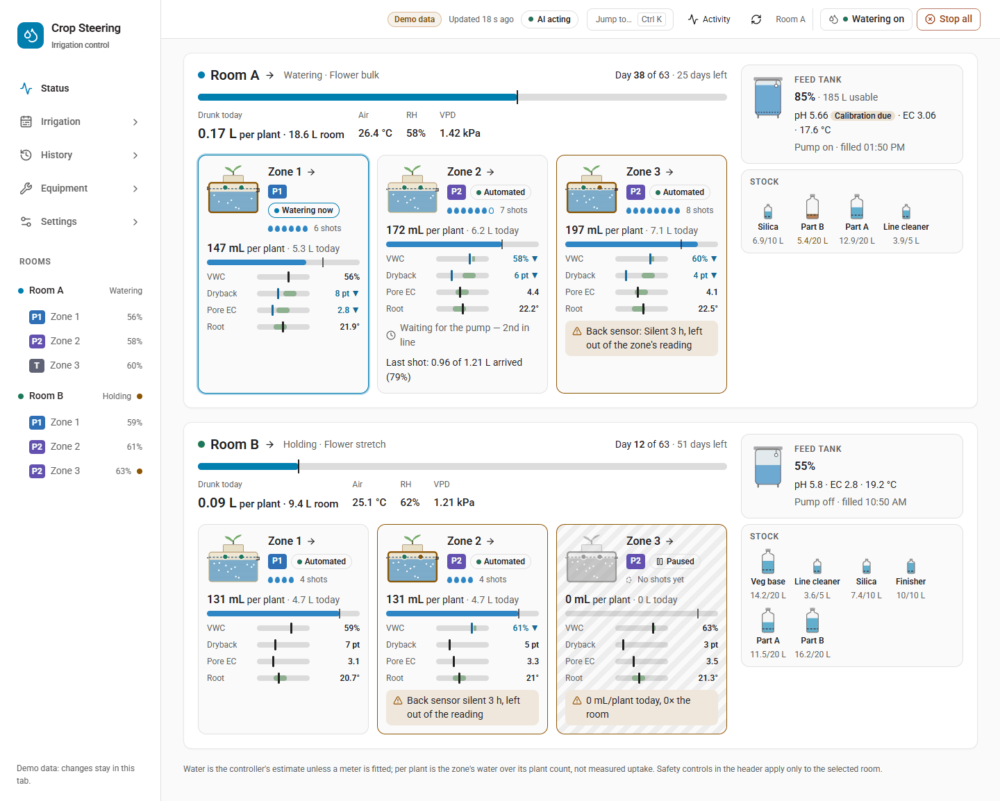
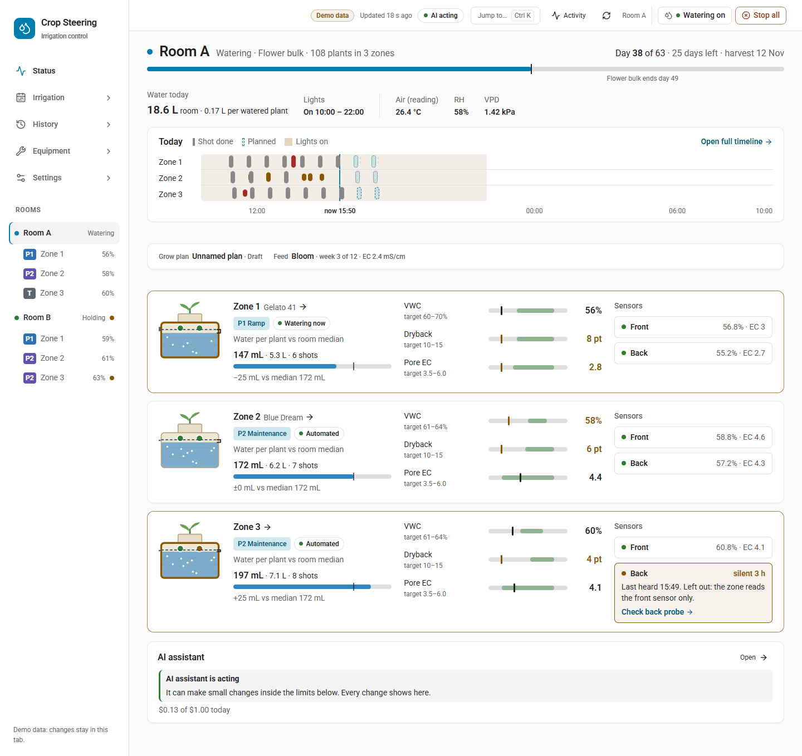
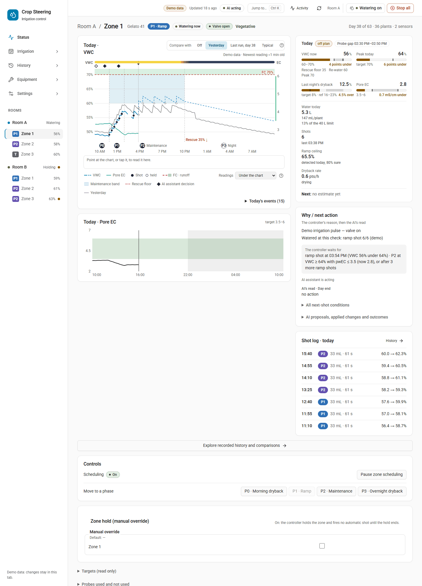
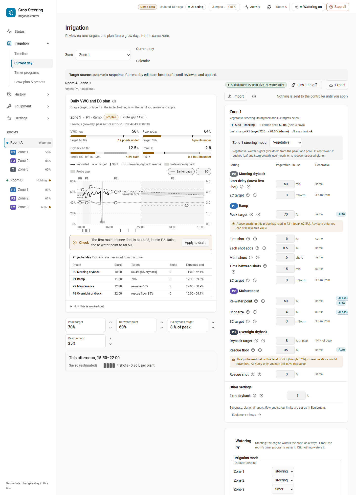
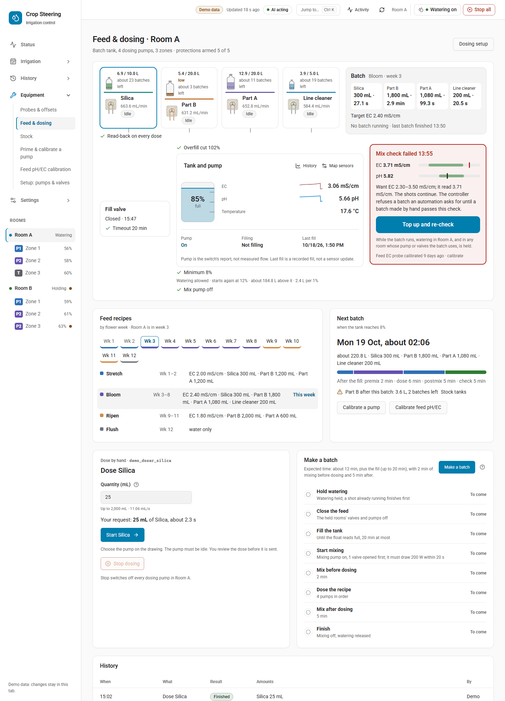
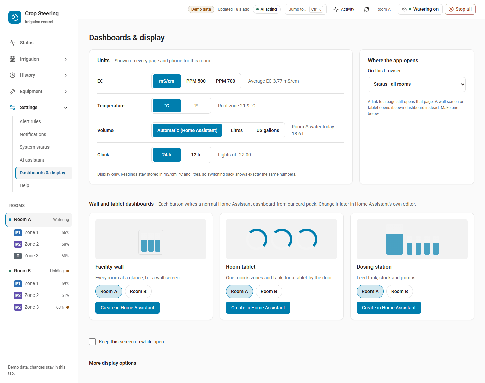

# Dashboards and display

The 3.18 dashboard has five menu sections: Status, Irrigation, History, Equipment and Settings. They hold 21 menu pages. Six more pages have no menu entry: Today, Zone, the AI assistant page, Grows, Dryback drivers and Capabilities. This page goes through every page on a desktop and on a phone. It then covers the per-room display units and clock, and the wall, tablet and dosing-station dashboards that Crop Steering can write into Home Assistant for you.

Nothing on this page waters, opens a valve or changes a setpoint. Units, clock, theme, landing page and extra panels change only what the screen shows. A wall dashboard holds built-in Home Assistant cards and switches nothing when it is created.

## Getting around

### Desktop (wider than 720 px)

- **Left sidebar.** The live room tree: each room with its state, each zone under it with its phase and moisture, and the five menu sections. Click a room to open it in the section you are in, or click a zone to open that zone's page. The browser remembers which sections you left open. Between 721 and 960 px the sidebar is narrower and its brand block is a little smaller, but its contents are the same.
- **Top bar.**
  - A Home Assistant menu button, shown when the dashboard runs inside Home Assistant.
  - One chip per room, coloured by its state. Click a chip to switch rooms. You stay on the page you are on.
  - A **Demo data** pill in the demo.
  - The age of the selected room's latest controller report, or **Offline**, **Connecting…** or **No controller data**.
  - The AI assistant chip, which opens the AI assistant page.
  - The activity panel, which links to History › Explorer.
  - Refresh, then the selected room's name and its safety switches.
- **Safety scope.** The watering and stop controls in the top bar apply **only to the selected room**. Its name sits beside them so you can always see which room they act on.
- **Banners.**
  - A full-width band appears while the selected room's controller is not reporting. The numbers you see are then its last report, and the band links to Equipment › Probes & offsets.
  - A connection banner appears when Home Assistant is offline or needs attention, with a button to the connection settings.

### Phone (720 px and narrower)



- The sidebar is hidden. The **menu button** at the top left opens the same room tree as a sheet.
- A **bottom bar** holds the five sections, within reach of your thumb. Each opens its first page: Status › All rooms, Irrigation › Timeline, History › Explorer, Equipment › Probes & offsets and Settings › Alert rules. A number on Irrigation counts the unsaved target drafts.
- **Page tabs.** In a section with more than one page, a row of tabs above the page lists that section's pages. Wider screens hide this row because the sidebar shows the same pages.
- When a page asks you to choose rooms or zones (for example **Copy to room…**), the room tree opens as a bottom sheet with checkboxes and **Done**/**Cancel**. On a desktop the same picker opens in the sidebar.

### Old links still work

Bookmarks and notification links from before 3.18 open the page that now holds their content. For example, `#/sensors` opens `#/equipment/probes`, `#/history/timeline` opens History › Explorer, and the old `?view=` links of the single-page dashboards open their new pages. The full table is in `frontend/src/lib/routes.ts` (`LEGACY_PAGES`, `LEGACY_VIEWS`).

## The pages

Each page's address is shown after its name. `?zone=N` keeps a zone in focus on Current day, Grow plan & presets and Explorer.

### Status







| Page | Address | What it shows |
|---|---|---|
| All rooms | `#/all-zones` | The whole facility: each room's run, water today, climate, feed and stock tanks, then a card per zone with its phase, automation state, VWC, dryback, pore EC, root temperature and sensor readings. Problems are flagged where they happen. Tap a zone to open it. |
| Today (room) | `#/today` | One room's day: the watering switch, stage and day of flower, steering mode, pore EC band, lights, a strip of today's shots, a row per zone with gauges against targets, sensor trouble, a way back for a paused zone, open alerts, and **Stop all**. It has no menu entry. Click a room in the room tree to open it. A top-bar chip switches rooms but keeps you on the current page, so from All rooms it leaves you on All rooms. |
| Zone | `#/zone/N` | One zone: what it did today and why, whether it is on its stage curve, the probe trust and combined reading, the shot log, AI overlays on the pore EC chart (keep or undo), the next action, the zone's scheduling switch, test shot and ask AI. Open it from the room tree or a zone card. |
| AI assistant | `#/today/ai` | The assistant's state, today's budget, its last decision, what it may do, its recent decisions, and its instructions with rebuild and rollback. Open it from the AI chip in the top bar. |

### Irrigation



| Page | Address | What it shows |
|---|---|---|
| Timeline | `#/plan/watering` | Past and planned shots for every room and zone over a span you choose, timer program runs, skipping a planned timer run, and undo. On a phone it shows all rooms for one day. Use the arrows to step through days and swipe for more rooms. |
| Current day | `#/plan/targets` | Targets by phase (P0 to P3) in a table, with the planning curve beside it, markers on AI-managed targets, and draft edits with **Review & apply**. It is locked while a grow plan is armed. |
| Timer programs | `#/plan/timers` | The room's timer programs: a list, and an editor that reads each amount as a sentence. It also has a 24-hour preview, the daily limit and pump, and who waters each zone. Changes go through **Review & apply** and are read back. |
| Grow plan & presets | `#/plan/schedule` | The grow plan calendar (the page heading still says **Calendar**): stage guide, per-zone profiles by grow day, validate, arm or disarm. It also saves and applies presets and copies settings between zones and rooms. |

### History

| Page | Address | What it shows |
|---|---|---|
| Explorer | `#/history/explorer` | The room's readings on stacked charts under its phase and shot lanes, notes where something happened, one crosshair, the last run beside it, and a CSV of what is charted. Pick a zone to add its probes, targets and other grows. |
| Water & flow | `#/history/water` | Each zone's litres today, this grow week and since grow start, an estimate for the whole grow, bars per grow week, and today's water per plant. The page heading says **Water use**. |
| Compare runs | `#/history/compare` | This run against a run you choose, week by week (VWC and dryback, pore EC, water per plant, shots per day), as charts and a table. It also shows the largest differences, a full-resolution overlay and data coverage. |
| Changes | `#/history/changes` | Every setting change by day: who made it and why, the old and new value, and how it worked out. Filter by who, what, room or zone. An administrator can put a change back. |
| Grows | `#/history/grows` | Run records, up to six grows side by side by grow day, harvest results and yield plots. There is no menu entry. Open it from **Run records** on Compare runs, or from **Record a run** there when the room has no runs yet. |
| Dryback drivers | `#/history/drivers` | For the last 14 nights, each zone's lights-off to lights-on dryback rate against the room's climate. Nights with a shot are left out. It shows how the two go together, not what caused what. There is no menu entry and nothing links to it: type `#/history/drivers` in the address. The page stays empty until `show_dryback_drivers` is turned on under Settings › Dashboards & display › More display options › Display. |

### Equipment



| Page | Address | What it shows |
|---|---|---|
| Probes & offsets | `#/equipment/probes` | The room's probes with trust and health, moisture probe offsets matched to a handheld meter, substrate curves, placement guidance, feed-water probe calibration, the room map and all sensors. |
| Feed & dosing | `#/equipment/dosing` | The batch tank (level, float, EC, pH, temperature), linked stock bottles, pump cards for dosing by hand, making a batch, history, the recipe by week and dosing setup. |
| Stock | `#/equipment/stock` | Stock tanks: which runs out next, levels against their low marks, refill or set level, batches left, litres drawn per week, and refills from the journal with undo. |
| Prime & calibrate a pump | `#/equipment/pump-calibration` | Prime a dosing pump's line while the button is held, run it for a measured time and save the mL/min you measured. |
| Feed pH/EC calibration | `#/equipment/feed-calibration` | The two-point calibration of the feed pH and EC probes in buffer solutions, applied only when committed. |
| Setup: pumps & valves | `#/equipment/setup` | Administrator setup: rooms and zones, plumbing type, pump, main line and valve mapping, probes per zone, plant count, substrate and dripper sizing, commissioning, test shot, catch test, the supply editor and the long-history connection. |

### Settings

| Page | Address | What it shows |
|---|---|---|
| Alert rules | `#/settings/alerts` | Your own alert rules, built as sentences and replayed over yesterday before you save. Rules only notify and never touch watering. |
| Notifications | `#/settings/notifications` | Which phone gets a push for which kind of alert, room scoping, high priority for emergencies, test push and the shots-stopped delay. |
| System status | `#/settings/system` | A health ring, software versions, heartbeat and every mapped device, each with its open alerts, which you can acknowledge. |
| AI assistant | `#/settings/ai` | Per-room switches, today's budget, dry run, model, what the assistant did and how it turned out, and the room's instructions and permissions. |
| Dashboards & display | `#/settings` | Units and clock, where the app opens, wall and tablet dashboards, keep-screen-on, and more display options. See below. |
| Help | `#/help` | Searchable alert codes (`#/help?code=CS-101`), a glossary and What's new. |
| Capabilities | `#/settings/features` | A read-only, searchable list of every capability and setting with its current value. Each item links to the one page where you change it. There is no menu entry. Open it from System status. |

## Settings › Dashboards & display



From top to bottom, the page holds:

1. **Units**: EC, temperature, volume and clock for the selected room.
2. **Where the app opens**: the landing page for this browser.
3. **Wall and tablet dashboards**: one card per template.
4. **Keep this screen on while open**: a checkbox shown only on browsers that support it. It keeps a wall tablet awake while the page is open.
5. **More display options** (collapsed):
   - Home Assistant connection
   - Appearance, with the water today display
   - Display
   - Pot and dripper units
   - In the demo only, **Reset demo session…**

### Units and clock

The units are display only. Readings are stored, and every service and the MCP server answer, in **mS/cm, °C and litres**. Switch back and you see exactly the same numbers again.

| Option (`display_save` key) | Choices | Default |
|---|---|---|
| EC (`ec_unit`) | `mS/cm`, `ppm500`, `ppm700` | `mS/cm` |
| Temperature (`temp_unit`) | `C`, `F` | `C` |
| Volume (`volume_unit`) | `auto`, `L`, `gal` | `auto` |
| Clock (`clock`) | `24`, `12` (numbers, not strings) | `24` |

- **ppm.** ppm500 is mS/cm × 500, and ppm700 is mS/cm × 700. Both are shown as whole ppm. For example, 1.8 mS/cm shows as 900 ppm on the 500 scale and 1260 ppm on the 700 scale. When you type an EC into the dashboard while it shows ppm, the number is read as ppm and converted back to mS/cm. Typing `mS/cm` or `ppm` after the number overrides that.
- **Volume `auto`** follows Home Assistant's unit system. Without one it uses this browser's last pot and dripper volume choice, and otherwise litres. US gallons are litres ÷ 3.785411784.
- **Clock.** 24-hour shows `14:02`, and 12-hour shows `2:02 pm`. Times always use Home Assistant's time zone.
- **Per room.** The settings belong to the room, so everyone who opens that room on any browser or phone sees the same units. Each row shows a live example taken from the room's own readings.
- **Saving.** Choosing an option saves it at once, then reads it back. When the read-back matches you see "Saved and read back HH:MM" with **Undo**. Undo puts the old value back only if nobody has changed it since. If somebody has, it tells you and leaves the value alone.
- **Who can change them.** Only a Home Assistant administrator. Anyone signed in can read them.
- **Older integration.** With an integration that has no unit options (3.17), the page saves the units in this browser only and says so.
- **Upgrade.** On the 3.18 upgrade, a room whose Home Assistant uses °F gets `temp_unit: F`, unless the room already had a temperature choice. The upgrade report also asks you to choose an EC scale, and on °F sites a clock style.

For automations and scripts:

```yaml
action: crop_steering.display_get
data:
  room_id: "room:f2_"
response_variable: display
```

```yaml
action: crop_steering.display_save
data:
  room_id: "room:f2_"
  expected_revision: 4        # the revision display_get returned
  options:
    ec_unit: ppm500
    clock: 12
```

`display_save` refuses a save when no option is given, when the options have changed since your read (stale revision), when a key is unknown, or when a value is not one of its choices (on/off options must be real booleans). It also refuses an unknown or ambiguous `room_id`, and a room whose stored options could not be loaded. When a signed-in user calls it, that user must be an administrator. An automation with no user can call it. The room's options are also published as `sensor.crop_steering_<prefix>display`: its state is the revision and each option is an attribute.

### Where the app opens

This sets which page opens when you go to the dashboard without a page in the address. It is stored **in this browser only**, under `crop-steering-landing-view`. The choices are:

- Status · all rooms (the default)
- Status · selected room
- Irrigation · current day
- Irrigation · calendar
- History · explorer
- History · Water & flow
- Equipment · rooms and zones

A link to a page always opens that page. If the browser blocks storage, the app opens on Status · all rooms.

### More display options

- **Home Assistant connection.** Shows **Connected**, **Demo mode**, **Connection pending** or **Offline**. You can use the current Home Assistant session, or enter a Home Assistant URL and a long-lived access token for this tab.
- **Appearance.** The theme can be **Home Assistant or system**, **Light** or **Dark**. It is stored in this browser.
- **Water today display.** Choose **Zone total** or **For each plant**. This writes the room's `water_today_view` select, so everyone sees the same choice and the controller's vitals notification follows it. Per plant is a zone's water today divided by its plant count from Equipment › Setup.
- **Display.** Extra panels for the room. Each is off until someone turns it on, and everyone who opens the room sees the same choice. A change opens a review first, and only an administrator can save it.

| Panel | Where | Key |
|---|---|---|
| Tank readout | Today | `today_tank_readout` |
| Room climate | Zone page | `show_climate` |
| Root-zone temperature | Zone page | `show_substrate_temp` |
| Today against yesterday | Zone page | `zone_day_deltas` |
| Room camera | Zone page | `show_camera` |
| Hardware panel | Zone page | the room's own `manual_hardware_enabled` switch |
| Equipment lanes | History | `show_equipment_lanes` |
| Zone lanes | History | `show_room_day_lanes` |
| Dryback drivers | History | `show_dryback_drivers` |
| Reference rows | Plan | `planner_reference_rows` |
| Day curve in the planner | Plan | `planner_day_curve` |

`today_zone_layout` is still stored, but it is not offered because the room page no longer has a zone table.

- **Pot and dripper units.** How pot volume and dripper flow are shown and typed, in this browser only.

## Wall, tablet and dosing-station dashboards

Crop Steering can write a normal Home Assistant dashboard for a wall screen, a room tablet or a dosing station. It uses only Home Assistant's built-in cards (entities, gauge, tile and history graph), and only entities the chosen rooms actually have. A card with nothing to show is left out.

| Template | Rooms | What it shows |
|---|---|---|
| Facility wall (`facility_wall`) | Any number | For each room: an average VWC gauge, then phase, average VWC, average EC, `room_active` and `engine_enabled`. A 24-hour VWC history graph at the foot. |
| Room tablet (`room_tablet`) | Exactly one | The room's phase and `room_active`. For each active zone: a status tile, then VWC, EC, last irrigation, shots today and water today. A 24-hour zone VWC graph at the foot. |
| Dosing station (`dosing_station`) | Any number | For each room: feed EC (0–4) and feed pH (4–8) gauges, using the corrected feed sensor when there is one and the raw one otherwise. Then the raw feed EC and pH sensors, dosing config, stock low, the corrected feed sensors, and the mapped tank EC, pH, temperature, water level and last-fill sensors. A 24-hour feed history graph at the foot. |

### Making one

1. Open Settings › Dashboards & display, then **Wall and tablet dashboards**.
2. On a template's card, pick the rooms. The selected room is picked to start with, and a room tablet takes one room.
3. Press **Create in Home Assistant**. Only an administrator can do this.

What happens next:

- Crop Steering creates a storage dashboard in **Home Assistant › Settings › Dashboards**, shown in the sidebar with a sprout icon and open to all users.
- It saves the cards, then **reads them back**. If the read-back does not match, the half-made dashboard is removed again and you see an error.
- Its address is `/crop-steering-<template>-<n>`, where `n` is the lowest free number. For example, `/crop-steering-facility_wall-1`.
- The card then shows "Created *day time* for *rooms* as /*address*" with **Open in Home Assistant**.
- The creation is written to each room's journal as a settings change, so it appears on History › Changes.

**Create again** makes a new dashboard with the next number and leaves the old one as it was. Crop Steering never edits or deletes a dashboard after making it, and never touches dashboards you made yourself. Use **Create again** after you add hardware or zones, then delete the old dashboard in Home Assistant if you no longer want it. Edit the cards freely in Home Assistant's own dashboard editor.

### Services

```yaml
action: crop_steering.dashboard_create
data:
  template: room_tablet       # facility_wall | room_tablet | dosing_station
  rooms: ["room:f2_"]
  title: "F2 tablet"          # optional; default "Room tablet: F2"
```

The service answers with `url_path` and `title`. It refuses a call in these cases:

- the template is unknown
- no room is given
- a room tablet is given more than one room
- the chosen rooms have none of the entities the template uses
- Home Assistant's dashboards have not finished loading
- the caller is a signed-in user who is not an administrator
- a room id is unknown or matches more than one room
- Crop Steering's dashboard store could not be loaded
- the Home Assistant version has no dashboards collection Crop Steering can find

`crop_steering.dashboard_list` takes no fields and needs no administrator. For each dashboard Crop Steering made, it returns `url_path`, `title`, `template`, `rooms` and `created_at`. `exists` is `false` once the dashboard has been deleted in Home Assistant. It also returns the template list. The list is kept in the store `crop_steering.dashboards`.

## Related

- [UPGRADING.md](../UPGRADING.md): the 3.18 upgrade and its report, including the units rows.
- [HA_SIDEBAR.md](../HA_SIDEBAR.md): adding the dashboard itself to Home Assistant's sidebar.
- [USER_GUIDE.md](../USER_GUIDE.md): daily use.
