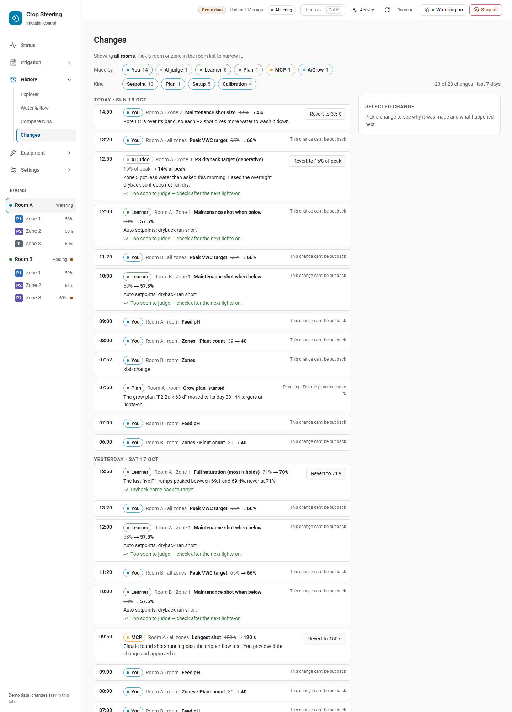
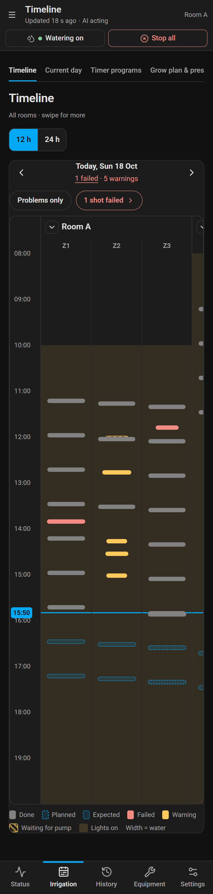

# History, changes and putting things back

**Bottom line:** Crop Steering keeps one event Journal for the whole site. It records every shot,
hold, phase change, alert, dose, AI action and setting change. Three pages read it: **History ›
Changes** (who changed what, with a button to put a change back), **Irrigation › Timeline** (what each
zone did and is planned to do) and **History › Explorer** (readings with phase and shot lanes). Watering
never depends on the Journal. If the Journal cannot open, shots carry on, and only these pages and
services report "unavailable".

Putting a change back is safety-checked in the same way as the original change. It is refused if the
value has moved since, it goes through the store's own save path, and it reads the value back before
saying it is done. Only a Home Assistant administrator can put a change back.

Needs an integration that has the Journal (`journal_query`, `history_changes`, `timeline_get`). The
dashboard calls this "Crop Steering 3.18 or newer". Note that the integration manifest in this tree still
reports version 3.17.0, so check for the services rather than the version number. On an older
integration the Changes page falls back to the selected room's setting log (see
[On an integration without the Journal](#on-an-integration-without-the-journal)). The whole Timeline page
is replaced by a "Needs integration 3.18" panel.

## The Journal

### What it records and where it lives

- One SQLite file for the site: `<config>/crop_steering/journal.db`. It opens with the first room and
  stays open while any room is loaded. It opens in the background, so setup and room reloads never
  wait on it.
- Each event belongs to one room (`room_id`, such as `room:f2_`) and gets the next sequence number
  (`seq`) for that room.
- Both halves write to it:
  - The **integration** writes setting changes, saved store sections, put-backs, alerts from rules and
    acknowledgements.
  - The **controller** (the add-on) writes shots, holds, queues, phase changes, doses, flow checks and
    AI outcomes. It appends each event as a line to `journal_outbox.jsonl` beside its state file, then
    sends the file to `crop_steering.journal_append` after each control pass. Writing that line is the
    only thing a shot waits for, and it is never synced to disk. A power cut can lose a
    `shot.started` line, but the shot still runs.
- `journal_append` keys on the event `id`, so the same event sent twice is stored once. An event that
  is not well formed is rejected on its own. The controller moves it to `journal_dead.jsonl` (keeping
  the newest 500), so it never blocks the others. The outbox is trimmed only when it is flushed: if
  more than 5000 events are pending then, it keeps the newest 4500 (it can hold more than 5000 between
  flushes). After a trim the controller queues its own history again with the same ids, but that is
  only dosing history and AI ledger rows. Live events the trim dropped (shots, holds, phase changes
  and so on) are not sent again and are lost.

### Retention

The Journal is pruned when it opens and then once a day. Events whose kind starts with `shot.`,
`intent.` or `flow.` are deleted after **400 days**. Every other kind (setting changes, plans,
calibrations, alerts, AI outcomes, stock, harvests) is kept.

### History from before the Journal (backfill)

On the first start with the Journal, each room's older records are imported once as Journal events.
That is why History › Changes shows changes from before the Journal existed.

| Old record | Imported as |
|---|---|
| Setpoint log (who changed which setting) | `target.changed` |
| AI overlays still held | `target.changed` on the overlay layer, with the overlay's expiry |
| Stock history | one `stock.drawn` per tank |
| Probe calibration checks | `calibration.captured` (a check only, nothing applied) |
| Controller dosing history and AI ledger | sent by the controller, up to 200 events per pass |

Imported events have `source.detail` set to `backfill` and ids derived from the old rows, so a run that
is cut short and repeated adds nothing twice. Each source is marked done on its own (meta key
`backfill:<room>:<source>:v1`). A source that is missing or fails to load is tried again on the next
start. Imported events are not re-fired on the bus. One known limit: an AI overlay that has already
ended is not stored anywhere, so its change imports as an ordinary (base) change.

### The event

Every event has this shape (version 1). `room_id` and `seq` are added when it is stored.

```json
{
  "v": 1,
  "id": "01JBD3K6Z9Q8W1V2X3Y4Z5A6B7",
  "ts": "2026-10-22T08:15:02.120+13:00",
  "room_id": "room:f2_",
  "seq": 18452,
  "zone": 3,
  "kind": "target.changed",
  "outcome": "ok",
  "code": null,
  "source": {"actor": "manual", "detail": null, "program_id": null,
             "user_id": "9f2c…", "judge": null, "client": null},
  "correlation": {"intent_id": null, "causation_id": null, "batch_id": null, "run_id": null,
                  "plan_revision": null, "setup_revision": null, "proposal_token": null,
                  "ledger_id": null},
  "data": {"key": "p2_vwc_threshold", "scope": "zone:3", "layer": "base",
           "old": 52, "new": 50, "expires": null, "reason": null, "expected": null,
           "entity_id": "number.crop_steering_f2_zone_3_p2_vwc_threshold"},
  "readback": null
}
```

- `id` is a ULID, so ids sort by time.
- `outcome` is one of `ok`, `queued`, `held`, `refused`, `aborted`, `failed` or `partial`.
- `source.actor` is one of `engine`, `timer`, `plan`, `manual`, `ai`, `learner`, `safety`, `mcp`,
  `aigrow`, `automation` or `system`.

For a service call, the actor is chosen this way. A `client` of `mcp` or `aigrow` names the actor. A
signed-in user with no client is `manual`. A call with no user is `automation`. This is the same rule
the setpoint log used.

### Event kinds

| Group | Kinds |
|---|---|
| Watering | `intent.queued`, `intent.held`, `intent.refused`, `shot.started`, `shot.completed`, `shot.aborted`, `flow.reconciled`, `phase.changed` |
| Settings | `target.changed` (one setting), `config.changed` (a saved store section) |
| Grow plan | `plan.saved`, `plan.armed`, `plan.activated`, `plan.disarmed`, `plan.expired` |
| Calibration | `calibration.started`, `calibration.captured`, `calibration.committed`, `calibration.reverted`, `pump.primed`, `pump.calibrated` |
| Feed and stock | `dose.completed`, `batch.step`, `batch.completed`, `batch.failed`, `stock.drawn`, `stock.refilled` |
| Alerts | `alert.raised`, `alert.cleared`, `alert.acknowledged` |
| AI | `ai.judgement`, `ai.outcome` |
| Runs | `run.saved`, `run.archived`, `harvest.recorded` |

These `data` fields are the ones the dashboard reads:

- `target.changed`: `key`, `scope` (`room` or `zone:N`), `layer` (`base`, or `overlay` for an AI
  overlay), `old`, `new`, `expires`, `reason`, `expected` and `entity_id`.
- `config.changed`: `store`, `section`, `old`, `new` and `diff`. The whole section is stored before
  and after.
- `shot.started`: `commanded_l`, `duration_s`, `reason`, `phase`, `vwc_before`, `vwc_expected`,
  `requested_at` and `pump_wait_s`.
- `shot.completed`: `commanded_l` and `metered_l`.
- `flow.reconciled`: `metered_l`. It is tied to its shot by `correlation.intent_id`.
- `calibration.committed`: `probe`, `record_id`, `superseded_record_id`, `verdict` and `applied`.
- `pump.calibrated`: `pump`, `ml_min` and `previous_ml_min`.

### Reading it: `crop_steering.journal_query`

Any signed-in user can call it. It returns a response (`return_response`).

| Field | Required | Meaning |
|---|---|---|
| `room_id` | yes | `room:f2_` |
| `since` | yes | ISO time, inclusive |
| `until` | no | ISO time, exclusive |
| `kinds` | no | list of kinds, such as `["shot.completed", "alert.raised"]` |
| `zones` | no | list of zone numbers |
| `actor` | no | one actor, such as `ai` |
| `limit` | no | 1 to 500 (default 500) |
| `cursor` | no | the `cursor` from the previous page |

The answer is `{events, cursor}`, oldest first. `cursor` is `null` on the last page. The call also
takes the common API fields (`api`, `client`, `proposal_token`). With `api: 2`, the answer comes in the
[API v2 envelope](../MCP.md).

```yaml
action: crop_steering.journal_query
data:
  room_id: "room:f2_"
  since: "2026-10-22T00:00:00+13:00"
  kinds: [shot.completed, shot.aborted]
  zones: [3]
response_variable: shots
```

`crop_steering.journal_append` is the controller's way in. It is admin only, takes at most 50 events
per call, and answers `{accepted, duplicate, seq_max, rejected}`. Automations should not need it.

### Following it live (automations)

Every event that is stored live is fired on the Home Assistant bus as **`crop_steering_event`**, with
the event as its data. Backfilled events are not fired. Here is an example automation trigger:

```yaml
trigger:
  - trigger: event
    event_type: crop_steering_event
    event_data:
      kind: shot.aborted
      room_id: "room:f2_"
```

A signed-in user who is not allowed to subscribe to custom bus events can use the websocket command
**`crop_steering/subscribe`** instead. It takes an optional `rooms` list and an optional `kinds` list.
Each matching event arrives as `{"id": <your id>, "type": "event", "event": {…}}`. The command answers
`unauthorized` with no signed-in user, and `unavailable` only when the Journal hub was never set up. If
the Journal failed to open, the subscription still succeeds but never delivers events. The dashboard
subscribes in this way. Without a websocket, it calls `journal_query` every 30 s while the page is
visible.

## History › Changes



This page answers who changed what, when, from what to what, why, and how it worked out. Open it from
**History › Changes** (`#/history/changes`).

### What appears

| Kind chip | What it covers | Journal source |
|---|---|---|
| Setpoint | One setting on the room or a zone: a number, or a switch or select such as zone enable, the room kill switch, growth stage, P2 mode or watering-by | `target.changed` |
| Recipe | A setting written by a preset, a copy or a recipe | `target.changed` with `source.detail` starting `preset ` or `copy from `, or containing `recipe` |
| Setup | A saved section: room setup, water supply, presets, timer programs, dashboards | `config.changed` |
| Calibration | Probe offsets, feed-probe calibrations, dosing pump rate | `config.changed` (store `calibration`), `calibration.committed`/`reverted`, `pump.calibrated` |
| Plan | Grow plan saved, armed, started, stopped or ended | `plan.*` |
| Alerts | The alert rules | `config.changed`, section `alert_rules` |

Shots, holds, doses and alerts are not changes and do not appear. Find them on the Timeline or in the
Explorer.

### Reading the page

- **Period.** The page shows the last 7 days. Scroll to the end, or press **Show the 7 days before …**,
  to read the week before. At most 2000 changes are read per period, the newest first. If more exist,
  the page says "Showing the newest 2000 changes of this period."
- **Scope.** All rooms by default. Pick a room or zone in the room list to narrow it, and press **Show
  all rooms** to widen it again. A site-wide change (supply, presets, dashboards) is one row, scoped
  "All rooms", even when the save touched several rooms.
- **Filters.** The **Made by** chips can be You, Learner, AI judge, Timer, Plan, MCP, AiGrow, Safety,
  Automation, Setup and Engine, and the **Kind** chips are those listed above. A chip is drawn only
  when the loaded rows contain that maker or kind, or it is the one selected, so not every chip is
  always shown. Each chip shows its count. "You"
  means any signed-in person. The panel names them when Home Assistant knows the user.
- **Each row** shows the time, who made the change, where, the setting, was → now, the reason, and how
  it worked out.
- **Selected change panel.** Pick a row to see:
  - who made it and when;
  - a was/now bar on the setting's own range. If the setting has moved since, the panel shows "Set to"
    and the value "Now";
  - the limits a learner or AI change had to stay within;
  - **Why** (the recorded reason);
  - **What happened next**.

  On a phone (720 px wide or less), the panel opens under the row.

### What happened next

Only changes made by the learner or the AI judge are judged. The judgement comes from the controller's
`ai.outcome` event for the same ledger row, recorded at or after the change:

| Shown | Meaning |
|---|---|
| Dryback came back to target. | The outcome was judged good |
| No change in dryback yet. | The outcome was judged not good |
| Too soon to judge — check after the next lights-on. | No outcome yet |

Every other change reads "Only learner and AI judge changes are judged afterwards."

### `crop_steering.history_changes`

Any signed-in user can call it. It returns a response.

| Field | Required | Meaning |
|---|---|---|
| `since` | yes | ISO time |
| `until` | no | ISO time |
| `room_id` | no | one room; every room when left out |
| `zone` | no | only changes scoped to `zone:N` |
| `key` | no | one setting key, such as `p2_vwc_threshold` |
| `kinds` | no | any of `setpoint`, `plan`, `recipe`, `setup`, `calibration`, `alerts` |

The answer is `{changes, truncated?}`, newest first, at most 2000 rows. Each row has these fields:

- `id` and `event_id` (the Journal event), `room_id` and `ts`;
- `actor`, `detail`, `user_id` and `user_name`;
- `kind`, `key`, `section` and `scope` (`room`, `zone:N` or `site`);
- `old` and `new`;
- `reason`;
- `outcome` (the sentence above, or `null`);
- `limits` (`{writer, min, max, step_scope}` for a learner or AI setting change);
- `revertible`;
- `causation_id`.

Rows are ordered by time, not by `seq`, because backfilled rows get later sequence numbers.

## Putting a change back (revert)

Press the row's button or the panel's button. The label says what it will do: **Revert to 52%**,
**Put back the previous version**, **Restore previous calibration** or **Put back in reading**. A change
that cannot be put back shows the reason in place of a button.

### Who can

Only a Home Assistant **administrator**. Anyone else gets "Only a Home Assistant administrator can put a
change back."

### What can be put back

A change can be put back only if its own `outcome` was `ok` (or was not recorded) and it is one of
these. A store-section change also needs its old copy (`data.old`) to have been recorded.

| Change | Can be put back when | What putting it back does |
|---|---|---|
| A setting (`target.changed`) | It is a base-layer change with an `entity_id` and both an old and a new value | Writes the old value and reads it back |
| Room setup | The old copy was recorded (section `setup` / `room`). Refused if the old copy lacks a part the room has now | Saves the old setup through `setup_save`, with all its safety checks |
| Water supply | The old copy was recorded (`site` / `supply`) | Saves the old supply and reads it back |
| Presets | The old copy was recorded (`site` / `presets`) | Saves the old preset list |
| Timer programs | The old copy was recorded (`timers` / `programs`) | Saves the old programs. A program the change deleted comes back under a **new id** |
| Probe offsets | The old copy was recorded (`calibration` / `probe_user_offsets`) | Sets each changed probe's old offset and curve again, and reads each one back |
| A committed calibration | It was applied and no later commit or revert of the same probe replaced it | Reverts that probe to the calibration it replaced, or to none |

These cannot be put back:

- **Plan steps.** The row says "Plan step. Edit the plan to change it."
- An AI overlay (keep or undo it on the zone page).
- `calibration.reverted` and `pump.calibrated` events.
- Dashboards.
- **Alert rules.**
- **Timer skips.**
- Any change whose recorded outcome was something other than `ok`.
- A store-section change with no recorded old copy.

### When it is refused

| Message | Why |
|---|---|
| This has changed again since. Reload the history and check it before trying again. | The setting or section no longer holds the value this change set (`stale_revision`). Something changed it again. Put back the newer change first, or set it by hand |
| The controller refused: Keep or undo the AI change first | An AI overlay holds this setting now |
| This change can't be put back | The change is not in the table above. Or, for room setup, the old copy lacks a part the room has now (such as plumbing or a tank level), and a put-back never half-applies |
| The controller refused: Not put back: … | The write was sent but did not read back. The service turns this into a `guard_refused` failure |

### What it records

A put-back is a new change. It is journaled as `manual` with detail `put back`. Its `causation_id` is
the event it reverses, and its row reads "Put back from History." On success, the page shows **Written
and read back HH:MM** and offers **Undo: write back the value it had**.

### `crop_steering.history_revert`

This service is admin only. A response is optional.

| Field | Required | Meaning |
|---|---|---|
| `event_id` | yes | the change's `event_id` from `history_changes` |
| `expected_revision` | no | for a store section: refuse unless the store is still at this revision |

The answer is `{reverted_event_id, new_event_id, readback, error?}`. Some changes add fields:

- probe offsets add `entities`, the per-probe read-back;
- timer programs add `renewed: [{name, old_id, id}]`.

`readback` is `verified` or `refused`. With `api: 2`, a `refused` read-back comes back as `ok: false`,
code `guard_refused`, "Not put back: …".

## Undo rules across the dashboard

Pages that make a change you can reverse show a 10-second toast with **Undo**, in place of a confirm
dialog. Most Undos put back the Journal events that change wrote, so the rules above apply (admin
only, refused if the value moved since, read back). Some do not go through `history_revert` and its
admin-only check:

- **Stock refill.** Undo calls `stock_refill` again with the level before the refill.
- **Timer zone mode.** Undo writes the zone's mode entity back directly.
- **Deleting an alert rule** when no Journal events came back: Undo saves the rule again.

For Undos that do use the Journal:

- **Order.** Events are put back newest first. Undo stops at the first refusal and says how far it got:
  "2 of 3 put back: …".
- **Done means read back.** An Undo counts as done only when every value read back. A value that does
  not read back is refused, and the error toast shows the raw "Not put back: …" message.
- **No silent success.** A refused Undo shows the reason in an error toast. Nothing reads as undone
  when it was not.
- **Two known gaps.** **Skip this shot** on the Timeline and saves on Settings › Alert rules also offer
  Undo. The Journal does not count timer skips or alert-rule changes as revertible (`changes.py`
  `REVERTIBLE_SECTIONS`), so that Undo is refused with "This change can't be put back". A skip
  expires by itself 15 minutes after the shot's time. Change an alert rule back by editing it.

## Irrigation › Timeline



`#/plan/watering`. This page shows, for every room at once, what each zone did and what it is planned
to do. Each room has a header row, then one row per zone.

### Reading it

| Block | Meaning |
|---|---|
| Done | A shot that completed. "Watering now" while it is running |
| Failed | A shot that was aborted or failed. The zone and room rows turn red. A held intent (a shot the safety guards stopped) is drawn with the same failed mark, but the controller gives it `warning` status, so it is not counted in "N shots failed" or in the day strip's "N problems" |
| Warning | A partial shot, a shot with no completion past its expected end plus 120 s, or an alert. The rows turn amber |
| Waiting for pump | A queued intent: the zone waited its turn on a shared pump |
| Planned | A future shot from the controller's plan (timer or steering engine) |
| Expected | A future shot the steering engine expects, but which depends on the readings |
| Skipped | A planned slot that has been skipped, drawn faded and struck through |
| Lights on | The room's lights windows behind the blocks |

Tap a block to see more:

- **Water.** Per plant, and "X L arrived of Y L". *Arrived* is the metered litres (from the shot's own
  meter reading, or the flow check that followed it). The second figure is the commanded litres. Per
  plant uses the metered litres when they exist.
- **VWC.** Before (or now, for a planned shot) → expected.
- **Status line.** For example "Done · waited 12 min for pump" when the shot queued for a shared pump.
- **Reason, source and alert code**, where recorded.

Planned and expected blocks come only from the controller's `projection_app` sensor, and only for
times after now. If the controller has not published one, the room shows "Planned shots not available
from the controller". Past blocks still show.

### Controls

- **Day strip.** A week of days around the chosen date. Each day reads Done, Planned or "N problems"
  (failed plus warnings; held intents are counted separately and are not included, so a day with only
  held intents can show red rows but no problems). **Today** returns to today.
- **Hours shown.** 12, 24 or 48 h. A phone offers 12 and 24 h and pages day by day.
- **Filters.**
  - **Flower rooms** and **Veg rooms** chips.
  - **Problems only** keeps rooms with a failed or warning block.
  - **N shots failed** steps through the error blocks (aborted or failed shots, not held intents).
  - A search narrows the rows: `z3` for zone 3, or a room name.
- **Block buttons.** **Open F2 Zone 3** opens the zone page. **See what happened** (on a failed shot)
  opens History › Explorer for that zone. **Skip this shot** appears on a skippable planned shot.
- **Live updates.** The page refreshes 2 s after a new shot or intent event arrives. While the
  connection is down it shows "Live updates paused — reconnecting".

### Skip this shot

A skip writes to the room's timer store (`crop_steering.timer_skip`) at its current revision.

- **Timer shot.** The skip covers that one slot.
- **Steering engine shot.** The skip covers 15 minutes from the shot's time.
- **Limits.** The time must be no more than 24 h ago and no more than 48 h ahead ("That time is more
  than 48 h ahead").
- **If it is refused.** If the timers changed since you opened the page, the skip is refused with "The
  timers changed since you opened this. Try again."

See the known gap on Undo above.

### `crop_steering.timeline_get`

Any signed-in user can call it. It returns a response.

| Field | Required | Meaning |
|---|---|---|
| `rooms` | yes | list of room ids, such as `["room:f1_", "room:f2_"]` |
| `start` / `end` | yes | ISO times. The span is at most 48 h. A time without an offset is read in Home Assistant's time zone |
| `zones` | no | only these zone numbers |

The answer is `{rooms, errors, truncated?}`, with times in Home Assistant local time.

Each room has these fields:

- `room_id`;
- `lights`: `[{on, off}]`;
- `rows`: `[{zone, blocks}]`;
- `pump`;
- `pump_rooms`: every room on the same pump;
- `pump_load`: `[{t, pct}]`, the running zones' demand over the pump's `max_flow_lph`. This is the
  pump's total across every room on it. `pct` is `null` when the capacity or a zone's demand is not set
  in the supply;
- `planned_source`: `projection_app` or `unavailable`.

Each block has these fields:

- `id`, `kind` (`shot`, `held`, `queued`, `alert` or `planned`) and `status` (`done`, `error`,
  `warning` or `planned`);
- `start` and `end`;
- `litres` (commanded) and `metered_l`;
- `reason`, `phase`, `vwc_before`, `vwc_expected`, `requested_at` and `pump_wait_s`;
- `source`, `code` and `event_id`;
- `skippable`, `skipped`, `expected` and `running`.

`errors` is `{count, markers: [{room_id, zone, t, code, block_id}]}` for every error block. At most
5000 blocks are returned, the newest. If more exist, `truncated: true` is set.

### `crop_steering.timeline_summary`

Any signed-in user can call it. Give `rooms` and `days` (up to 14 dates, `YYYY-MM-DD`). The answer is
`{days: [{date, rooms: [{room_id, shots, failed, warnings, held, queued}]}]}`. Each block is counted on
the local day it started. `failed` counts error blocks. `warnings` counts warning shots and alerts.
Held and queued intents have their own counts.

## History › Explorer

`#/history/explorer`. This page shows the room's readings on stacked charts, under phase and shot lanes,
with one crosshair across all of them. The choice of range is **Today**, **7 d**, **This run** or **Custom**.

The lanes come from the Journal. They show `phase.changed`, `shot.completed` and `alert.raised`, up to
5000 events per range. Past that, only the newest are shown. Without the Journal the phase lane is drawn
from the zone's phase sensor as Home Assistant recorded it.

- **Pick a zone** in the room list to add its probes, its targets and its other grows below the room
  charts.
- **AI assistant decisions** lists the AI decisions that acted, with how each turned out.
- **Export CSV** downloads the series that are charted.

Old links to the activity, log and timeline pages open here. Setting changes are on History › Changes.

## On an integration without the Journal

The dashboard labels this case "3.17" and the Journal-capable one "3.18".

- **History › Changes** reads the selected room's setting log (`setpoint_log_get`) and shows setting
  changes only. The other kind chips say "Needs Crop Steering 3.18 or newer". To see another room, pick
  it in the room list.
- **Putting a setting back.** The dashboard writes the old value again with read-back, but only while
  the setting still holds the change's value. If it does not read back, the page says "The controller
  did not confirm the value. Reload and check before trying again."
- **Undo.** The dashboard writes the change's value again, but only while the setting still holds the
  value that was put back. If it does not read back, you see "The controller did not confirm the
  previous value. Reload and check it before trying again."
- **Timeline.** The whole page is replaced by a "Needs integration 3.18" panel and no blocks are drawn.
  (If `timeline_get` exists but `timer_skip` does not, the Timeline works and **Skip this shot** instead
  says "Skipping a shot needs Crop Steering 3.18 or newer.")

## Troubleshooting

| You see | Do this |
|---|---|
| "The event journal is unavailable" | Check the Home Assistant log for `Event journal unavailable (…journal.db)`. The usual causes are disk space and file permissions on `<config>/crop_steering/`. Watering is not affected. Restart Home Assistant once it is fixed |
| Changes from before the Journal missing | The backfill runs once per source per room after start. Check the log for `Journal backfilled N events` or `Journal backfill skipped …`. A skipped source is tried again on the next start |
| A shot with no start in the Timeline | Its `shot.started` line was lost in a power cut, so the shot is not drawn. Its completion is still in the Journal |
| Controller log says `journal outbox: … failed …; events may be lost, watering is not affected` | The add-on cannot write its outbox (usually a full disk). Shots go on, but events from that time may be missing |

Code: `custom_components/crop_steering/journal.py`, `journal_api.py`, `changes.py`, `timeline.py`,
`timers_api.py`; `addons/f2_control/f2_control/journal_out.py`; dashboard `frontend/src/pages/changes.tsx`,
`watering.tsx`, `explorer.tsx`, `lib/undo.ts`.
