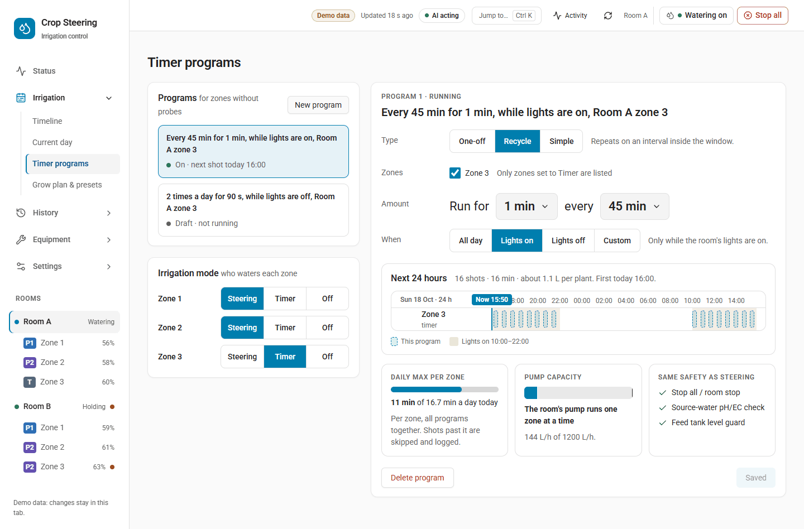

# Timer programs and irrigation modes

**Bottom line:** every zone has a **Watering by** setting: `steering` (the engine waters by its
probes, as before), `timer` (the room's timer programs water it) or `off` (no shots at all, rescue
shots included). A zone on `timer` still gets the engine's safety shots: the P3 emergency, the
lights-on watchdog, the minimum-daily floor and a blind zone's copy of a sibling's rescue. Timer
shots go through every safety check a steering shot does: the kill switch, the zone switch, faults,
source water, the daily budget and the pump queue. One planned shot can be skipped from the
timeline. Every program save is checked, previewed, read back and written to the journal.

## Getting there

- Dashboard menu: **Irrigation › Timer programs** (route `#/plan/timers`). This page holds the
  room's programs, the program editor and the **Irrigation mode** panel (who waters each zone).
- Dashboard menu: **Irrigation › Timeline** (route `#/plan/watering`). This shows the planned
  timer shots and has the **Skip this shot** button.
- With an integration that has no timer programs, the Timer programs page says so and shows no
  programs. The Timeline still works; only **Skip this shot** answers "Skipping a shot needs Crop
  Steering 3.18 or newer."

## Irrigation modes (Watering by)



Each zone has one select:

`select.crop_steering_<prefix>zone_<n>_irrigation_mode`, named **Zone N Watering by**, with options
`steering`, `timer` and `off`. A new zone starts on `steering`.

| Mode | What the zone gets |
|---|---|
| `steering` | The engine's shots, as always. Timer programs do not water it, even if it is listed in one. |
| `timer` | The slots of the one active timer program that lists it, plus the engine's safety shots: `p3_emergency`, `watchdog`, `min_daily` and `blind_copy_rescue`. Every other engine shot is dropped (reason `TIMER: the engine's <kind> shot is not given`). |
| `off` | Nothing: no engine shots, no timer shots and no rescue shots (reason `OFF: this zone is set to no watering`). |

Safety-critical points:

- **`off` stops rescue shots too.** A zone on `off` will not get a P3 emergency or watchdog shot.
  The page warns: "Off: no shots at all, rescue shots included."
- **A zone on `timer` that no active program lists gets only the safety shots.** The page warns:
  "No running program covers this zone: it will not be watered."
- **Steering needs a probe.** On the Timer programs page the **Steering** button is greyed out for a
  zone with no probe ("Needs a probe in this zone").
- **A test shot still runs on any mode, `off` included.** It is the operator's own action. The kill
  switch and the other checks still apply to it.
- The blind fallback shot (`blind_fallback`, a steering estimate for a zone with no readable probe) is
  not kept in timer mode.

### Changing a zone's mode

On **Irrigation › Timer programs › Irrigation mode**, pick the mode, read the sentence that says what
will change, then press **Switch <zone name> to …** (Steering, Timer or Off) or **Keep …**. The
button uses the zone's display name. The sentences are:

- To timer: "Zone N stops steering and waters only by its timers." If no running program covers the
  zone, it adds "No running program covers it, so it will not be watered."
- To off: "Zone N gets no shots at all, rescue shots included."
- To steering: "Zone N steers by its probe again; its timers stop watering it."

You can also set the select directly in Home Assistant (`select.select_option`).

### How the controller reads the mode

- The controller reads each zone's select on every pass and remembers the last mode it read in its
  `state.json`.
- If the select reads `unknown`, `unavailable` or is missing, the controller uses the last mode it
  read. A zone stays `off` through a Home Assistant restart.
- If no mode was ever read for a zone (an older integration with no select), the zone runs on
  `steering`, as it always did.
- If the integration restores a saved mode it does not recognise, the select reads `unknown` until
  someone picks a mode. It does not fall back to `steering`.

### Mode `off` compared with the zone switch

| | Watering by = `off` | Zone switch `switch.crop_steering_<prefix>zone_<n>_enabled` off |
|---|---|---|
| Where it acts | On the decision, before anything opens. The engine's shot and any timer slot are dropped. | A safety check (`zone_paused`) that holds every shot for the zone. |
| Test shot | Still runs. | Held. |
| A shot already running | Not affected. Only new decisions are dropped. | Stopped early. Alert CS-305, "this zone was set to off". |
| If it cannot be read | The last mode read is used. | Held: an unreadable zone switch counts as off. |

Use the zone switch to pause a zone for work on it. Use mode `off` when a zone should not be watered
by the engine or a timer, but you still want to be able to give it a test shot.

### Mode `timer` compared with the kill switch

The kill switch (the room's engine switch) holds every shot in the room, timer shots and safety
shots included. A timer program never runs while the kill switch is off. Turning the kill switch off
during a timer shot stops that shot (CS-305, "the kill switch was set to off").

## Timer programs

A room holds any number of timer programs. Each program waters a list of zones for a fixed number of
seconds at times set by its type and window.

### Program fields

| Field | Required | Meaning |
|---|---|---|
| `id` | No (new) / Yes (change) | Leave it out to add a program. Give it to change an existing one. |
| `name` | No | Shown on the page. Blank becomes `Timer`. |
| `type` | Yes | `recycle`, `simple` or `one_off`. |
| `zones` | Yes | At least one zone number in this room. Duplicates are removed. |
| `duration_s` | Yes | Seconds each zone runs per shot. Must be greater than 0. |
| `active` | No | `true` (default) or `false`. An inactive program never runs. |
| `window` | No | When the program may water. Default `{"kind": "all"}`. See below. |
| `interval_min` | `recycle` | Minutes between shots. At least 1. |
| `sync_time` | No (`recycle`) | `HH:MM`. The first shot lines up on this time. It must be inside the window. |
| `frequency_per_day` | `simple` | Shots per day. At least 1. A fraction is cut to a whole number (2.5 becomes 2), not refused. |
| `start_at` | `one_off` | ISO date and time, for example `2026-10-24T09:00:00+13:00`. |

Anything else sent with a program (for example `next_at` from a list) is not stored. The integration
adds `created_at`, `updated_at` and, on delete, `deleted_at`.

### Windows

| `kind` | Window |
|---|---|
| `all` | The whole day, from local midnight. |
| `lights_on` | From the room's lights-on hour to its lights-off hour. |
| `lights_off` | From lights-off to lights-on. |
| `custom` | From `from` to `to`, both `HH:MM`. If `to` is earlier than `from`, the window crosses midnight. `from` and `to` cannot be the same. |

The lights hours come from the room's `number.crop_steering_<prefix>lights_on_hour` and
`lights_off_hour`, or from what setup saved if those cannot be read.

### When each type waters

- **`recycle`:** every `interval_min` minutes from the start of the window, until the window ends.
  With `sync_time`, the first shot is at `sync_time` and the next ones follow every `interval_min`
  minutes until the window ends; no shots fall between the window start and `sync_time`. If the
  lights hours later move the window
  so that `sync_time` falls outside it, the shots start at the start of the window.
- **`simple`:** `frequency_per_day` shots spread evenly across the window, the first at its start.
  For example, `frequency_per_day: 4` with `{"kind": "all"}` waters at 00:00, 06:00, 12:00 and 18:00.
- **`one_off`:** one shot for each zone at `start_at`.

A wall-clock time that does not exist because of a daylight-saving change is left out.

### Example

Two minutes every two hours during lights-on for zones 1 and 2:

```json
{
  "name": "Mother room",
  "type": "recycle",
  "zones": [1, 2],
  "duration_s": 120,
  "window": {"kind": "lights_on"},
  "interval_min": 120,
  "active": true
}
```

### Rules the integration checks

- **A zone can belong to one active program only.** A save that would put a zone in two active
  programs is refused, for example "Zone 3 is already in timer 'Mother room'".
- Every zone must exist in the room ("Zone 9 is not in this room").
- Errors are in plain words, for example "interval must be at least 1 minute",
  "sync time must be inside the window", "End must be after start".

### How a timer shot is sized and checked

- A timer shot asks for `duration_s` seconds. The room's maximum shot length still caps it. A capped
  shot runs, cut, and raises CS-306.
- The zone needs a known flow (dripper flow and drippers per plant) and substrate volume. Without them
  the shot does not run and CS-204 says why.
- The daily budget applies. A shot that would go past the zone's daily maximum is cut to what is left
  of the budget and runs (logged as "shot clipped Xs -> Ys"). It is held only when less than the
  minimum shot length is left, and then alert CS-205 (daily cap) is raised. The page words this as
  "Shots past it are skipped and logged."
- A plan hold does not stop timer shots. Plan holds stop routine steering only.
- Zones wait for the pump only when running them together would go past the pump's capacity
  (`max_flow_lph`, `max_concurrent_zones`) or an exclusive group. The preview shows "Waiting for
  pump" only when the pump runs one zone at a time and the program has more than one zone.
- Water given by a timer shot is never used as input by the Auto setpoints learner.

### Missed slots

- If a safety shot fires in the same pass as a timer slot, the safety shot goes first. The slot is
  still owed and is given on a later pass.
- An owed slot is dropped 15 minutes after its time, or at the end of its program window if that is
  sooner. It is journaled as `intent.refused` with guard `expired`.
- After a controller restart, the first pass only starts the clock. Slots missed while the controller
  was down are not given late.
- If a program cannot be worked out, the controller logs it once ("timer program '…' not run: …") and
  runs the room's other programs.

## Using the Timer programs page

1. Pick a program in the list, or start a new one. With no programs the page says "No timer yet.
   Most mother rooms use 2 min every 2 h during lights-on."
2. Set the zones. The list holds zones set to Timer plus any zone already in the program, whatever
   its mode (the page's own hint says only Timer zones are listed). If no zone is set to Timer, the
   page says "No zone is set to Timer yet. Set one under Irrigation mode."
3. Set the amount. It reads as a sentence, for example "Run for 2 min every 120 min" (the interval
   is always in minutes, 10 to 120). A one-off reads
   "Run for 3 min at 20:00 on Fri 23 Oct". The zones and the window are chosen beside it.
4. Check **Next 24 hours**. It draws the shots this program would give. Shots past a zone's daily
   maximum are drawn as "Blocked by daily max".
5. Check **Daily max per zone** and **Pump capacity**. The pump card shows the flow needed against the
   pump's `max_flow_lph`, or "The pump cannot feed every zone it may run at once."
6. Press **Review & apply**. The page shows the differences, saves and reads the program back from the
   list.
7. **Delete program** removes it. It can be put back with **Undo**.

The **Same safety as steering** card is a reminder that Stop all, the source-water pH/EC check and
the feed-tank level guard hold timer shots as they hold steering shots.

## Skipping one planned shot

On **Irrigation › Timeline**, a planned shot has a **Skip this shot** button.

A skip covers one zone at one time:

- **A timer slot** at exactly that time is not given.
- **An engine shot** that would fire within 15 minutes from that time is not given, once. This works
  on a steering zone too.
- **These shots are never skipped:** `p3_emergency`, `watchdog`, `min_daily` and `blind_copy_rescue`.
- The time may be up to 48 hours ahead and no more than 24 hours ago. A skip older than 24 hours is
  no longer published in `timers_config`; it is pruned from the store at the next save. Skipping the
  same zone and time again replaces the earlier skip.
- Each skipped shot is journaled as `intent.refused` with guard `skipped` and the reason
  "skipped by <id>", where the id is the Home Assistant user id, else the calling actor, else
  `timer_skip`.
- Once skipped, the shot on the timeline is marked skipped and has no Skip button.

## Projection: what the timeline shows as planned

At the end of each pass the controller works out `sensor.crop_steering_<prefix>projection_app` and
writes it when its state or attributes changed. Its
state is the number of planned shots. Its `intents` attribute lists the next 24 hours:

- **Timer zones:** each program slot with `source: "timer"`, `program_id`, `duration_s` and
  `expected: false`.
- **Steering zones:** the engine's next expected shot with `source: "engine"`, `duration_s: null` and
  `expected: true`. This is an estimate based on what the engine is waiting for, not a promise.
- **Off zones:** nothing.
- Each intent has a stable `id` and `phase`, the phase the engine expects the zone to be in then
  (`null` where moisture decides).

The controller writes this sensor only once the integration publishes timer programs. If the
projection fails, the error is logged and watering continues. The timeline (`timeline_get`) draws
planned blocks from this sensor only, so nothing is drawn twice. It shows only intents after now and
marks skipped ones.

## Entities

| Entity | State | Attributes |
|---|---|---|
| `select.crop_steering_<prefix>zone_<n>_irrigation_mode` | `steering`, `timer` or `off` | `options` |
| `sensor.crop_steering_<prefix>timers_config` | The store revision, or `unavailable` | `room_id`, `revision`, `programs` (active, not deleted), `skips` (`zone`, `at`, `until`, `by`), or `error` |
| `sensor.crop_steering_<prefix>projection_app` | Number of planned shots | `room_id`, `intents` |

If the stored programs cannot be read, `timers_config` reads `unavailable`, the store is never
saved over and every save is refused. While it is unavailable the controller has no programs to run,
so timer zones get only their safety shots.

## Services

`room_id` takes the form `room:<prefix>`, for example `room:f2_`. It is optional for
`timer_program_list` and required for the other four. The writes take the
`expected_revision` from `timer_program_list`. If the store changed since, the write is refused with
`stale_revision` ("Timer programs changed elsewhere. Reload before saving."). With `api: 2` the
answer comes in the API v2 envelope. The writes also take `client` (`mcp` or `aigrow`) and
`proposal_token`.

| Service | Admin | What it does |
|---|---|---|
| `crop_steering.timer_program_list` | No | The room's programs that are not deleted, each with `room_id`, `next_at` (next shot within 8 days), `error` and `zones_in_timer_mode`, plus `revision`. Without `room_id`: every room's programs, with `revisions` and `errors` per room. |
| `crop_steering.timer_program_preview` | No | Checks the full `program` sent with it (there is no lookup by id, so send a saved program in full) and returns `preview` (`zone`, `at`, `duration_s` for each shot), `shots` and `total_s`. `hours` from 1 to 48, default 24. Saves nothing. |
| `crop_steering.timer_program_set` | Yes | Adds a program, or changes one when `program.id` is given. Returns `program`, the new `revision` and `preview` for the next 24 hours. |
| `crop_steering.timer_program_delete` | Yes | Soft delete by `id`: sets `active: false` and `deleted_at`. The program stays in the store for its history and is no longer listed. |
| `crop_steering.timer_skip` | Yes | Skips `zone` at `at` (ISO date and time; a time with no offset is taken in Home Assistant's time zone). Returns `skip` (`zone`, `at`, `until`) and `revision`. |

"Admin" means a signed-in user calling it must be a Home Assistant administrator. Every save
journals `config.changed` with `store: "timers"`, the section (`programs` or `skip`), the old and
new values and the diff.

Example:

```yaml
service: crop_steering.timer_program_set
data:
  room_id: "room:f2_"
  expected_revision: 3
  program:
    name: Mother room
    type: recycle
    zones: [1, 2]
    duration_s: 120
    window: {kind: lights_on}
    interval_min: 120
```

Timer programs are also part of presets and copy settings (section `timers`). The MCP server can
preview and apply a program (`preview_timer_program`, then `apply_proposal`) but cannot delete one or
skip a shot.

## Code

- Integration store and services: `custom_components/crop_steering/timers_api.py`
- Program checks and projection: `crop-steering-engine/src/crop_steering_engine/timers.py` (copied to
  `custom_components/crop_steering/generated/timers.py` and the controller's `crop_steering_engine/`)
- The select: `custom_components/crop_steering/select.py`, options in `const.py` `IRRIGATION_MODES`
- Controller: `addons/f2_control/f2_control/controller.py` `IRRIGATION_MODES`, `TIMER_KEEPS`,
  `_irrigation_modes`, `_apply_modes`, `_publish_projection`, `_skipped_by`
- Timeline planned blocks and skips: `custom_components/crop_steering/timeline.py`
- Pages: `frontend/src/pages/timers.tsx`, `frontend/src/lib/timers.ts`, `frontend/src/pages/watering.tsx`
