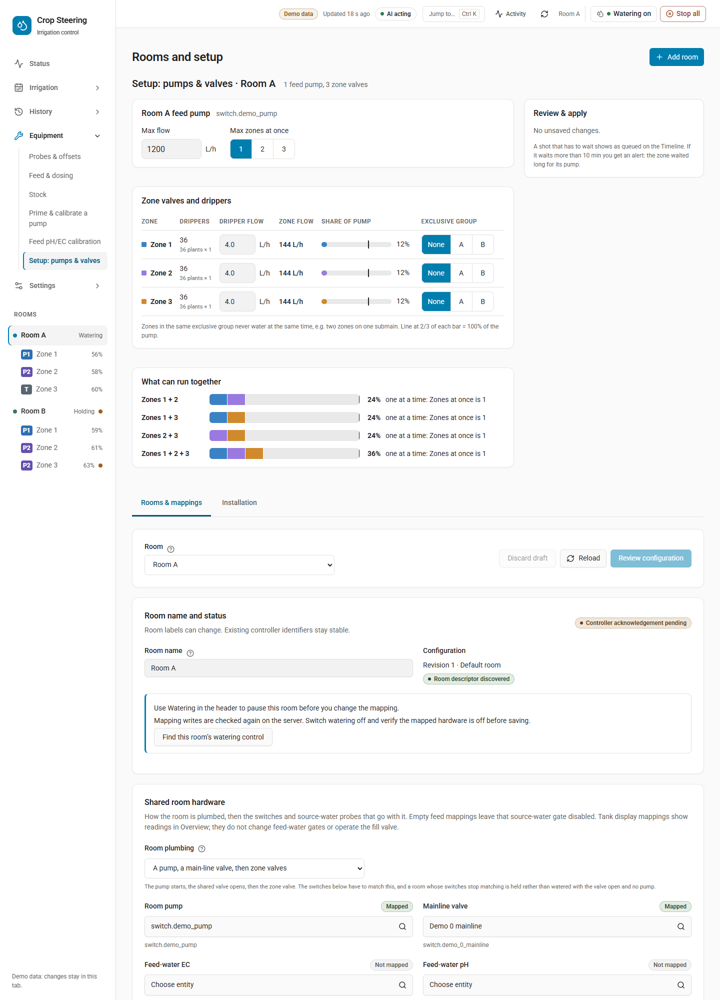
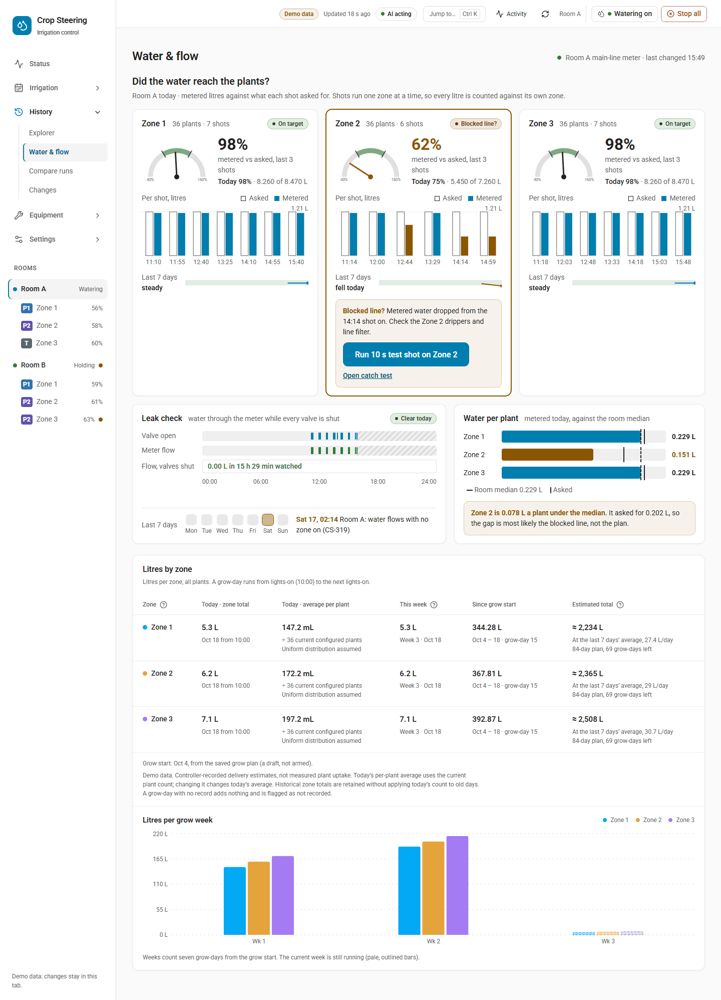

# Water supply, pump queue and flow checks

**Bottom line:** the supply is one optional, site-wide description of your irrigation pumps: how much
water each really gives (L/h), how many zones it may feed at once, which zones must never run together,
and which flow meters measure the water. Until you save one, watering runs exactly as before. Once
saved, the zones that fire in a pass take turns at their pump in a fixed order, long waits and
undersized pumps raise **CS-214**, and with a flow meter set each shot is checked against the meter
(**CS-318**: less water than counted) and the meter is watched for water with no zone on (**CS-319**:
a leak). None of this ever holds or stops a shot. It only orders, records, shows and alerts.

Safety-critical points:

- The queue and the flow checks never hold watering. A zone that waits still waters. A zone that gets
  too little water, or a meter that counts with no zone on, raises an alert and nothing is switched off.
- The controller opens one zone at a time, whatever the supply says. The supply orders the zones and
  explains the waits, it does not make zones run in parallel.
- Every save is previewed first, refused if it would let a pump feed more zones at once than it can,
  and read back after it is written.

## Getting there

- Dashboard: **Equipment › Setup: pumps & valves** (route `#/equipment/setup`). The supply editor is the
  "Setup: pumps & valves" part of the page, one room at a time.
- Services: `crop_steering.supply_get` (no permission check) and `crop_steering.supply_save` (a Home
  Assistant administrator when a user calls it; an automation or script with no user can call it too).
- Sensor: `sensor.crop_steering_supply_config`, the copy the controller reads.

## What the supply holds

One store for the whole site (`crop_steering.site`), not one per room. A pump shared by two rooms is
listed once, and its capacity check counts the zones of every room that uses it.

| Section | Shape | What it does |
|---|---|---|
| `irrigation_pumps` | list of `{entity_id, max_flow_lph, max_concurrent_zones, flow_meter}` | One row per irrigation pump. Required in every save. |
| `zone_groups` | `{"room:<prefix>": {"<zone>": "<group>"}}` | Zones with the same group name in one room are an exclusive group: they must never water at the same time (for example two zones on one submain). The controller keeps groups per room, but the capacity check on a pump shared by several rooms treats the same group name in those rooms as one group. |
| `zone_meters` | `{"room:<prefix>": {"<zone>": "sensor.x"}}` | A flow meter for one zone. It wins over the pump's `flow_meter`. |
| `water_sources` | list of objects | Stored and returned as sent. Nothing in this release acts on it. |

Pump row fields:

- `entity_id`: the pump switch, the same entity as the room's `hardware.pump_switch` in setup (for
  example `switch.f2_irrigation_pump`). Each pump may be listed once.
- `max_flow_lph`: the pump's real output in litres per hour, above 0, or `null` when unknown. With
  `null` no capacity check runs for that pump. Measure it at the far zone with a bucket and a timer; the
  number on the pump box is not what it gives through your lines.
- `max_concurrent_zones`: a whole number from 1 to the zone maximum. Default 1, which is how every room
  ran before.
- `flow_meter`: a meter on the pump's line, or `null`.

Group names are 1 to 24 letters, digits, `-` or `_`. The dashboard offers no group, **A** or **B**. Zone
numbers are written as text (`"3"`), and an empty value removes the zone from the map.

### A zone's demand

The capacity check and the queue need each zone's demand in L/h. It is worked out from the zone's setup,
not from the supply:

```
demand (L/h) = plant_count × drippers_per_plant × dripper_flow_rate
```

Example: 12 plants × 2 drippers × 2 L/h = 48 L/h. Only active rooms and active zones count. The
supply editor shows each zone's dripper flow beside its group so you can correct it there.

## The capacity check

`supply_get` and every `supply_save` answer with a `capacity_check`:

- `worst_case_lph`: the most water the pump could be asked for: the `max_concurrent_zones` largest
  demands on that pump, counting only the largest zone of each exclusive group (two zones of one group
  never run together). On a pump shared by several rooms, a group name used in more than one of those
  rooms counts as one group here.
- `ok`: true when the worst case fits within `max_flow_lph` (always true when `max_flow_lph` is null).
- `suggest_max_concurrent`: the most zones the pump can feed at once with the worst mix.
- `pumps`: one row per pump with the same numbers.
- `pairs`: every pair of zones on a pump, their total L/h, `pct_of_pump`, and a verdict: `together`, or
  `one_after_another` when they share a group, the pump feeds one zone at a time, or the pair is over the
  pump's flow.

The editor does not draw `capacity_check` itself. Its **Worst pair allowed to start together** bar
(shown only when **Max zones at once** is 2 or more) and its **What can run together** list are worked
out in the browser from this room's zones only; the list also shows groups of 3 and 4 when the room has
4 zones or fewer. On those bars the line marks 100% of the pump. The "line at 2/3 of each bar" applies
only to the **Share of pump** bars in the zones table.

A save is **refused** with `pump_over_capacity` when a pump set to feed 2 or more zones at once cannot
feed the worst mix, for example:

```
pump_over_capacity: switch.f2_irrigation_pump cannot feed 3 zones at once: the worst mix needs
432 L/h and the pump gives 300 L/h. Set Zones at once to 2 or less.
```

The editor then offers **Use 2**. A single zone bigger than its pump is never refused: with one zone at
a time it still waters, and CS-214 warns about it.

## Setting up a supply



1. In each room's setup, map the pump (`pump_switch`) and set each zone's plant count, drippers per
   plant and dripper flow. Until the pump is mapped the editor says "This room has no pump mapped. Map Room pump
   under Rooms & mappings below."
2. Measure the pump's output in L/h (or gal/h when the dashboard's volume unit is gallons; it is stored
   as L/h).
3. Open **Equipment › Setup: pumps & valves**, pick the room, enter **Max flow** and **Max zones at once**
   (1 if unsure).
4. Give zones that must never run together the same exclusive group.
5. Review the changes and the capacity check, then apply. The page saves the supply first, then the
   dripper settings, and reads both back.

Flow meters (`flow_meter`, `zone_meters`) are not edited on this page. Set them with `supply_save`
(below). The page keeps a pump's existing `flow_meter` when it saves.

## Services

### `crop_steering.supply_get`

No fields. No permission check. Answer:

```json
{
  "revision": 4,
  "irrigation_pumps": [
    {"entity_id": "switch.f2_irrigation_pump", "max_flow_lph": 300.0,
     "max_concurrent_zones": 1, "flow_meter": "sensor.f2_main_water_total"}
  ],
  "water_sources": [],
  "zone_groups": {"room:f2_": {"1": "A", "2": "A"}},
  "zone_meters": {"room:f2_": {"3": "sensor.f2_zone_3_water_total"}},
  "capacity_check": {"worst_case_lph": 96.0, "max_flow_lph": 300.0, "ok": true,
                     "suggest_max_concurrent": 4, "pairs": [], "pumps": []},
  "warnings": [],
  "error": null
}
```

`warnings` lists a stored section this version could not read (`{section, error}`); that section reads as
empty until a save sends it again. `error` is set when the whole store could not be loaded; saves are then
refused so the file is never overwritten.

### `crop_steering.supply_save`

A user who calls it must be a Home Assistant administrator. A call with no user (an automation or a
script) skips this check.

| Field | Required | Notes |
|---|---|---|
| `expected_revision` | yes | The `revision` you read. Refused with "Supply settings changed elsewhere. Reload before saving." when it moved. |
| `irrigation_pumps` | yes | The whole pump list; it replaces the stored one. |
| `zone_groups`, `zone_meters`, `water_sources` | no | Sent: replaces that section. Left out: the stored section stays. |
| `preview` | no | `true` returns `{diff, capacity_check}` and saves nothing. An over-capacity preview is shown, not refused. |
| `client`, `proposal_token` | no | Common API fields (`client` is `mcp` or `aigrow`). |

A save that would drop a stored section the integration could not read is refused until that section is
sent. After a save the answer is the new `supply_get` answer plus `readback {status, at, entity_id}`:
`status` is `ok` when `sensor.crop_steering_supply_config` shows the new revision, else `mismatch`. The
change is journaled as `config.changed` (section `supply`) and shows under **History › Changes**.

Preview first:

```yaml
action: crop_steering.supply_save
data:
  expected_revision: 4
  preview: true
  irrigation_pumps:
    - entity_id: switch.f2_irrigation_pump
      max_flow_lph: 300
      max_concurrent_zones: 1
      flow_meter: sensor.f2_main_water_total
  zone_meters:
    "room:f2_":
      "3": sensor.f2_zone_3_water_total
```

Then send the same data without `preview`.

### `sensor.crop_steering_supply_config`

What the controller reads. It does not exist until a supply has been saved, so a site with no supply
looks exactly as before. It is `unavailable` (attribute `error`) when the stored settings cannot be read;
the controller then runs as before.

- State: the supply's revision.
- Attributes: `irrigation_pumps`, `zone_groups`, `zone_meters`, and `zone_demand_lph`
  (`{"room:f2_": {"1": 48.0, ...}}`, active zones only).

## The pump queue (CS-214)

The controller reads the supply sensor once per pass. With a supply saved, the zones of a room that
decide to fire in that pass take turns at the room's pump in this order:

1. rescue shots (every shot a plan hold never stops, except timer and test shots: the P3 emergency and
   watchdog rescues, the minimum-daily floor, the blind fallback and a blind zone's copy of a sibling's
   rescue),
2. steering shots,
3. timer program shots,
4. an operator's test shot,

and, within the same priority, in the order the controller walks the zones (every zone of a pass is
stamped with the same `requested_at`, so there is no "first asked"). Zones that do not fire keep their
place.

When a zone waters after others in the same pass, it **waited**. That wait is:

- journaled as `intent.queued` with `position` (how many went before it), `priority`, `requested_at`
  and `guard`: `pump_capacity` (the pump could not take one more zone, or simply feeds one at a time)
  or `exclusive_group` (a zone of its group went first). Recorded only: the zone waters either way.
- carried on the shot as `pump_wait_s` (seconds from asked to started) in `shot.started`.
- shown on **Irrigation › Timeline** as a **Waiting for pump** marker, with the wait on the shot block.

Two more states are written at the end of each pass (never before a pump opens, so nothing slows a shot):

- `sensor.crop_steering_<prefix>pump_load_pct`: the most any shot of the pass put on its pump, as a
  percentage of `max_flow_lph`. `unknown` when the pump has no `max_flow_lph` or the room's pump is not
  listed in the supply. With `max_flow_lph` set it is `0` when no shot ran, and a shot whose zone has no
  demand (plant count, drippers or dripper flow missing) counts as `0`, so it shows `0` or the load of
  the other zones' shots, never `unknown`.
- `binary_sensor.crop_steering_<prefix>shot_queued`: written `off` with an empty `queue` at the end of
  the pass, when nobody waits any more. Use the Timeline or the journal to see the waits themselves.

**CS-214** (*Warning*, notification kind **Hardware lockouts**) is raised for a zone whose shot ran and:

- the zone alone needs more than its pump gives (demand above `max_flow_lph`): "zone 3 needs 360 L/h,
  switch.f2_irrigation_pump gives 300 L/h; it waters anyway", or
- it waited more than 600 s (10 min) behind other shots of the same pass: "zone 3 waited 12 min for
  switch.f2_irrigation_pump, behind 4 other shot(s) of this pass; it watered after them".

Each one clears after a later pass where that zone's shot runs without the condition. Water continues in
every case. Fixes: measure and correct `max_flow_lph`, check the zone's plant count, drippers and
dripper flow, or spread the room's shots so fewer zones fire in one pass. See
[CS-214](../ERROR_CODES.md#cs-214).

## Flow meters and flow checks (CS-318, CS-319)



The flow checks run only for zones that have a meter in the supply: the zone's own `zone_meters` entry,
else its pump's `flow_meter`. Without a meter nothing is checked and nothing is published.

**What counts as a meter.** A sensor whose state is a running **total** volume, with
`unit_of_measurement` `L`, `l`, `m³` or `gal`. A meter in any other unit (a rate such as L/min, or
pulses) is not read; the controller logs this once for the meter and never guesses a conversion. Never
use a dosing pump's mL/min sensor.

### Per-shot check (CS-318)

1. The meter is read just before the shot's pump opens, and again after the valve's close is read back
   (2 s timeout each; a meter that does not answer reconciles nothing and the shot runs as before).
2. If the meter has not reported since the close, the shot is judged once it does, or given up
   unjudged 300 s (5 min) after the close. Only completed shots are reconciled, not aborted ones.
3. The ratio is metered ÷ commanded litres. The commanded litres come from the dripper settings, not
   the meter.

| Ratio | Verdict | Effect |
|---|---|---|
| below 0.80 | `low` | CS-318 raised for the zone |
| 0.80 to 1.20 | `ok` | an open CS-318 for the zone clears |
| above 1.20 | `high` | no alert; an open CS-318 clears |

Each reconciled shot is journaled as `flow.reconciled` with `{ratio, commanded_l, metered_l, verdict}`,
and at the end of the room's pass `sensor.crop_steering_<prefix>zone_<n>_flow_ratio` is written:

- State: the ratio as an unrounded fraction, for example `0.9333333` (93% of the counted water reached
  the meter).
- Attributes: `commanded_l`, `metered_l`, `intent_id` of the shot.

The metered litres also appear on the shot's block on **Irrigation › Timeline** next to the commanded
litres. A threshold alert rule can watch this sensor (source `zone.flow_ratio`, shown in percent).

**CS-318** (*Warning*, **Hardware lockouts**): "The flow meter saw 1.60 L of the 2.40 L that the
controller counted for the last shot of this zone (67%)". Water continues. The zone can get less than
the controller counts and dry out. Check the zone's line, filter and drippers, a half-closed hand valve,
the dripper settings, and the meter's unit and reporting. See [CS-318](../ERROR_CODES.md#cs-318).

### Idle meter watch (CS-319)

Once per controller loop, before any room waters, every meter in the supply is read:

- A meter is skipped while any room that reads it has a shot in flight.
- Its baseline moves past each shot's own water (what the meter saw, or what the shot counted when the
  meter has not reported it all yet), so a late report of a shot is not counted as a leak.
- A rise of more than **0.5 L** above the baseline with no shot in flight raises CS-319, and the
  baseline moves up to the new reading.
- The alert clears once the meter stops counting. A meter that goes down (a reset) starts again from
  its new reading.

**CS-319** (*Warning*, **Hardware lockouts**): "The flow meter counted 0.82 L while the controller ran
no shot." The controller does not switch anything off. Check for a valve stuck open or leaking, a
broken line or fitting after the meter, hand watering or an automation opening a valve on the same
line. See [CS-319](../ERROR_CODES.md#cs-319).

Removing a meter from the supply takes down its CS-319. A zone's CS-318 is taken down only when the
zone is left with no meter at all, neither its own `zone_meters` entry nor its pump's `flow_meter`.

## Troubleshooting

| You see | Check |
|---|---|
| No queue, no CS-214, no `pump_load_pct` | Is a supply saved? `sensor.crop_steering_supply_config` must exist and not be `unavailable`. Is the room's pump listed in `irrigation_pumps` under the same entity id as its `pump_switch`? |
| `pump_load_pct` is `unknown` | `max_flow_lph` is null, or the room's pump is not listed in `irrigation_pumps`. (A zone with no plant count, drippers or dripper flow shows `0`, not `unknown`.) |
| Save refused `pump_over_capacity` | Lower **Max zones at once** to the suggested number, or correct the flow and demand. |
| No `zone_<n>_flow_ratio` sensor | No meter for the zone or its pump, the meter's unit is not L/m³/gal, or no completed shot has been reconciled yet. |
| CS-318 on every shot of one zone | Line, filter or dripper blockage, or dripper flow set too high in setup. If every zone on the meter is low, check the meter. |
| CS-319 repeating | A leaking or stuck valve after that meter, or something else drawing water through it. |

Related: [Error codes](../ERROR_CODES.md), [Notifications](../NOTIFICATIONS.md),
[3.18 upgrade report](../UPGRADING.md#supply).
