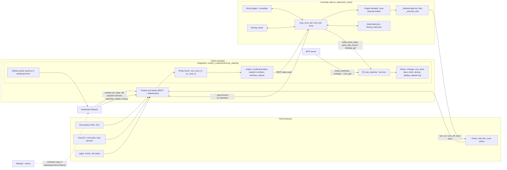

# System map

One map of the whole Crop Steering product at 3.17.0 (`81140bd5`): what the parts are, how they connect, and where to look. Findings against these parts are in [system-audit.md](system-audit.md). Line numbers are approximate and drift; file paths are stable.

## 1. Components

| Component | Path | Runs as | Job |
|---|---|---|---|
| Integration | `custom_components/crop_steering/` | HA custom integration (Python) | Owns the room setup, every setpoint as a `number`/`switch`/`select`, the stores, the 55 `crop_steering.*` services and the sidebar panel. Fuses probes into `vwc_zone_N` / `ec_zone_N`. Mirrors some controller outputs. |
| Controller add-on | `addons/f2_control/f2_control/controller.py` and siblings | HA add-on or standalone Docker container (Python, 1 pass per `loop_seconds`) | The only thing that drives hardware. Reads state over the HA REST API, decides per zone, opens pump, main line and valve, counts water, publishes `*_app` sensors and a heartbeat. |
| Engine | `crop-steering-engine/src/crop_steering_engine/` | Pure Python library | `decide()` and the rules behind it. Vendored byte-identical into the add-on; `generated/defaults.py` is copied into the integration. |
| Brain (AI judges) | `addons/f2_control/f2_control/brain/`, `brain_bridge.py` | Inside the controller | Optional judges (rules or Claude Haiku) that can advance a phase, distrust a probe, steer EC or nudge a setpoint inside a safety envelope. |
| Dosing runner | `addons/f2_control/f2_control/dosing_runner.py` | Inside the controller loop | Feed batches, doses, mix checks, pH auto-correct, stock draws. |
| Dashboard | `frontend/` | React/Vite app built to a single `dashboard.html` | The operator UI. Three identical committed bundles: `www/`, `addons/f2_control/www/public/`, `custom_components/crop_steering/www/`. |
| MCP server | `mcp-server/` | Local stdio server (TypeScript) | Lets an AI client read a room and propose reviewed setup/plan changes. Six allow-listed services; `*_save` blocked unless `CROP_STEERING_ALLOW_WRITES=true`. |
| Website | separate repo `cropsteering-site` | Vite/React static site | Marketing, docs (rendered verbatim from this repo), install, tutorials, compare, a vendored demo of the dashboard. |
| Academy | `www/learn/`, `docs/ACADEMY.md`, `tests/academy*.mjs` | Static lessons and video | 24 lessons built by `build_course.py`, deployed with the demo to GitHub Pages. |
| CI | `.github/workflows/` | GitHub Actions | Validate (the PR gate), release guards, promote, controller container, release packaging, Pages. |

Everything meets in Home Assistant. The integration and the controller never call each other directly: they exchange state through HA entities and a few service calls.

## 2. Main data and actuation flow

How to read it: probes feed HA; the integration turns them into one VWC and one EC per zone and publishes the room's setup as a descriptor sensor; the controller discovers rooms from that descriptor, reads every setpoint back over REST, asks the engine what each zone needs, passes the decision through the gate list, and only then switches hardware. Every hardware switch is read back, and the dashboard sees all of it through HA entities.

## 3. Entry points

### Integration

| Entry | Where | Notes |
|---|---|---|
| `async_setup` | `__init__.py:121` | Registers the `setup_*` services before any room exists. |
| `async_setup_entry` | `__init__.py:129-280` | Per room: stores, services, five platforms (sensor, number, switch, select, button), panel, health check (60 s then every 5 min). |
| `async_unload_entry` | `__init__.py:368-453` | No `async_remove_entry`: deleting a room leaves its Store files (INT-025). |
| Config flow | `config_flow.py` | `user`, `room`, `manual_zones`, `zones`, `hardware` plus an options flow; validates through `setup_api.prepare_setup`. |
| Sidebar panel | `setup_panel.py`, `www/panel.js` | Static path `/crop_steering`; custom element wraps `dashboard.html?v=<version>` in an iframe. Once per HA. |
| Repairs | `health.py`, `repairs.py`, `stock_api.py`, `bounds.py` | Read-only diagnostics into HA Repairs. |
| WebSocket | none | The dashboard uses HA's `call_service` with `return_response`, or REST. |

### Controller

| Entry | Where | Notes |
|---|---|---|
| Image entry | `addons/f2_control/run.sh` | nginx for ingress (container only with `F2_SERVE_UI=1`), then `python3 controller.py`. |
| `__main__` | `controller.py:7746` | `runtime_env.preflight`, then `Controller().run()`. |
| `Controller.run` | `controller.py:7656` | Time-zone check once, hold checks, dosing recover, then forever: `loop_once`, `_sleep_for(loop_seconds)`. |
| `close_only_start` | `controller.py:7737` | Non-admin token with a recorded shot or dose: reconcile only, then return. |
| SIGTERM `_safe_exit` | `controller.py:5828` | Switches the shot in flight off within `F2_STOP_BUDGET_S` (25 s app, 75 s container), saves state, heartbeat `stopped`. |
| Container | `docker-compose.yml` | GHCR image, `F2_RUNTIME=container`, token as secret, `/data` volume, 90 s grace, no healthcheck (CTL-029). |
| App manifest | `addons/f2_control/config.yaml` | Version 3.17.0, ingress 8420, options and schema. |

### Dashboard, MCP, site

| Entry | Where |
|---|---|
| Dashboard | `frontend/index.html`, `src/main.tsx` (ErrorBoundary, then `App`); build is `tsc --noEmit && vite build && node scripts/package.mjs` |
| MCP | `mcp-server/src/index.ts`, `server.ts`; REST to HA with a long-lived token (`ha.ts`) |
| Site | `cropsteering-site`: `bun run build` = sync (newest tag or `UPSTREAM_DIR`) then content then prerender then postbuild (sitemap, headers, pagefind, forbidden-word scan) |

## 4. One controller pass

`loop_once` (`controller.py:6420`):

1. Read the notify config; recover latched hardware faults (CS-301); reconcile any in-flight shot left by an interrupted run (`_shot_inflight` in `state.json`).
2. Rediscover rooms every `rediscover_seconds` from the `sensor.crop_steering_*engine_config` descriptors.
3. Per room (each wrapped so one room's error cannot stop the others, once #204 merges): duplicate-controller guard on the heartbeat, refresh lights, then `_loop_room`.
4. `_loop_room`: sync the AI prompt, check `room_active`, load the strategy snapshot, then per zone: apply a Set Phase request, count water, snapshot (fused VWC/EC, dryback rate, feed EC), brain tick, `decide(snap, params)`, phase side effects, EC offset steering, learner/follower setpoint writes.
5. Blind zones (no readable probe): time-only phase forces, a 15 min grace, then copy a healthy sibling or fire the fallback shot every `blind_fallback_min` (90) at `p2_shot_size` (only with lights on in P1/P2 once #203 merges).
6. Per zone with a decision to fire: `_blocked` gate list, then `_act_zone` (size, duration cap, budget clip), then `_execute_shot`.
7. `_publish_status` writes every per-zone and room sensor and the heartbeat. Then the global steps: defaulted-setpoint check (CS-402), 30 min vitals, phase push events.

### Gate order before a shot (`_blocked`, `controller.py:3472`)

Setup pending, archived, room off, dosing hold, plan hold (rescues exempt), hardware-fault latch (CS-301), max-run latch (CS-312), no valve mapped, plumbing mismatch (CS-202), undrivable actuator (CS-313), kill switch, retired switches, zone switch, manual override, `hold_entities`, waste valve (CS-316), settings wait / water sizing never read (CS-402), tank minimum, source-water EC band, pH band, pump/main line/valve offline. `gate_report.py` repeats the same order for the dashboard; parity backend Task 10 moves both into `guards.py`.

### Shot sequence (`_execute_shot`, `controller.py:5538`)

Fault latch, auth gate, prior in-flight, plumbing, strategy preflight, tank plan-ahead, waste close with read-back, dosing lock, write-ahead `_shot_inflight` to `state.json`, then pump on with prime (0-20 s), main line on with lead (0-10 s), valve on, `_wait_shot` (2 s polls of kill/room/zone/override/holds/waste), valve off, main line and pump off, `_confirm_switches` (poll to 6 s, re-send, then CS-301 latch on failure), `_advance_shot_counters` (flow x elapsed). SIGTERM mid-shot counts elapsed water. Fixes in flight: valve-on read-back (#208), count on error (#197), `_busy` wedge (#210).

## 5. Dashboard routes and pages

Five sections, 21 pages (`frontend/src/lib/routes.ts`; tabs in `components/page-tabs.tsx`). Routes are hash routes; `?room=f1` or `room:<prefix>` selects the room. Legacy addresses map through `LEGACY_PAGES` / `LEGACY_VIEWS` and the 14 stub files that `scripts/package.mjs` writes.

| Route | Page | Operator services it calls |
|---|---|---|
| `#/all-zones` (All rooms) | `pages/all-zones.tsx` | none |
| `#/today` (Status, Room) | `pages/today.tsx` | `runs_get`, `strategy_get`, `stop_all` |
| `#/zone/N` | `pages/zone.tsx` | `overlay_get/keep/undo`, `test_shot`, `strategy_get`, `brain_ask`, `runs_get` |
| `#/today/ai`, `#/settings/ai` | `components/brain.tsx` | `brain_prompt_get/save/rebuild` |
| `#/plan/targets`, `#/plan/schedule` (Irrigation) | `pages/irrigation.tsx` to `strategy.tsx`, `grow-planner.tsx` | `strategy_get/preview/save/activate/disarm` |
| `#/history/timeline` | `pages/timeline.tsx` | `setpoint_log_get`, `runs_get`, `grow_days_get` |
| `#/history/water` | `pages/water-use.tsx` | `strategy_get` |
| `#/history/compare` | `pages/comparison.tsx` | `runs_get` (+ `history_long` through the client) |
| `#/history/grows` | `pages/grows.tsx` | `runs_get/save/archive/import`, `grow_days_get/backfill`, `harvests_get`, `runs_set_harvest` |
| `#/history/drivers` (display option) | `pages/drivers.tsx` | `runs_get`, `grow_days_get` |
| `#/equipment/probes` | `pages/probes.tsx` | `setup_read/save`, `calibration_get/record` |
| `#/equipment/stock` | `pages/stock.tsx` | `stock_get/save/refill/record_batch` |
| `#/equipment/feed` | `pages/reservoir.tsx` | none (tank history) |
| `#/equipment/dosing` | `pages/dosing.tsx` | `dosing_get/request/save`, `stock_get` |
| `#/equipment/setup` | `pages/setup.tsx` | `setup_read/create/save/remove/commission`, `test_shot`, `history_connection_get/save` |
| `#/settings` | `pages/settings.tsx` | `display_save` |
| `#/settings/features` | `pages/features.tsx` | none (writes through `validateChange`) |
| `#/settings/notifications` | `pages/notifications.tsx` | `notify_get/save/test` |
| `#/help` | `pages/help.tsx` | `whats_new_get/seen` |

The parity frontend plan (Task 1) adds a room tree menu and eight new pages (`plan/watering`, `plan/timers`, `history/explorer`, `history/changes`, `equipment/pump-calibration`, `equipment/feed-calibration`, `settings/alerts`, `settings/system`).

### Dashboard internals

| Piece | File | Role |
|---|---|---|
| Store | `lib/use-controller.ts` | `ControllerStore` with `useSyncExternalStore`; snapshot is `Controller`. Methods: `write`, `operator`, `history`, `timeline`, `historyWindow`, `dailyRanges`, `sensorStatistics`, `waterRecord`. |
| Room model | `lib/model.ts` | `discoverRooms` (one room per descriptor), `buildRoom`, `roomStatus`, `validateChange` (the write allow-list; refuses pump, main line, valves and plan-owned numbers). |
| Transport | `lib/client.ts` `HaClient` | Inside HA: `hass` from `window.parent`; standalone: REST with a token. 48-action operator allow-list; room-scoped actions get `room_id` injected. |
| Live updates | `lib/live.ts` | `subscribe_entities` for watched entities, 250 ms coalesced publish, 30 s tick. |
| Demo | `lib/demo.ts`, `operator-demo.ts` | Active on `?demo` or any `*.github.io` host; states from `createDemo()`. |

## 6. Services (55, `custom_components/crop_steering/services.yaml`)

Room key is `room_id` (canonical `room:<prefix>`) unless noted. Callers: FE = dashboard, CTRL = controller, MCP = mcp-server.

| Service(s) | Module | Callers |
|---|---|---|
| `set_manual_override` (room slug) | `services.py` | none in repo (for automations) |
| `apply_recipe`, `save_recipe` (optional `room` after #205) | `services.py` | none; being deprecated |
| `setup_read/create/save/remove/commission` (`entry_id`) | `setup_api.py` | FE, MCP (read, save) |
| `strategy_get/save/preview/activate/disarm` | `strategy_api.py` | FE, CTRL (get, preview), MCP |
| `runs_get/save/archive/import`, `runs_set_harvest`, `harvests_get` | `run_api.py`, `harvest_store.py` | FE, MCP (runs_get) |
| `grow_day_record`, `grow_days_get/backfill` | `grow_day_store.py` | CTRL (record), FE |
| `setpoint_log_get`, `overlay_get/keep/undo` | `setpoint_log.py`, `overlays.py` | FE; notification taps |
| `stock_get/save/refill/record_batch`, `stock_draw` | `stock_api.py` | FE; CTRL (`stock_draw`) |
| `calibration_get/record` | `calibration.py` | FE |
| `dosing_get/save/request` | `dosing_api.py` | FE |
| `notify_get/save/test` (site store), `notify` (room slug) | `notify_api.py` | FE; CTRL (`notify`) |
| `display_get/save` | `display.py` | FE |
| `test_shot`, `stop_all` | `selftest.py`, `safety_ops.py` | FE |
| `whats_new_get/seen` | `whats_new.py` | FE |
| `brain_ask`, `brain_prompt_get/save/rollback/rebuild`, `brain_prompt_publish` | `brain_api.py`, `brain_prompt_api.py` | FE; CTRL (`publish`) |
| `history_connection_get/save`, `history_long` | `long_history.py` | FE |

## 7. Entities

Ids are `<domain>.crop_steering_<prefix><key>`; zone copies are `..._<prefix>zone_N_<key>`; prefix is empty for the default room, else `<slug>_`.

### Published by the integration

| Entity | Source | Read by |
|---|---|---|
| `sensor.engine_config` | config entry (hardware map, zones, kill switch, revision) | controller room discovery, dashboard, MCP |
| `sensor.dosing_config`, `brain_questions`, `brain_prompt_config`, `display`, `stock_low`, `strategy_plan` | the matching stores | controller or dashboard |
| `sensor.vwc_zone_N`, `ec_zone_N` | fused probes (`calculations.fuse_probes`) | controller (the engine's input), dashboard, MCP |
| `sensor.zone_N_status`, `last_irrigation`, `daily_water_usage` | mirrors of the controller's `*_app` sensors | dashboard |
| `sensor.current_phase` | mirrors `app_current_phase`, unknown when stale (#207) | nothing |
| About 70 `number`s plus `switch`, `select` and `button` entities | setpoints, kill switch (`engine_enabled`), `room_active`, `zone_N_enabled`, `zone_N_manual_override`, `stop_all`, `tank_filled`, `zone_N_test_shot` | controller reads them; dashboard edits them |

Written by the integration but read by no controller code: `p2_ec_high/low_threshold`, `ec_target_*_p3`, `irrigation_phase`, room `steering_mode`, `recipe_stage` (audit INT-005, INT-007 to INT-009).

### Published by the controller

| Entity | Notes |
|---|---|
| `sensor.ai_heartbeat` | Beat, instance id, versions, hardware fault, strategy and setup state; `stopped` on exit. |
| `sensor.zone_N_status_app`, `waiting_for_app`, `last_irrigation_app`, `phase`, `safety_status`, `vmax_detected`, `daily_water_app`, `weekly_water_app`, `irrigation_count_app`, `dryback_app`, `water_response_app`, `shot_log_app` | The per-zone outputs. The dashboard does not read `vmax_detected` or `dryback_app` (FE-004). |
| `sensor.app_status`, `current_decision`, `system_safety_status` and `app_current_phase` (the last two unread by the dashboard, FE-004), `activity_log`, `runoff_estimate_app`, `tank_level` | Room level. |
| `sensor.f2_control_vitals`, `crop_steering_controller_runtime` | Unprefixed. |
| `sensor.
jev`, `zone_N_jev`, `jev_log`, `brain_report`, `brain_answers` | Brain. |

### Controller reads (by group)

Kill switch and room/zone switches (fail closed when unreadable); fused probes (VWC None makes the zone blind); feed EC/pH probes and bands (30 min grace, then hold); about 60 setpoint suffixes, zone-level first then room-level (`_zone_num`); selects (steering mode, growth stage, drainage, runoff, shot check); hardware entities (`switch`, `input_boolean` or `valve` for pump, main line, valves; ACTUATORS list); integration config sensors. A failed read returns `HAState(None, {}, None)` and cannot tell a 404 from a timeout (see CTL-004 for the consequence).

## 8. Stores and state files

| Store (HA `Store`, in `.storage`) | Module | Backs |
|---|---|---|
| `crop_steering_recipes_<entry>`, `crop_steering_strategy_<entry>` | `recipe.py`, `strategy.py` | named-stage recipe; grow plan and activation |
| `crop_steering.<kind>.<entry>` with kind `runs`, `harvests`, `grow_days`, `setpoint_log`, `overlays`, `stock`, `dosing`, `calibration`, `display`, `brain_questions`, `brain_prompt`, `history_connection` | the matching `*_store` / `*_api` modules | run records, harvests, per-zone day summaries, who changed which setpoint, AI temporary overlays, stock and batches, dosing, feed probe checks, dashboard options, brain, InfluxDB connection |
| notify and what's-new (site-wide) | `notify_api.py`, `whats_new.py` | recipients and mutes; last seen version |
| Config entry `data`/`options` | `config_flow.py`, `setup_api.py` | room setup |

| Controller file under `/data` | Contents |
|---|---|
| `state.json` (atomic tmp+replace) | Per room slug: room meta (`_shot_inflight`, `_hardware_fault`, `_room_active`, tank estimate, runoff, dim state, setup revision) and per zone (`phase`, `peak`, `shots`, `daily_vol`, `water_history`, `ec_offset`, `last_shot`, rescue state, day history, ...). No EC integral (CTL-012). |
| `dosing_state.json` | Per room: handled requests, in-flight dose, batch, draws, mix and pH state, outbox. `.bad` on corrupt. |
| `jev_usage.json`, `jev_ledger.jsonl`, `jev_journal.jsonl`, `jev_setpoints.json`, `brain_notices.json`, `brain_report.json` | Brain ledger and journal. |
| `options.json` (read) | Add-on options; overridable by `F2_OPT_<KEY>`. |

## 9. External integrations and seams

| Seam | Mechanism |
|---|---|
| Integration to controller | REST state reads of the descriptor, config sensors, probes, numbers, switches, selects, buttons. |
| Controller to integration | Service calls `notify`, `stock_draw`, `grow_day_record`, `brain_prompt_publish`, `strategy_get`, `strategy_preview`; a `crop_steering_setpoint_write` bus event so the setpoint log names the writer; the `*_app` sensors that the integration mirrors. |
| Controller to hardware | `switch` / `input_boolean` `turn_on`/`turn_off`, `valve.open_valve`/`close_valve`, `light.turn_on` (dry-dim), dosing pumps via switch, button, script or number. |
| Dashboard to HA | `number.set_value`, `select.select_option`, `switch.turn_*` with read-back; operator services; history via WebSocket (`history/history_during_period`, statistics) or REST. |
| History | HA Recorder, or InfluxDB through `history_long` when the room's connection says so. |
| AI | Claude Haiku through `brain/client.py` (`brain_provider`), the `anthropic_*` options; `brain_ask` from the dashboard. |
| Notifications | `persistent_notification`, `notify.<service>`, `crop_steering.notify` (recipients from `sensor.notify_config`). Error codes CS-1xx to CS-9xx in `docs/ERROR_CODES.md`. |
| MCP to HA | REST with a long-lived token; `setup_read/save`, `strategy_get/preview/save`, `runs_get`, state reads for `ai_heartbeat`, `engine_config`, zone sensors. |
| Container | GHCR image `crop-steering-controller`; Docker secret token; `/data` volume. |

## 10. Controller options

`config.yaml` options: `num_zones`, `lights_on_hour`, `lights_off_hour`, `enable_flag`, `notify_service`, `notify_min`, `instance_name`, `feed_ec_sensor`, `feed_ph_sensor`, `sump_power_sensor`, `sump_silent_hours`, `pump_power_sensor`, `hold_entities`, `substrate_l`, `flow_lps`, `loop_seconds`, `rediscover_seconds`, `brain_provider`, `stage_arc`, `anthropic_*`, `brain_dry_run`, `ai_*`, plus legacy `cf_*`, `typesafe_api_key`, `jev_*`. Read but not in the schema: `feed_grace_min`, `blind_fallback_min` (CTL-014). Environment: `F2_RUNTIME`, `SUPERVISOR_TOKEN`, `HA_URL`, `HA_TOKEN`, `HA_TOKEN_FILE`, `F2_STOP_BUDGET_S`, `F2_DATA_DIR`, `F2_STATE_PATH`, `F2_OPTIONS_PATH`, `TZ`, `F2_OPT_*`, `ANTHROPIC_API_KEY`, `F2_SERVE_UI`.

## 11. MCP server

Tools (`mcp-server/src/server.ts`): `list_rooms`, `get_room_configuration`, `get_room_status`, `search_candidate_entities`, `get_room_plan`, `get_room_runs`, `preview_setup`, `preview_plan`, `apply_proposal`. Setup and plan shapes are duplicated in `schemas.ts` from `setup_api.py` and `plumbing.py`, and have drifted (INT-019 to INT-022). `apply_proposal` saves and reads back; saves are refused unless writes are enabled by env.

## 12. Website

Live at `cropsteering.growlabs.nz` (currently 3.16.0). Content reaches the site by `bun run build`: sync the newest `vX.Y.Z` tag of this repo (or `UPSTREAM_DIR`), copy `www/dashboard.html` to `public/demo/app/`, build every `docs/*.md` through `src/content/docs.config.ts` (a missing entry fails the build, which is WEB-001 today), optimise `img/*.png`, prerender, then postbuild.

| Route | Source |
|---|---|
| `/` | site copy plus `content/{pricing,prices,gap,release-features}.ts`, version chips from build info |
| `/features` | `docs/FEATURE_MATRIX.md`, `content/feature-shots.ts`, 82 controls from `features-restore.json` |
| `/compare` | site-owned: 53 comparison rows and vendor prices |
| `/demo` | iframe of the vendored dashboard with `?demo=1`; 13 tour steps |
| `/install` | `docs/INSTALL.md` sections |
| `/tutorials` | site-owned beginner guide |
| `/docs`, `/docs/<slug>` (28) | upstream Markdown, rendered verbatim with redactions (`scripts/lib/forbidden.ts`) |
| `/changelog`, `/404`, redirects | `CHANGELOG.md` plus the add-on changelog; site-owned |

Not published by policy: `docs/RECIPE_LIBRARY.md`. Needs a decision: `docs/REFERENCES.md` (WEB-008). The product repo's `gh-pages` branch is a stale snapshot, not the Pages source (WEB-017).

## 13. CI and release

| Workflow | Trigger | Role |
|---|---|---|
| `ci-validate.yml` Validate | push `main`/`testing`, every PR | The PR gate. 9 jobs: lint and HA validations (3.11 and 3.12), add-on image build, controller container smoke (28 tests, ~23 of 30 min), per-arch add-on images, dependency review (cannot fail), real Home Assistant (production and oldest-supported legs), dashboard build and 8 browser scripts, MCP tests. |
| `release-guards.yml` | `pull_request_target`, push `main` | Version changes only in release PRs; `main` moved only by promotion. Its push check is red on `main` since the 3.17.0 merge (CI-004). |
| `promote.yml` | manual from `main` | Checks the candidate tag, CI and evidence, then fast-forwards `main`. |
| `container.yml` | release or manual | Builds, smoke-tests and pushes the GHCR image. |
| `release.yml` | release | Builds the dashboard, attaches assets. |
| `pages.yml` | push `main` | Builds the demo and Academy and deploys Pages; post-merge only. |

Local suites at the audit: integration `tests/` 1064 pass; add-on 2116 pass, 3 Windows-only failures; engine 1559 pass; `tests_ha` 625 pass (production leg); `tests_container` 28 pass (about 28 min); vitest 84 files, 1103 tests; MCP 24/24. Branch model: feature branches into `testing`; `main` only by promotion; version bumps only in `release/x.y.z`.

## 14. Same rule in more than one place

| Rule | Places | Audit |
|---|---|---|
| Shot seconds and duration cap | controller `_act_zone`, `_room_duration_cap`; integration `sensor.py`, `calculations.py` | CTL-010, INT-013 |
| EC-adjusted re-water point | controller `_step_ec_offset`; integration `p2_vwc_threshold_adjusted` | CTL-011, INT-007 |
| Time-only phase transitions | engine `decide()`; controller loop; `_blind_time_transition` | CTL-009 |
| Gate list | `_blocked`; `gate_report.py` | merged by parity Task 10 |
| Zone status label | engine `zone_status_label`; dashboard regexes in `controller-health.ts` | CTL-022 |
| Dryback | controller `zone_N_dryback_app`; four dashboard recomputations | FE-001 |
| Defaults table | engine `defaults.py` copied to the add-on and `generated/defaults.py` | byte-identical, tested; not a defect |
| Hardware and unit tables | `setup_api.py`; MCP `schemas.ts`, `workspace.ts` | INT-019, INT-020 |

## 15. In flight

Open PRs into `testing` (all by JakeTheRabbit):

| PR | Branch | Subject | Audit |
|---|---|---|---|
| [#196](https://github.com/JakeTheRabbit/HA-Irrigation-Strategy/pull/196) | `fix/ui-polish` | Dashboard visual All rooms, no duplicate pickers | FE-011 related |
| [#197](https://github.com/JakeTheRabbit/HA-Irrigation-Strategy/pull/197) | `fix/count-water-when-a-shot-errors` | Count water of a shot that errors | CTL-005 |
| [#198](https://github.com/JakeTheRabbit/HA-Irrigation-Strategy/pull/198) | `docs/match-3-17-section-names` | Match 3.17.0 section names | WEB-011 |
| [#199](https://github.com/JakeTheRabbit/HA-Irrigation-Strategy/pull/199) | `fix/water-volumes-read-their-unit` | Water volumes in HA's unit | FE-003 |
| [#200](https://github.com/JakeTheRabbit/HA-Irrigation-Strategy/pull/200) | `fix/dosing-form-uses-the-room-limits` | Dosing form uses room limits | FE-002 |
| [#201](https://github.com/JakeTheRabbit/HA-Irrigation-Strategy/pull/201) | `fix/shot-cap-survives-read-blip` | Cap survives a read blip | CTL-004 |
| [#202](https://github.com/JakeTheRabbit/HA-Irrigation-Strategy/pull/202) | `fix/unreadable-feed-band-holds` | Hold on unreadable feed band | CTL-003 |
| [#203](https://github.com/JakeTheRabbit/HA-Irrigation-Strategy/pull/203) | `fix/blind-fallback-only-with-lights-on` | Blind fallback only with lights on | CTL-001 |
| [#204](https://github.com/JakeTheRabbit/HA-Irrigation-Strategy/pull/204) | `fix/one-room-error-does-not-stop-the-others` | Per-room error isolation | CTL-006 |
| [#205](https://github.com/JakeTheRabbit/HA-Irrigation-Strategy/pull/205) | `fix/recipe-services-take-a-room` | Recipe services take a room | INT-002 |
| [#206](https://github.com/JakeTheRabbit/HA-Irrigation-Strategy/pull/206) | `fix/stage-select-only-shows-what-applied` | Stage select shows what applied | INT-001 |
| [#207](https://github.com/JakeTheRabbit/HA-Irrigation-Strategy/pull/207) | `fix/phase-sensor-never-invents-p2` | Phase sensor never invents a phase | INT-006 |
| [#208](https://github.com/JakeTheRabbit/HA-Irrigation-Strategy/pull/208) | `fix/read-back-switches-on-at-shot-start` | Read ON back at shot start | CTL-002 |
| [#209](https://github.com/JakeTheRabbit/HA-Irrigation-Strategy/pull/209) | `fix/equal-light-hours-mean-24h-light` | Equal light hours are not used | CTL-030 |
| [#210](https://github.com/JakeTheRabbit/HA-Irrigation-Strategy/pull/210) | `fix/shot-start-error-cannot-wedge-the-controller` | Shot-start error cannot wedge the controller | CTL-032 |

No PR is open on `cropsteering-site`. Parity plans live on `feat/parity-system` (frontend) and `feat/parity-backend` (backend) in `docs/superpowers/plans/2026-10-22-parity-*.md`: a Journal store, GuardChain refactor, pump queue, timer programs, feed calibration, API v2 envelope, MCP read/preview tools, tree menu and eight new pages. They rebase onto the fixes above.
